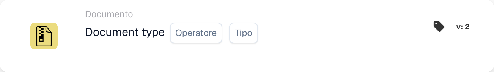
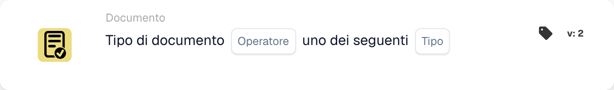

# Descrizione della carta

## **Carte When: Tipo di documento**

Un workflow può essere avviato con queste due carte. Qui puoi decidere con quale tipo di documento inizia il workflow o se non deve influenzare determinati tipi di documento.

\\

<figure><figcaption>
Campi della scheda nella versione visualizzata. I campi non sono ancora configurati.
</figcaption></figure>

<figure><figcaption>
Campi della scheda nella versione visualizzata. I campi non sono ancora configurati.
</figcaption></figure>

Questa carta può anche essere utilizzata per specificare più tipi di documento che il workflow deve influenzare.
