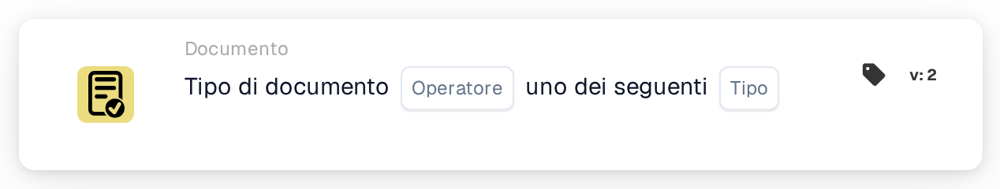

# Tipo di Documento Uno di

<figure><figcaption>
Versione 2
</figcaption></figure>

## **Scopo:**

Questa carta DocBits garantisce la corretta classificazione di un documento verificando se corrisponde a uno dei tipi di documento specificati. Questo è utile in situazioni in cui un documento potrebbe appartenere a più di una categoria, consentendo una validazione più ampia e una gestione automatizzata.

## **Funzionalità:**

* **Validazione di Più Tipi di Documenti:** Questa carta consente agli utenti di verificare se un documento corrisponde a uno dei tipi di documento specificati, garantendo una categorizzazione flessibile per flussi di lavoro documentali più complessi.
* **Operatore:** Gli utenti possono definire condizioni per convalidare il documento rispetto a più tipi. Gli operatori disponibili includono:
  * **È:** Conferma che il documento corrisponde a uno dei tipi di documento specificati.
  * **Non È:** Garantisce che il documento non corrisponda a nessuno dei tipi di documento selezionati.
* **Tipi di Documenti:** Gli utenti possono selezionare tra diversi tipi di documenti supportati, tra cui:
  * **Fattura:** Registrazioni finanziarie presentate per il pagamento.
  * **Nota di Debito:** Documenti che indicano un aggiustamento che aumenta l'importo dovuto.
  * **Nota di Credito:** Documenti che indicano una riduzione dell'importo dovuto.
  * **Ordine di Acquisto:** Documenti che dettagliano l'ordine di un acquirente.
  * **Conferma d'Ordine:** Documenti che confermano che un ordine è stato accettato.
  * **Avviso di Spedizione Anticipata:** Documenti che notificano di una spedizione imminente.

## **Utilizzo:**

Questa carta è ideale per i gestori e gli amministratori documentali che devono garantire che i documenti siano categorizzati in uno dei vari tipi. È particolarmente utile per i flussi di lavoro documentali in cui un documento può essere classificato in più categorie, migliorando l'automazione e l'accuratezza della classificazione.

## **Scenario Esempio:**

* Un utente carica un documento che potrebbe essere sia una "Fattura" che una "Nota di Debito". Utilizzando l'operatore "È", la carta conferma che il documento corrisponde a uno dei tipi selezionati, consentendo al sistema di applicare le regole e la categorizzazione appropriate.

Utilizzando la carta "Validazione di Più Tipi di Documenti", le organizzazioni possono migliorare la flessibilità del flusso di lavoro, automatizzare la categorizzazione e garantire che i documenti siano gestiti correttamente anche quando sono applicabili più tipi.
