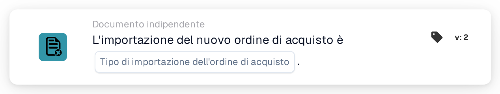

# Importazione dell'ordine di acquisto

<figure><figcaption>
Versione 2
</figcaption></figure>

## Scopo:

Questa scheda del workflow avvia un workflow (trigger) quando un ordine di acquisto viene importato in DocBits. Può reagire agli ordini di acquisto appena creati, agli aggiornamenti di ordini di acquisto esistenti o a entrambi. Il workflow viene eseguito senza un documento, quindi può essere utilizzato per informare delle persone o per richiamare altri sistemi ogni volta che arrivano dati di ordini di acquisto.

## Componenti della scheda:

1. **Tipo di importazione dell'ordine di acquisto**
   * **Descrizione:** Definisce quale tipo di importazione avvia il workflow.
   * **Opzioni:**
     * **un nuovo ordine di acquisto.** L'ordine di acquisto non esisteva in precedenza ed è stato creato dall'importazione.
     * **un aggiornamento di un ordine di acquisto esistente.** Un ordine di acquisto esistente è stato aggiornato dall'importazione.

     È possibile selezionare entrambe le opzioni.

## Funzionalità:

* **Quando si avvia il workflow:** Quando un ordine di acquisto proveniente dal sistema ERP viene elaborato dall'importazione degli ordini di acquisto, il sistema registra se si tratta di un ordine nuovo o di un aggiornamento. Avvia quindi tutti i workflow indipendenti dal documento attivi dell'organizzazione (tranne i workflow webhook e quelli pianificati) e trasmette loro questa informazione, insieme all'ID e al numero dell'ordine di acquisto. Ciò avviene solo se il modulo workflow è attivo per l'organizzazione e se esistono workflow attivi. Un ordine di acquisto che viene saltato perché la versione in arrivo non è più recente di quella memorizzata non avvia alcun workflow.
* **Valutazione della condizione:** La scheda verifica se il tipo di importazione trasmesso al workflow è uno dei tipi selezionati sulla scheda.
* **Esecuzione dell'azione:**
  * **Condizione vera:**\
    Se il tipo di importazione corrisponde a un'opzione selezionata, il workflow prosegue con le schede successive.
  * **Condizione falsa:**\
    Se il tipo di importazione non corrisponde, oppure il workflow è stato avviato da un altro evento indipendente dal documento (ad esempio una modifica dello stato di un fornitore), la scheda non è soddisfatta e i passaggi successivi non vengono eseguiti.
* **Dati mancanti:** Se sulla scheda non è selezionato alcun tipo di importazione, la scheda non valuta la condizione. Segnala l'input mancante (o un errore) nel log del workflow e i passaggi successivi non vengono eseguiti.

## Configurazione e impostazione:

* La scheda può essere aggiunta dalla sezione **WHEN**, categoria **Documento indipendente**. Poi si selezionano uno o entrambi i tipi di importazione, si aggiungono le ulteriori condizioni e azioni, e il workflow viene salvato e attivato.

## Conclusione:

La scheda "Purchase order import" consente ai workflow di reagire non appena i dati di un ordine di acquisto vengono creati o aggiornati, senza attendere un documento. In questo modo i processi successivi restano allineati agli ordini di acquisto provenienti dal sistema ERP.
