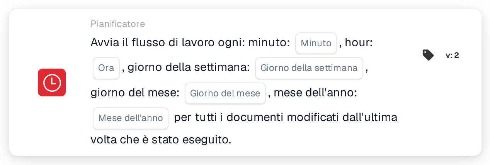

# Avvio pianificato del workflow

<figure><figcaption>
Versione 2
</figcaption></figure>

## Scopo:

Questa scheda del workflow avvia un workflow (trigger) in base a una pianificazione temporale, in modo simile a un cron job. A ogni orario pianificato, il workflow viene eseguito per tutti i documenti modificati dall'esecuzione precedente. È utile per elaborazioni regolari, come controlli notturni, promemoria periodici o solleciti, che non dovrebbero essere eseguiti subito a ogni modifica di un documento.

## Componenti della scheda:

1. **Minuto**
   * **Descrizione:** Il minuto o i minuti dell'ora in cui si avvia il workflow.
   * **Dettaglio:** Valore in stile cron, ad esempio `0`, `30`, `0,30` o `*/15`. Un campo vuoto significa ogni minuto (`*`).
2. **Ora**
   * **Descrizione:** L'ora o le ore del giorno in cui si avvia il workflow.
   * **Dettaglio:** Valore in stile cron, ad esempio `6` o `8-18`. Un campo vuoto significa ogni ora (`*`).
3. **Giorno della settimana**
   * **Descrizione:** Il giorno o i giorni della settimana in cui si avvia il workflow.
   * **Dettaglio:** Valore in stile cron, ad esempio `1-5`. Un campo vuoto significa ogni giorno della settimana (`*`).
4. **Giorno del mese**
   * **Descrizione:** Il giorno o i giorni del mese in cui si avvia il workflow.
   * **Dettaglio:** Valore in stile cron, ad esempio `1` o `1,15`. Un campo vuoto significa ogni giorno (`*`).
5. **Mese dell'anno**
   * **Descrizione:** Il mese o i mesi in cui si avvia il workflow.
   * **Dettaglio:** Valore in stile cron, ad esempio `1` o `1-6`. Un campo vuoto significa ogni mese (`*`).

## Funzionalità:

* **Fuso orario:** Tutti gli orari sono espressi in UTC, il fuso orario dei server DocBits. Ad esempio, le 6:00 UTC corrispondono alle 8:00 dell'ora legale dell'Europa centrale.
* **Quando si avvia il workflow:** Quando il workflow viene salvato e attivato, dai cinque campi viene creata una voce di pianificazione. Se il workflow viene disattivato o eliminato, la voce di pianificazione viene rimossa. A ogni orario pianificato, il sistema:
  * cerca i documenti dell'organizzazione che sono stati modificati, salvati o hanno cambiato stato dall'ultima esecuzione del workflow,
  * avvia il workflow in background separatamente per ciascuno di questi documenti e
  * memorizza l'orario di questa esecuzione come punto di partenza per quella successiva.

  I documenti che hanno raggiunto il limite di esecuzioni del workflow vengono saltati. Se il workflow viene disattivato mentre i documenti sono in elaborazione, i documenti rimanenti non vengono elaborati.
* **Valutazione della condizione:** La scheda verifica se il workflow è stato avviato dalla pianificazione.
* **Esecuzione dell'azione:**
  * **Condizione vera:**\
    Se il workflow è stato avviato dalla pianificazione, la scheda è soddisfatta e il workflow prosegue con le schede successive.
  * **Condizione falsa:**\
    Se il workflow è stato avviato in qualsiasi altro modo, ad esempio da un trigger di documento, da un webhook o dalla modifica di una variabile, la scheda non è soddisfatta e i passaggi successivi non vengono eseguiti.
* **Una sola pianificazione per workflow:** Nell'Advanced Workflow Builder, se un workflow contiene più schede di pianificazione, per la pianificazione viene utilizzata solo la prima.
* **Salvataggio:** Se al salvataggio la voce di pianificazione non può essere aggiornata, il workflow viene comunque salvato e viene mostrato un avviso. Salvando di nuovo il workflow, l'aggiornamento viene ritentato.

## Configurazione e impostazione:

* La scheda può essere aggiunta dalla sezione **WHEN**, categoria **Pianificatore**. Poi si compilano i campi dell'orario; i campi lasciati vuoti significano "ogni". Ad esempio, con minuto `0`, ora `6`, giorno della settimana `1-5` e gli altri campi vuoti, il workflow si avvia alle 6:00 UTC nei giorni feriali. Successivamente si aggiungono le ulteriori condizioni e azioni, e il workflow viene salvato e attivato.

## Conclusione:

La scheda "Scheduled workflow start" esegue i workflow a orari fissi anziché a ogni evento. Poiché ogni esecuzione considera solo i documenti modificati dall'esecuzione precedente, l'elaborazione regolare resta concentrata sul lavoro nuovo.
