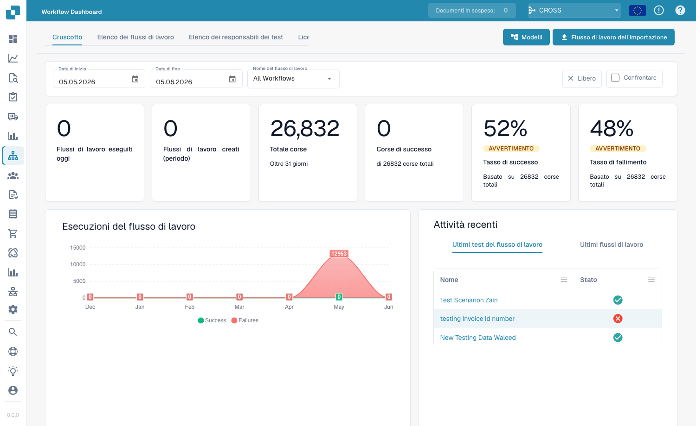
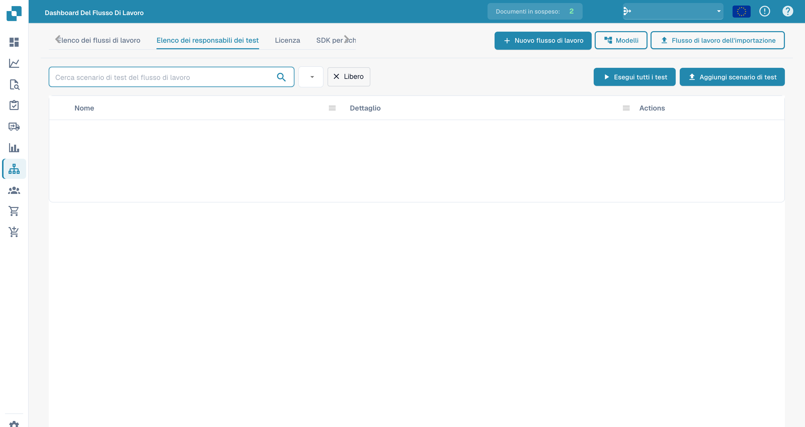

# Dashboard

La **Dashboard del flusso di lavoro** è la home dell'area workflow. Mostra come stanno andando i tuoi workflow — totali delle esecuzioni, tassi di successo e di fallimento, un grafico delle esecuzioni nel tempo e l'attività recente — e ti dà accesso all'elenco dei workflow, al test manager e al Card SDK.

<figure><figcaption>
La Workflow Dashboard — totali delle esecuzioni, tassi di successo/fallimento e attività recente per ogni workflow.
</figcaption></figure>

## Schede

- **Cruscotto** — metriche delle esecuzioni e attività recente (mostrate sopra).
- **Elenco dei flussi di lavoro** — ogni workflow con il suo tipo, l'ordine di esecuzione e il trigger. Creane uno nuovo con **Nuovo flusso di lavoro**.
- **Elenco degli scenari di test** — scenari di test che validano i tuoi workflow; eseguili con **Esegui tutti i test**.
- **Licenza** — informazioni sulla licenza dei workflow.
- **Card SDK** — crea e carica schede workflow personalizzate (vedi [Card SDK](card-sdk.md)).

La barra degli strumenti offre anche **Modelli**, che apre la libreria [Workflow Templates](standard-workflow-builder.md#workflow-templates), e **Flusso di lavoro dell'importazione**, che importa un workflow da un file JSON.

Il **Test Manager** ti permette di salvare scenari di test per ogni workflow e di eseguirli insieme, così puoi verificare che i tuoi workflow si comportino ancora correttamente dopo le modifiche:

<figure><figcaption>
Elenco degli scenari di test dei workflow.
</figcaption></figure>

## Prossimi passi

- Crea un'automazione lineare con il builder **Standard Workflow**.
- Crea un flusso con diramazioni con il builder **Flusso di lavoro avanzato**.
