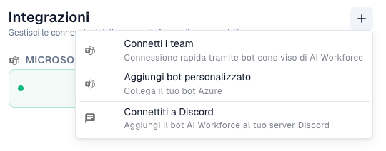
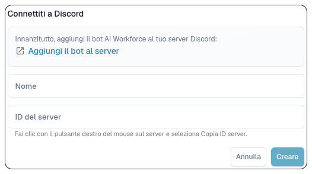

# Collegare AI Workforce a Teams e Discord

Servono un abbonamento AI Workforce attivo, diritti di gestione delle connessioni e accesso al tenant Teams o server Discord previsto. Risolvere prima eventuali requisiti di abbonamento con l'amministratore.

<figure><figcaption>
In Integrazioni, + apre le opzioni per collegare Teams, aggiungere un bot personalizzato o collegare Discord. Il nome della connessione esistente è nascosto. L’opzione «Connetti i team» corrisponde a Microsoft Teams; la traduzione attuale del nome del prodotto è errata.
</figcaption></figure>

## Microsoft Teams

1. Aprire **AI Workforce → Impostazioni → Integrazioni**.
2. Scegliere **+ → Collega Teams**. DocBits genera un codice con validità residua.
3. Seguire l'istruzione mostrata con il codice nell'ambiente Teams previsto. Mantenerlo riservato e completare l'associazione prima della scadenza.
4. Attendere conferma e verificare nome e modalità bot condiviso o personalizzato nell'elenco.
5. Attivare la connessione inattiva quando deve ricevere lavoro. Memorizzata e attiva sono condizioni diverse.
6. Inviare una richiesta di prova innocua dal contesto Teams previsto. Verificare missione, origine e organizzazione in DocBits e completare le approvazioni umane necessarie nella posta in arrivo.

Per un bot aziendale scegliere l'opzione personalizzata e inserire nome, ID tenant, ID applicazione e relativo segreto. Conservare i segreti nel modulo credenziali, fuori da prompt e screenshot.

## Discord

<figure><figcaption>
Modulo di connessione Discord prima dell’invio. L’ID del server identifica il server Discord (Guild ID); non è stata creata alcuna connessione.
</figcaption></figure>

1. Sotto **Integrazioni → +**, scegliere Discord.
2. Se proposto, aggiungere il bot al server corretto con un amministratore autorizzato.
3. Inserire nome riconoscibile e **Guild ID** corretto: identifica il server, non il canale.
4. Creare, verificare la connessione e attivarla se necessario.
5. Inviare una prova innocua e verificare missione, origine e organizzazione risultanti.

## Problemi

Se il codice Teams scade, generarne uno nuovo e seguirne l'istruzione aggiornata. Senza lavoro in ingresso verificare attivazione, identità tenant/server, accesso del bot ed errori. Una connessione stabilita non prova una missione completata.

Vedere [AI Workforce](ai_workforce/README.md) per missioni, diritti e approvazioni. Queste connessioni sono separate da importazione email e accesso Microsoft.
