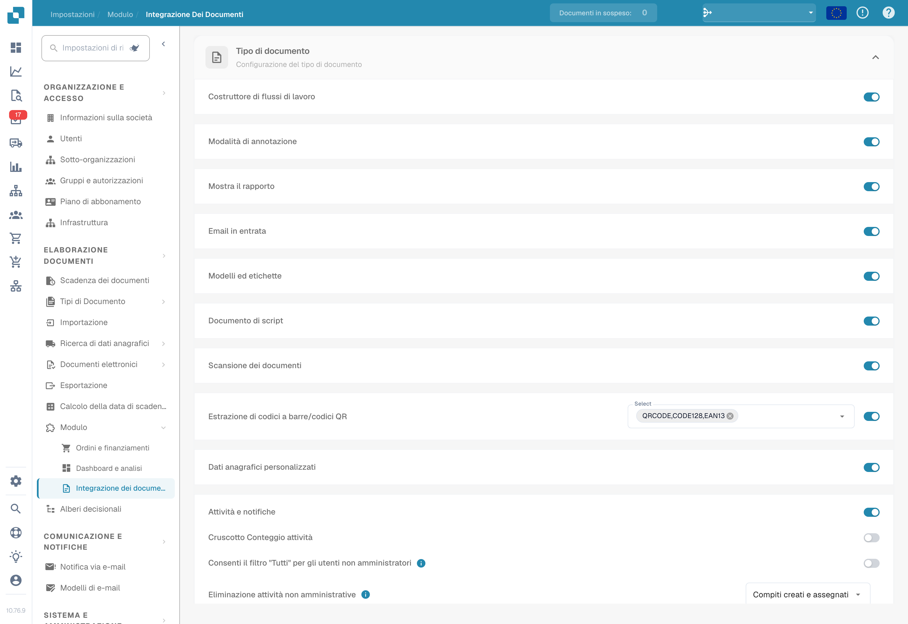
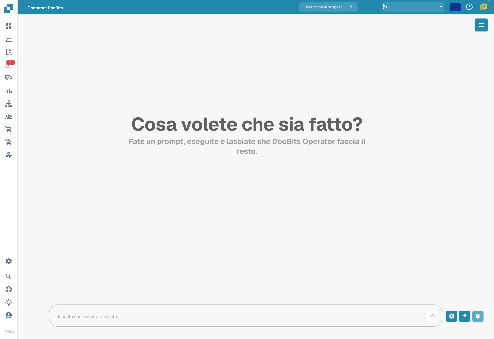
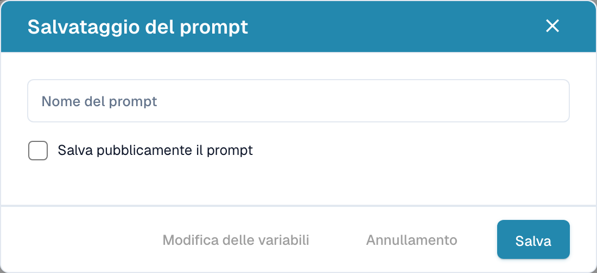

# Operatore DocBits

L’Operatore DocBits permette di preparare istruzioni per attività nel browser. Il risultato dipende dall’istruzione, dall’applicazione, dai dati e dalle autorizzazioni disponibili. Il salvataggio di un prompt non dimostra che l’attività sia stata eseguita correttamente.

## Accesso e contesto

Controlla il modulo corrispondente in **Impostazioni → Modulo → Integrazione documenti**, se la tua organizzazione utilizza questa funzione. L’immagine mostra le impostazioni esistenti, senza modificarle.

<figure><figcaption>
Contesto del modulo di integrazione documenti nella versione illustrata. I valori sono quelli esistenti; nessun modulo o interruttore è stato modificato.
</figcaption></figure>

Apri **Operatore DocBits** dalla navigazione disponibile nel tuo ambiente.

<figure><figcaption>
Schermata iniziale italiana dell’Operatore DocBits con campo delle istruzioni vuoto. Nessuna istruzione è stata inviata o eseguita.
</figcaption></figure>

## Preparare un’istruzione

Descrivi con precisione l’obiettivo e i passaggi richiesti. Identifica l’applicazione e i dati necessari. Variabili come `{invoice_number}` o `{url}` possono fungere da parametri quando la configurazione le supporta; sono esempi di nomi, non valori universali.

Inizia con un caso di test autorizzato e controlla i valori delle variabili prima dell’esecuzione. Non inserire password o dati riservati in un esempio condiviso.

## Salvare un prompt

L’azione di salvataggio apre **Salvataggio del prompt**. Compila **Nome del prompt** e controlla **Salva pubblicamente il prompt** prima di confermare con **Salva**. L’ambito di condivisione e le autorizzazioni devono corrispondere alla tua organizzazione; il modulo non garantisce la condivisione tra tutti gli account o ambienti.

<figure><figcaption>
Modulo italiano Salvataggio del prompt con Nome del prompt, opzione di condivisione pubblica e comandi. Nessun valore è stato inserito e nessun prompt, variabile o consenso alla condivisione è stato salvato.
</figcaption></figure>

Nella versione illustrata, **Annullamento** chiude il modulo senza salvare; questa chiusura è stata verificata sul modulo vuoto. La casella di condivisione pubblica non è stata selezionata.

**Modifica delle variabili** apre la relativa configurazione quando l’azione è disponibile. Controlla i valori memorizzati e il loro ambito; la durata di validità non può essere dedotta da un modulo vuoto.

## Eseguire e controllare

Prima di avviare un’istruzione, controlla parametri ed effetti previsti. Segui l’esecuzione e verifica il risultato nell’applicazione di destinazione. Un’istruzione inviata, un passaggio iniziato e un’operazione completata rappresentano stati diversi.

I comandi di ripresa e arresto consentono di controllare un’esecuzione quando disponibili. Le icone seguenti sono riferimenti visivi e non mostrano un’attività eseguita durante questa documentazione.

<figure><figcaption>
Esempio delle icone per riprendere e interrompere.
</figcaption></figure>

Il comando di ingrandimento apre una vista dettagliata quando disponibile.

<figure><figcaption>
Icona per espandere la vista dettagliata.
</figcaption></figure>

Questa pagina illustra soltanto la schermata iniziale, il modulo di salvataggio vuoto e icone senza testo. Non è stata inviata alcuna istruzione, non è stato salvato alcun prompt e non è stata eseguita alcuna operazione esterna durante le riprese.
