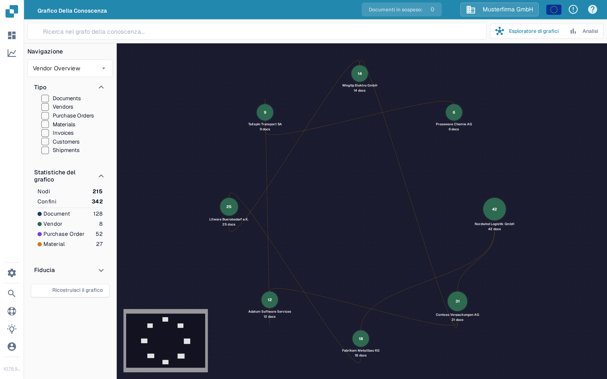

# Esploratore di grafici della conoscenza

L'**Esploratore di grafici della conoscenza** ti aiuta a vedere le connessioni tra fornitori, documenti, ordini di acquisto e altri record. Usalo quando vuoi seguire una relazione o controllare quanti elementi collegati sono disponibili. L'esempio seguente mostra un grafo con dati nell'organizzazione di prova della Sandbox.

<figure><figcaption>
Il grafo di esempio mostra fornitori collegati. Cerca un elemento o ricostruisci il grafo per vedere le tue connessioni.
</figcaption></figure>

## Per iniziare

1. Apri **Esploratore di grafici della conoscenza** in DocBits. Verifica che l'organizzazione mostrata in alto sia quella che intendi esaminare.
2. Se al centro compare **Search for a node or compute the graph to get started**, scegli **Ricostruisci il grafico** e attendi la fine del messaggio di avanzamento. Questa operazione prepara i dati del grafo; può richiedere del tempo. Se l'organizzazione non ha ancora relazioni corrispondenti, **Nodi** e **Confini** possono rimanere a zero.
3. Inserisci un nome o un altro termine di ricerca in **Search knowledge graph** e premi Invio oppure seleziona l'icona di ricerca. Quando compaiono più risultati, scegli quello che ti serve. Un risultato unico apre direttamente il suo grafo.
4. Seleziona un nodo per vederne i dettagli. Chiudi il pannello dei dettagli con **X** quando vuoi tornare al grafo.

## Scegli cosa vedere

| Controllo | Cosa fa |
| --- | --- |
| **Navigazione** | Passa da **Vendor Overview** (fornitori collegati) a **Vendor Intelligence** (una tabella di fornitori), **Document Journey** (passaggi e varianti nell'elaborazione dei documenti) e **Anomalies** (relazioni insolite). |
| **Tipo** | Seleziona i tipi di elementi su cui concentrarti, ad esempio Documents, Vendors, Purchase Orders o Invoices. I tipi selezionati limitano anche i risultati della ricerca. |
| **Statistiche del grafico** | Mostra il numero di nodi (elementi) e confini (collegamenti) attualmente disponibili. Espandi o comprimi questa sezione in base alle esigenze. |
| **Fiducia** | Apri questa sezione per impostare la confidenza minima delle relazioni quando espandi un nodo. Un valore più alto restringe i collegamenti mostrati. |
| **Ricostruisci il grafico** | Avvia un nuovo calcolo del grafo. Attendi la fine dell'avanzamento prima di cercare di nuovo. |
| **Esploratore di grafici / Analisi** | Passa dal grafo interattivo ai grafici di riepilogo. Analisi mostra conteggi e grafici quando esistono dati del grafo; anche un grafo vuoto lascia Analisi vuota. |

Se devi risolvere una differenza tra una fattura e il suo ordine, continua con la [Schermata di Abbinamento Ordini di Acquisto](../end-user-and-partner-section/end-user-section/purchase-order-matching/README.md). Per metriche più ampie al di fuori del grafo, consulta il [Dashboard di analisi](../administration-and-setup/analytics-dashboard.md).
