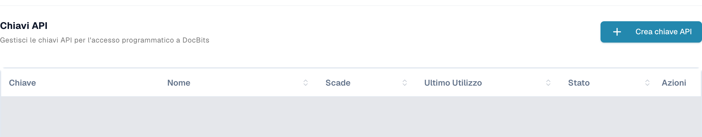
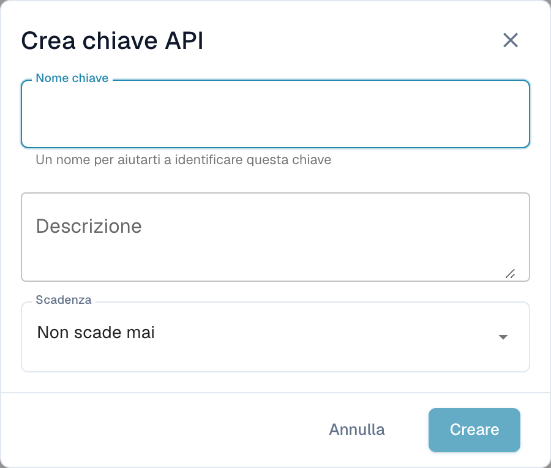

# Postman per DocBits

Postman consente di inviare richieste HTTP all’API di DocBits. Iniziare con una richiesta di sola lettura in un ambiente che si è autorizzati a usare. Separare gli ambienti di test e produzione e conservare le credenziali in variabili private o in un archivio di segreti.

## Configurazione

### API DocBits

Aprire la documentazione dell’API dell’ambiente appropriato, ad esempio l’[API Sandbox](https://sandbox.api.docbits.com/docs) o l’[API di produzione](https://api.docbits.com/docs). Usare i percorsi attuali delle operazioni e il valore **Servers** indicato nella documentazione. Un percorso di server relativo si aggiunge all’origine dell’API.

Nella [documentazione Dev verificata qui](https://eu.dev.api.docbits.com/docs), il percorso è `/dev-api`. L’URL di base completo è quindi `https://eu.dev.api.docbits.com/dev-api`. Altri ambienti possono usare un percorso di server diverso.

La specifica dell’API elenca diversi schemi di intestazione distinti:

| Intestazione | Scopo |
| --- | --- |
| `X-ORG-ID` | Identifica l’organizzazione di destinazione quando l’operazione lo richiede. |
| `Authorization` | Contiene il valore di autorizzazione richiesto dal meccanismo di autenticazione pertinente. |
| `X-API-KEY` | Contiene una chiave API per le operazioni che usano questo schema. |

Queste intestazioni non sono intercambiabili. La finestra globale **Authorize** mostra gli schemi disponibili; non tutte le operazioni richiedono tutte queste intestazioni. Consultare i parametri e le informazioni di autorizzazione dell’operazione specifica.

Richiedere le credenziali appropriate all’amministratore. Nelle impostazioni di DocBits, gli utenti autorizzati trovano la gestione delle chiavi sotto **Integrazione e SSO → Chiavi API**. L’elenco mostra il prefisso della chiave, il nome, la scadenza, l’ultimo utilizzo e lo stato. Le righe esistenti sono coperte nella schermata.

<figure><figcaption><p>Vista reale di Dev in italiano: Chiavi API, pulsante Crea chiave API e colonne Chiave, Nome, Scade, Ultimo Utilizzo, Stato e Azioni; le righe esistenti sono coperte.</p></figcaption></figure>

**Crea chiave API**, sopra l’elenco, apre prima un modulo vuoto con **Nome chiave**, **Descrizione** e **Scadenza**. Solo l’invio del modulo crea una chiave. Il modulo illustrato è stato chiuso con **Annulla**, senza inviarlo. Non è stata creata, mostrata, copiata o revocata alcuna chiave. Creare chiavi soltanto secondo le proprie autorizzazioni e le regole dell’organizzazione.

<figure><figcaption><p>Modulo vuoto Crea chiave API in italiano con Nome chiave, Descrizione, Scadenza, Annulla e Creare; Creare è disabilitato finché il nome è vuoto.</p></figcaption></figure>

### Creare un nuovo spazio di lavoro in Postman

Aprire Postman e usare uno spazio di lavoro con la visibilità adatta all’organizzazione. Creare un ambiente con la variabile `base_url`. Il suo valore deve essere l’URL di base completo, incluso il percorso del server. Selezionare l’ambiente prima di inviare una richiesta. La [guida agli ambienti di Postman](https://learning.postman.com/docs/use/send-requests/variables/managing-environments/) spiega come selezionare e usare le variabili.

Creare una richiesta o aggiungerla alla propria raccolta. I nomi dei comandi Postman riportati di seguito sono le etichette tecniche dell’applicazione; le immagini precedenti mostrano la gestione delle chiavi di DocBits in italiano.

## Esempio del metodo "GET"

Selezionare **GET** e l’URL `{{base_url}}/version`. In **Authorization**, scegliere **No Auth**, quindi **Send**. La richiesta Dev di sola lettura verificata era:

```http
GET https://eu.dev.api.docbits.com/dev-api/version
```

L’endpoint ha restituito HTTP 200 senza una chiave API. Verifica la raggiungibilità dell’API e restituisce informazioni sulla versione. Non dimostra l’accesso ai documenti o agli utenti di un’organizzazione. Controllare lo stato e il contenuto della risposta; in caso di errore, verificare prima l’ambiente selezionato, l’origine dell’API e il percorso del server.

Per un’operazione che usa una chiave API, selezionare **Authorization → API Key** in Postman. Inserire `X-API-KEY` in **Key**, usare un segreto privato per **Value** e selezionare **Header** in **Add to**. Aggiungere `X-ORG-ID` in **Headers** se l’operazione lo richiede. Consultare le guide ufficiali sull’[autorizzazione con chiave API](https://learning.postman.com/docs/use/send-requests/authorization/authorization-types/#api-key) e sui [segreti di Vault](https://learning.postman.com/docs/use/postman-vault/use-vault-secrets/).

## Esempio del metodo "POST"

**POST** può creare dati o avviare un’elaborazione. Copiare metodo, percorso, parametri obbligatori e schema del corpo dalla specifica attuale dell’API. Eseguire queste richieste solo per un’attività specifica e autorizzata. Una richiesta di versione riuscita non dimostra che una richiesta di scrittura avrà esito positivo.

### Caricare un documento

Prima di caricare un documento, consultare l’operazione attualmente documentata. Se richiede dati di modulo multipart, selezionare quel tipo di corpo e usare i nomi dei campi e i tipi di file indicati. Non dedurli da una schermata di una versione precedente dell’API. Per questa guida non è stato caricato alcun documento.

## Esempio del metodo "DELETE"

**DELETE** può eliminare definitivamente i dati. Verificare l’operazione specifica, l’ID di destinazione e le autorizzazioni richieste. Qui non è stata eseguita alcuna eliminazione né ne è stato dichiarato il collaudo con esito positivo.

## Esempio del metodo "PUT"

**PUT** può modificare dati esistenti. Usare esclusivamente i parametri e lo schema del corpo dell’operazione attuale e confermare l’ambito della modifica richiesta. Qui non è stata eseguita alcuna modifica.

## Modificare l’indirizzo e-mail di un utente

Ricavare il percorso e i campi obbligatori dalla specifica attuale dell’API e far verificare la modifica dell’utente prima di eseguirla. Questa guida non usa dati reali di utenti o organizzazioni e non dimostra una modifica dell’indirizzo e-mail riuscita.

Sono state verificate la specifica attuale dell’API Dev, la richiesta di versione senza autenticazione e le viste reali di DocBits in italiano della gestione delle chiavi e del modulo vuoto. Per verificare le viste sono stati usati l’account di test autorizzato e letture dei metadati dell’interfaccia. Non sono state eseguite creazioni di chiavi, caricamenti, creazioni di utenti, modifiche o eliminazioni. Non sono state provate operazioni applicative dell’API su documenti o record utente. Non è stata provata alcuna richiesta nell’applicazione Postman.
