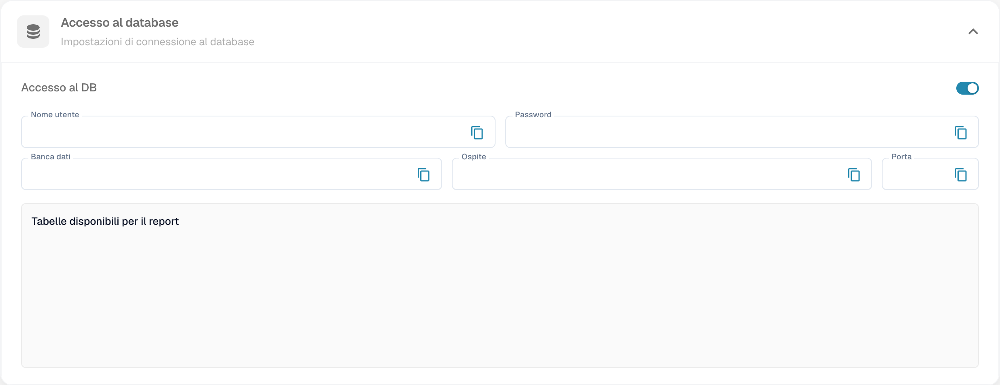

# Collegamento tramite database in sola lettura

Questa guida riguarda l’accesso di reporting **PostgreSQL** di DocBits tramite **psqlODBC**. L’accesso diretto a ClickHouse è una funzione distinta, descritta nella [guida ClickHouse](powerbi.md). Occorrono l’accesso autorizzato, i parametri dell’ambiente e la connettività di rete appropriata.




## 1. Verificare l’accesso in DocBits

Apri **Impostazioni → Modulo**, quindi la sezione relativa a dashboard e analisi e **Accesso al database**. Usa i parametri assegnati al tuo account. Non abilitare un modulo o cambiare le autorizzazioni soltanto per seguire un’immagine.

<figure><figcaption>
Accesso al database e Accesso al DB nella versione italiana. L’accesso era già attivo; credenziali e nomi delle tabelle sono mascherati. Ospite è una traduzione errata del campo tecnico Host, cioè il server. Nessuna connessione Power BI è stata eseguita.
</figcaption></figure>

## 2. Installare e configurare psqlODBC

Installa [psqlODBC dal sito PostgreSQL](https://www.postgresql.org/ftp/odbc/releases/) con architettura compatibile con Power BI Desktop. Apri il gestore delle origini dati ODBC di Windows con la stessa architettura, aggiungi un DSN di sistema e scegli il driver PostgreSQL Unicode appropriato.

Assegna un nome descrittivo al DSN e inserisci server, porta, database, nome utente e password forniti per l’accesso di reporting. Per TLS usa i requisiti dell’ambiente: `require` richiede la cifratura, ma non equivale da solo alla verifica completa del certificato e del nome del server. Consulta le [opzioni ufficiali psqlODBC](https://odbc.postgresql.org/docs/config-opt.html).

## 3. Collegare Power BI Desktop

Usa **Recupera dati → ODBC**, scegli il DSN e inserisci le credenziali richieste. Nelle immagini storiche del programma esterno i comandi sono in inglese: **Get Data**, **ODBC**, **Connect**.

<figure><figcaption>
Esempio storico dell’interfaccia esterna di Power BI in inglese: scelta ODBC. Non è una schermata italiana di DocBits né la prova di una connessione eseguita durante questa verifica.
</figcaption></figure>

<figure><figcaption>
Esempio storico esterno in inglese della selezione di un DSN in Power BI. Nome e configurazione del DSN dipendono dall’ambiente; l’immagine non documenta la connessione corrente.
</figcaption></figure>

Se compare `password authentication failed for user`, verifica server, database, nome utente e password. Inserisci la password effettiva nella finestra delle credenziali. Le parentesi graffe nella stringa di connessione sono sintassi di escape del driver, non una soluzione generale agli errori di autenticazione.

## 4. Selezionare e verificare i dati

Nel navigatore scegli soltanto tabelle o viste autorizzate. **Carica** importa i dati; **Trasforma dati** apre Power Query. Lo schema disponibile dipende dai permessi assegnati: non presumere che ogni tabella dello schema `public` sia accessibile.

<figure><figcaption>
Esempio storico esterno del navigatore di Power BI in inglese. Gli oggetti visibili sono un esempio della vecchia configurazione e non l’elenco attuale delle tabelle autorizzate.
</figcaption></figure>

Controlla tipi di dati, date, numero di righe e un campione confrontabile con la sorgente. Costruisci il report con i campi e le aggregazioni necessari. Le vecchie immagini di report con dati aziendali non verificati non sono usate come esempi.

## 5. Aggiornamento nel servizio Power BI

Per l’origine ODBC prepara un gateway raggiungibile con driver, DSN e credenziali appropriati. L’aggiornamento pianificato dipende dalla licenza o capacità dell’area di lavoro e dalla modalità di connessione. Pubblica il report, configura la connessione e verifica la cronologia di un aggiornamento prima di affidarti alla pianificazione.

Consulta la [documentazione del connettore ODBC](https://learn.microsoft.com/it-it/power-query/connectors/odbc) e dell’[aggiornamento pianificato](https://learn.microsoft.com/it-it/power-bi/connect-data/refresh-scheduled-refresh). Durante questa verifica non sono stati copiati parametri, configurati DSN, eseguite connessioni o aggiornati report.
