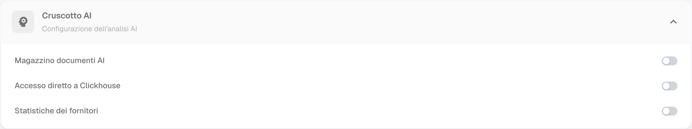

# Collegamento tramite ClickHouse

Usa questa guida quando l’organizzazione dispone dell’accesso diretto a **ClickHouse** e un amministratore ha fornito i parametri autorizzati. Non usare i parametri dell’[accesso PostgreSQL in sola lettura](connect-via-read-only-database.md): si tratta di una sorgente distinta.




## 1. Verificare la disponibilità di ClickHouse

Apri **Impostazioni → Modulo**, quindi **Cruscotto AI → Configurazione dell’analisi AI**. Verifica con l’amministratore la disponibilità di **Accesso diretto a Clickhouse** e i requisiti della tua installazione.

<figure><figcaption>
Configurazione dell’analisi AI con Magazzino documenti AI, Accesso diretto a Clickhouse e Statistiche dei fornitori. Nell’organizzazione di prova tutti e tre i controlli sono disattivati e non sono mostrate credenziali. Nessuna funzione è stata attivata né connessione eseguita.
</figcaption></figure>

La schermata documenta lo stato esistente, non un accesso ClickHouse funzionante. Se la funzione non è disponibile, chiarisci con l’amministratore abilitazione, autorizzazioni e condizioni prima di configurare Power BI.

## 2. Installare il driver

Installa il [driver ODBC ufficiale ClickHouse](https://github.com/ClickHouse/clickhouse-odbc) con architettura compatibile con Power BI Desktop e le dipendenze richieste. Usa server, porta, database, nome utente, password e impostazioni TLS forniti per la sorgente ClickHouse; non copiare credenziali di esempio.

## 3. Scegliere il percorso di connessione

Nelle versioni di Power BI Desktop che lo supportano, il connettore **ClickHouse** consente **Importazione** o **DirectQuery** e richiede il driver indicato dalla documentazione ClickHouse. Scegli **Recupera dati → ClickHouse**, fornisci i parametri richiesti e seleziona la modalità appropriata al report.

In alternativa, per il percorso ODBC generico crea un DSN ClickHouse nel gestore ODBC di Windows, poi scegli **Recupera dati → ODBC** e quel DSN. Questo percorso descritto qui usa l’**importazione**; non attribuire DirectQuery al connettore ODBC generico.

I campi e i requisiti dipendono dalle versioni installate. Segui la [guida ufficiale ClickHouse per Power BI](https://clickhouse.com/docs/integrations/connectors/data-visualization/powerbi-and-clickhouse), compresi i requisiti del gateway per il servizio Power BI.

## 4. Controllare i dati e creare il report

Seleziona soltanto tabelle o viste autorizzate. In modalità importazione, carica i dati o trasformali in Power Query. Verifica tipi di dati, date, conteggi e un campione rispetto alla sorgente prima di creare visualizzazioni e misure. Le vecchie immagini di report con nomi aziendali non verificati sono state rimosse.

## 5. Pubblicazione e aggiornamento

La connessione nel servizio richiede una configurazione di rete e gateway coerente con il connettore usato. Per i dati importati, l’aggiornamento pianificato dipende dalla licenza o capacità dell’area di lavoro e dalla sorgente. DirectQuery interroga la sorgente e non segue lo stesso caricamento periodico dei dati importati.

Controlla la [documentazione Microsoft sull’aggiornamento pianificato](https://learn.microsoft.com/it-it/power-bi/connect-data/refresh-scheduled-refresh) e prova il percorso scelto prima dell’uso operativo. Durante questa verifica non sono stati installati driver, creati DSN, eseguite query o pubblicati report.
