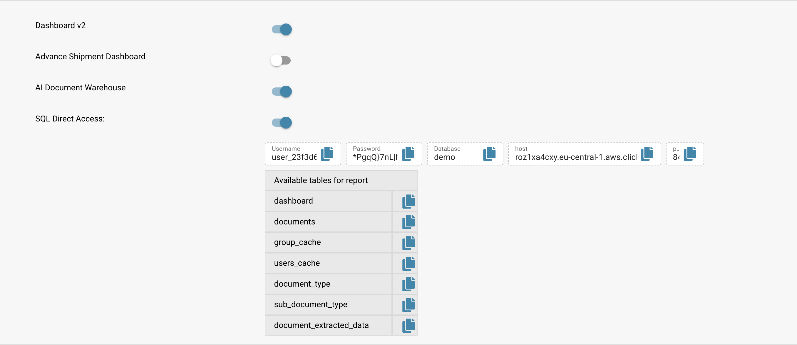

# Accesso SQL

<figure><figcaption></figcaption></figure>

## Panoramica

Nel modulo delle impostazioni di DocBits, gli amministratori possono accedere direttamente al database BI tramite SQL. Questa funzione è pensata per la gestione avanzata dei dati e per esigenze di reportistica personalizzata.

### Accedere all'accesso SQL diretto

Vai alla sezione SQL Direct Access nel modulo delle impostazioni. Qui trovi le credenziali e i dettagli di accesso, tra cui nome utente, password, nome del database e informazioni sull'host.

* **Username:** user\_23f3d6
* **Password:** _Cifrata_
* **Database:** demo
* **Host:** vedi lo screenshot

## **Esempio di dettagli di accesso:**

```sql
SELECT
    COUNT(*),
    status,
    invoice_type
FROM dashboard
GROUP BY
    status,
    invoice_type

```

#### Risultati di una query di esempio

I risultati seguenti mostrano il numero di documenti per stato e tipo di fattura:

* **Pronto per la validazione:** 71 fatture, 6 non specificate
* **In attesa di conferma:** 1 non specificato
* **Finished:** 3 non specificati, 1 fattura
* **Error:** 2 non specificati

#### Utilizzare clickhouse-client per l'accesso da terminale

Per gli sviluppatori che preferiscono il terminale, l'accesso può essere stabilito tramite `clickhouse-client`:

```bash
clickhouse-client --host <hostname_or_ip> --port <port> --user <username> --password <your_password> --database <database_name>

```

### Esempio di aggregazione con SELECT

La query seguente aggrega righe esistenti e non crea una vista materializzata. L’accesso in sola lettura non concede i permessi di scrittura necessari per crearla. Adattare nomi delle tabelle e conversioni allo schema, al formato numerico e alla valuta. Non sommare valute diverse senza una conversione esplicita.

```sql
SELECT toStartOfWeek(created_on) as week_start, sum(toFloat64OrZero(field_value)) as total_sum
FROM document_extracted_data
WHERE field_name = 'total_amount'
GROUP BY week_start

```

Questo esempio mostra come raggruppare gli importi totali in base alla settimana di creazione, il che è utile per i riepiloghi finanziari settimanali o per le tracce di audit.

## Risorse aggiuntive

Per ulteriore assistenza o configurazioni avanzate, rivolgiti al nostro team di supporto o consulta i nostri completi video di formazione disponibili nella sezione della guida.
