# Tabella AI

La **AI Tabella estratta** è la tabella delle voci di riga che DocBits legge con l'AI quando un fornitore non ha regole di tabella addestrate. Compare nella schermata di validazione sotto i campi di intestazione. Questa pagina spiega ogni controllo intorno alla tabella: come correggere una colonna errata, come dare istruzioni all'AI, come testare una modifica prima di conservarla, come vedere cosa ha fatto l'AI, cosa può e cosa non può fare l'Assistente per te e chi può salvare cosa.

## Quando ottieni la tabella AI

* Un amministratore ha attivato l'**Estrazione della tabella AI** (Impostazioni → Elaborazione del documento → Tipi di Documento → Classificazione ed estrazione, vedi [Impostazioni per gli amministratori](#impostazioni-per-gli-amministratori)). Se è disattivata, l'area della tabella mostra *La tabella AI verrà visualizzata qui. Abilitazione in …*.
* Il fornitore **non ha regole salvate**. Non appena qualcuno addestra la tabella del fornitore e salva le regole, le regole salvate sostituiscono la tabella AI per quel fornitore. Le righe compaiono allora nella scheda **Tabella estratta** e la scheda **AI Tabella estratta** diventa grigia con il tooltip *Tabella AI disattivata: È in uso una tabella addestrata su misura.*
* Eccezione: le colonne contrassegnate **Usa AI** nelle impostazioni delle colonne della tabella vengono compilate dall'AI anche per i fornitori con regole salvate, vedi [Usa AI per colonna](#usa-ai-per-colonna).

Quale livello AI legge la tabella (Fast, Full, Nexus) è impostato per organizzazione e può essere sovrascritto per fornitore, vedi Modello di IA Specifico per Fornitore.

## La tabella AI in sintesi

<figure>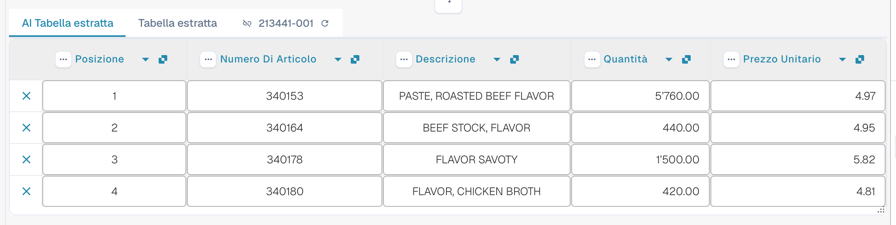<figcaption>
Le due schede, la AI Tabella estratta e le intestazioni delle sue colonne.
</figcaption></figure>

* **Schede.** *AI Tabella estratta* è ciò che ha letto l'AI. *Tabella estratta* è la tabella classica ottenuta dalle regole addestrate. La scheda AI si apre per impostazione predefinita quando il documento ha una tabella AI.
* **Intestazione di colonna.** Ogni colonna mostra il proprio nome, un piccolo simbolo di **origine** (passaci sopra il mouse: *IA · mappatura*, *IA · sinonimo* e così via indicano come l'AI ha abbinato la colonna), un menu con i **tre puntini** e, per una colonna mappata, un **pulsante con il nome** su cui puoi fare clic per cambiare quale colonna è.
* **Pulsanti di riga.** La **x** all'inizio di una riga rimuove quella riga. Fai clic con il pulsante destro su una riga per *Select as additional cost* / *Remove as additional cost*.
* **Barra degli strumenti a piè di pagina.** Le icone in fondo alla schermata aggiungono o nascondono colonne e righe, vedi [Barra degli strumenti a piè di pagina](#barra-degli-strumenti-a-pie-di-pagina).
* **Scheda Istruzioni per l'IA** sotto la tabella: prompt, colonne aggiuntive, **Modifica del test**, **Applicare**, **Salva come addestramento**, **Cancellare**, **Esportazione**, vedi [Dai istruzioni all'AI](#dai-istruzioni-allai).


I controlli delle colonne funzionano solo se puoi modificare il documento. Se sono disattivati, il documento è in sola lettura oppure è bloccato in un'altra sessione. Quando il banner rosso indica che il documento è bloccato dal tuo stesso utente in un'altra sessione, **Sbloccare** ne assume il blocco.


## Modificare una colonna

### Scegliere la colonna giusta (rimappatura)

Usa questa funzione quando un valore si trova nella colonna sbagliata, ad esempio l'importo netto è in *Importo totale* oppure *Quantità* è vuota anche se la fattura la riporta.

1. Fai clic sul **nome della colonna** nell'intestazione.
2. Scegli la colonna della tabella configurata a cui i valori appartengono davvero.

<figure>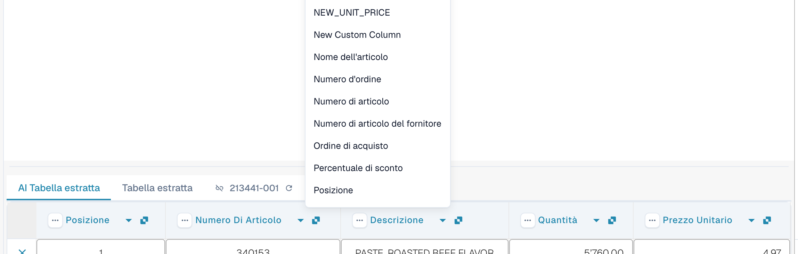<figcaption>
Fai clic sul nome della colonna e scegli quale colonna deve essere. L'elenco mostra tutte le colonne della tabella configurate.
</figcaption></figure>

DocBits riformatta subito la tabella, solo per questo documento. Se la colonna scelta è già usata da un'altra colonna, una finestra di dialogo *Rimappare "…"?* avvisa che l'altra colonna diventerà non mappata. Conferma per continuare; l'altra colonna mostra allora l'icona di errore *Select a column to map from dropdown*, così puoi scegliere una colonna anche per essa.

### Il menu con i tre puntini

<figure>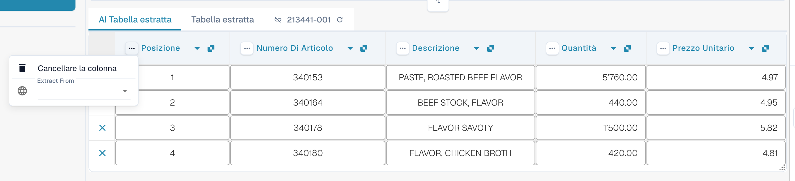<figcaption>
Il menu con i tre puntini di una colonna.
</figcaption></figure>

| Voce | Cosa fa |
| --- | --- |
| **Cancellare la colonna** | Nasconde la colonna. Una conferma indica *Le modifiche saranno scartate*; scegli **Fatto**. La tabella viene ricostruita senza la colonna. Usa **Ripristino della colonna della tabella** nella barra degli strumenti a piè di pagina per riportare le colonne nascoste. |
| **Disattivare la colonna** | Per una colonna che hai aggiunto tu: la nasconde senza rieseguire l'AI. |
| **Formattazione degli importi** | Solo per le colonne di importo. Scegli come vengono letti i numeri (separatori dei decimali e delle migliaia). **Auto** lascia decidere a DocBits. |
| **Extract From** | Indica all'AI di prendere il valore dalla riga **Above** (sopra) o **Below** (sotto) l'etichetta della colonna. Lascialo vuoto se il valore si trova nella posizione normale. |

### Barra degli strumenti a piè di pagina

<figure><figcaption>
Le icone della tabella nel piè di pagina della schermata di validazione, da sinistra a destra.
</figcaption></figure>

| Icona (tooltip) | Cosa fa |
| --- | --- |
| **Vai alla vista di estrazione della tabella** | Apre l'addestramento classico della tabella. Se il documento ha una tabella AI, DocBits avvisa: *La tabella è già stata estratta dall'intelligenza artificiale. Volete allenarvi manualmente? In futuro la tabella AI non verrà estratta per questo fornitore.* |
| **Aggiungere colonne mappate vuote** | Apre **Impostazioni delle colonne** per aggiungere le colonne configurate che l'AI non ha compilato, così puoi digitare i valori a mano. |
| **Mostra le colonne non mappate** / **Nascondere le colonne non mappate** | Mostra o nasconde le colonne restituite dall'AI che non sono mappate a una colonna configurata. Per impostazione predefinita sono nascoste. Questo modifica solo la vista di questo documento. |
| **Estrazione della tabella dei blocchi per questo fornitore** | Disattiva l'estrazione della tabella per il fornitore. |
| **Cancellare la tabella** | Svuota la tabella nell'editor. |
| **Aggiungere una nuova colonna alla tabella** | Aggiunge una colonna personalizzata. Solo amministratori. |
| **Aggiungere una nuova riga di tabella** | Aggiunge una riga vuota. |
| **Ignorare la convalida della tabella** | Ignora la convalida della tabella per questo documento. |
| **Ripristino della colonna della tabella** | Riporta tutte le colonne che hai eliminato. |

<figure>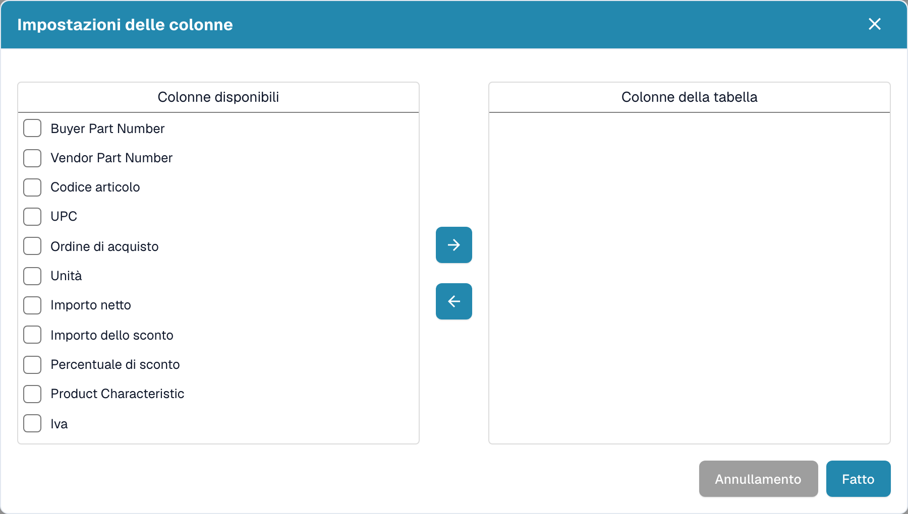<figcaption>
Impostazioni delle colonne: sposta le colonne da <em>Colonne disponibili</em> a <em>Colonne della tabella</em> con i pulsanti a freccia, poi scegli <strong>Fatto</strong>.
</figcaption></figure>

## Dai istruzioni all'AI

Sotto la tabella, la scheda **Istruzioni per l'IA** indica all'AI cosa fare in modo diverso. Ha due campi di input e quattro pulsanti che userai continuamente.

<figure>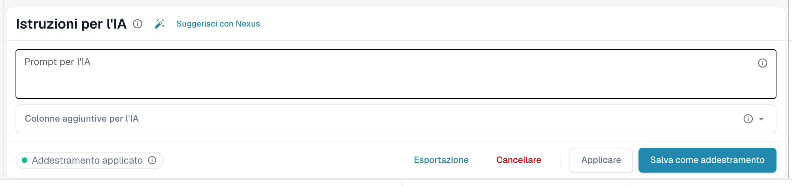<figcaption>
La scheda Istruzioni per l'IA.
</figcaption></figure>

* **Prompt per l'IA.** Scrivi un'istruzione per riga, in linguaggio semplice. Digita **@** per inserire il nome di una colonna, così l'AI sa esattamente a quale colonna ti riferisci.
* **Colonne aggiuntive per l'IA.** Scegli le colonne che l'AI deve restituire in aggiunta a quelle consuete.
* **Stato dell'addestramento.** Il chip mostra **Addestramento applicato** quando nell'ultima esecuzione è stato usato un addestramento salvato, oppure *Nessun addestramento selezionato*.

<figure>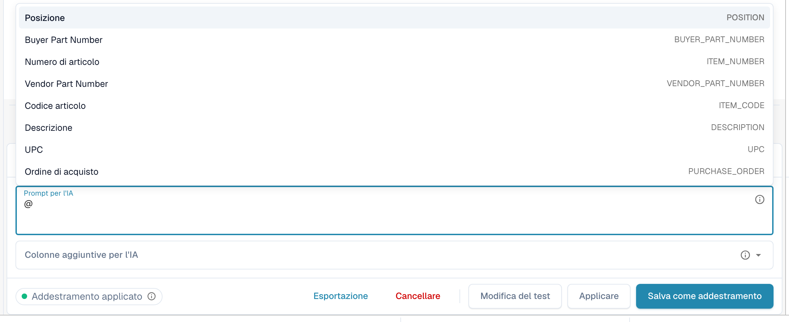<figcaption>
Digita <strong>@</strong> nel prompt per scegliere una colonna. Non appena qualcosa è cambiato, <strong>Modifica del test</strong> compare accanto a <strong>Applicare</strong>.
</figcaption></figure>


Un prompt modificato fa rileggere la tabella all'AI e può cambiare ogni colonna, non solo quella che avevi in mente. Controlla poi l'intera tabella.


### Suggerisci con Nexus

Non sai cosa scrivere? Fai clic su **Suggerisci con Nexus**. DocBits esamina l'estrazione di questo documento e propone istruzioni o colonne aggiuntive. Non viene applicato nulla finché non fai clic su **Inserisci** (aggiunge la riga al tuo prompt) oppure su **Aggiungi colonna**.

<figure>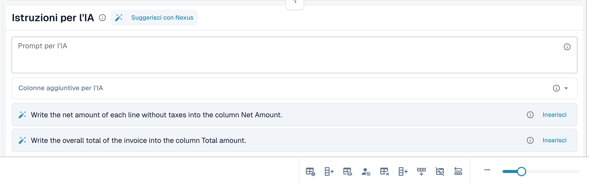<figcaption>
Un suggerimento di Nexus. <strong>Inserisci</strong> lo copia nel prompt.
</figcaption></figure>

Se la tua organizzazione ha disattivato il consulente AI, DocBits te lo comunica invece di fare suggerimenti.

### Testare, applicare, salvare: cosa fa ogni pulsante

| Pulsante | Cosa succede | Memorizzato per i documenti successivi? |
| --- | --- | --- |
| **Modifica del test** | Esegue la tua modifica e mostra un confronto. **Non viene scritto nulla**, né nel documento né come regola. | No |
| **Applicare** | Rilegge la tabella con le tue modifiche e inserisce il risultato in questo documento nell'editor. Diventa permanente solo quando salvi il documento. | No |
| **Salva come addestramento** (tooltip *Salva regole*) | Memorizza il prompt, le colonne aggiuntive, la mappatura delle colonne, le colonne nascoste, i formati degli importi e le impostazioni **Extract From** per questo layout del fornitore. I documenti successivi con questo layout vengono letti allo stesso modo. | Sì |
| **Cancellare** (tooltip *Elimina regole*) | Elimina le regole di tabella salvate di questo layout del fornitore, senza ulteriore conferma, ed esegue di nuovo l'AI senza di esse. Rimuove anche l'addestramento classico della tabella salvato per lo stesso layout. | Le rimuove |
| **Esportazione** | Scarica la tabella come file CSV. | No |


Le rimappature dell'intestazione, **Cancellare la colonna**, **Formattazione degli importi**, **Extract From** e **Ripristino della colonna della tabella** si comportano come **Applicare**: ricostruiscono subito la tabella per questo documento e vengono salvate con il documento, non come regola. Solo **Salva come addestramento** insegna a DocBits per i documenti successivi.


Se il documento ha già righe abbinate a un ordine di acquisto, Applicare e Salva avvisano che **potresti perdere le connessioni all'Ordine di acquisto**. Scegli **Fatto** per continuare e abbinare di nuovo in seguito.

<figure>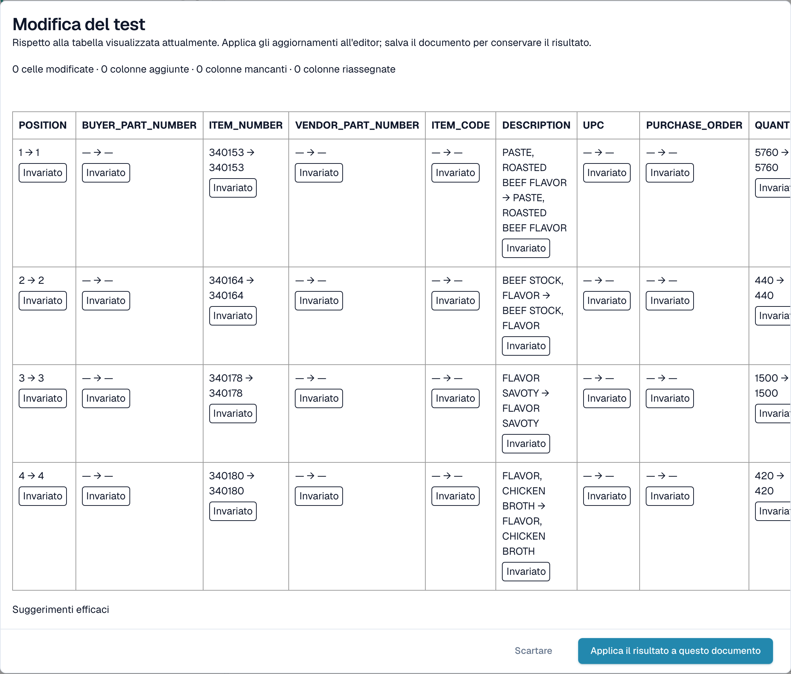<figcaption>
La finestra <strong>Modifica del test</strong> confronta il nuovo risultato con la tabella che vedi ora.
</figcaption></figure>

La finestra **Modifica del test** conta cosa cambierebbe: celle modificate, colonne aggiunte, colonne mancanti e colonne riassegnate. Ogni cella è contrassegnata come **Aggiunto**, **Modificato**, **Mancante**, **Riassegnato** o **Invariato**. In fondo, la finestra elenca le evidenze dell'esecuzione: *Suggerimenti efficaci*, *Formazione selezionata*, *Politica della rubrica* e *Sovrascritture della richiesta utilizzate*. Scegli **Applica il risultato a questo documento** per recepirlo (poi salva il documento) oppure **Scartare** per eliminarlo. Se modifichi il prompt dopo il test, il risultato viene contrassegnato come obsoleto e devi testare di nuovo.

Dopo **Salva come addestramento** DocBits ti informa che l'addestramento verrà usato alla successiva rielaborazione; l'esecuzione corrente non lo ha ancora usato. Verifica sul documento successivo del fornitore che il chip indichi **Addestramento applicato**.

## Vedere cosa ha fatto l'AI

Quattro pulsanti sotto la tabella spiegano l'estrazione.

<figure>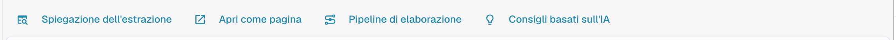<figcaption>
I pulsanti di spiegazione.
</figcaption></figure>

* **Spiegazione dell'estrazione** apre *Come la tabella dell'IA è giunta ai suoi valori*: il documento, l'estrazione AI (livello, numero di colonne grezze e di righe), la mappatura alla tua struttura e il risultato per colonna con l'origine di ciascuna colonna.
* **Apri come pagina** mostra la stessa spiegazione in una finestra a sé.
* **Pipeline di elaborazione** elenca i passaggi di elaborazione del documento e dove si è fermato.
* **Consigli basati sull'IA** chiede a Nexus come migliorare l'estrazione ed elenca raccomandazioni concrete, ad esempio *Enable structured output* o *Add an instruction tag → Net Amount*. Sono solo consigli; decidi tu.

<figure>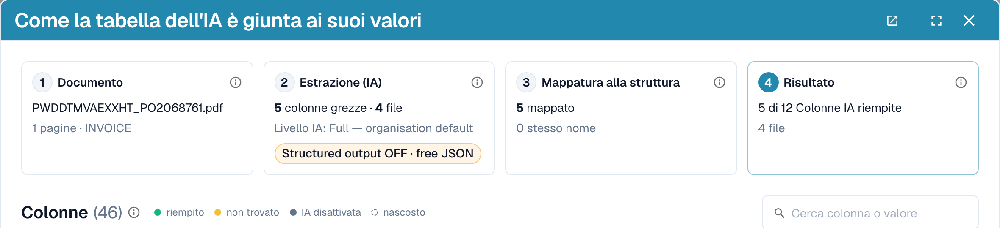<figcaption>
Spiegazione dell'estrazione: quattro passaggi dal documento al risultato.
</figcaption></figure>

<figure>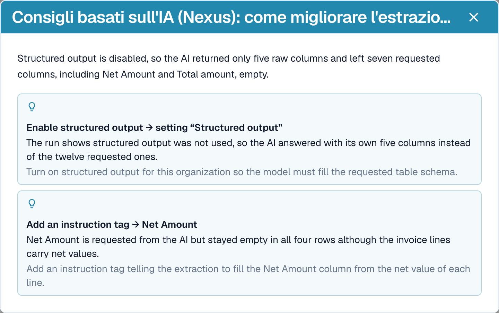<figcaption>
I consigli basati sull'IA propongono i passi successivi.
</figcaption></figure>

<figure>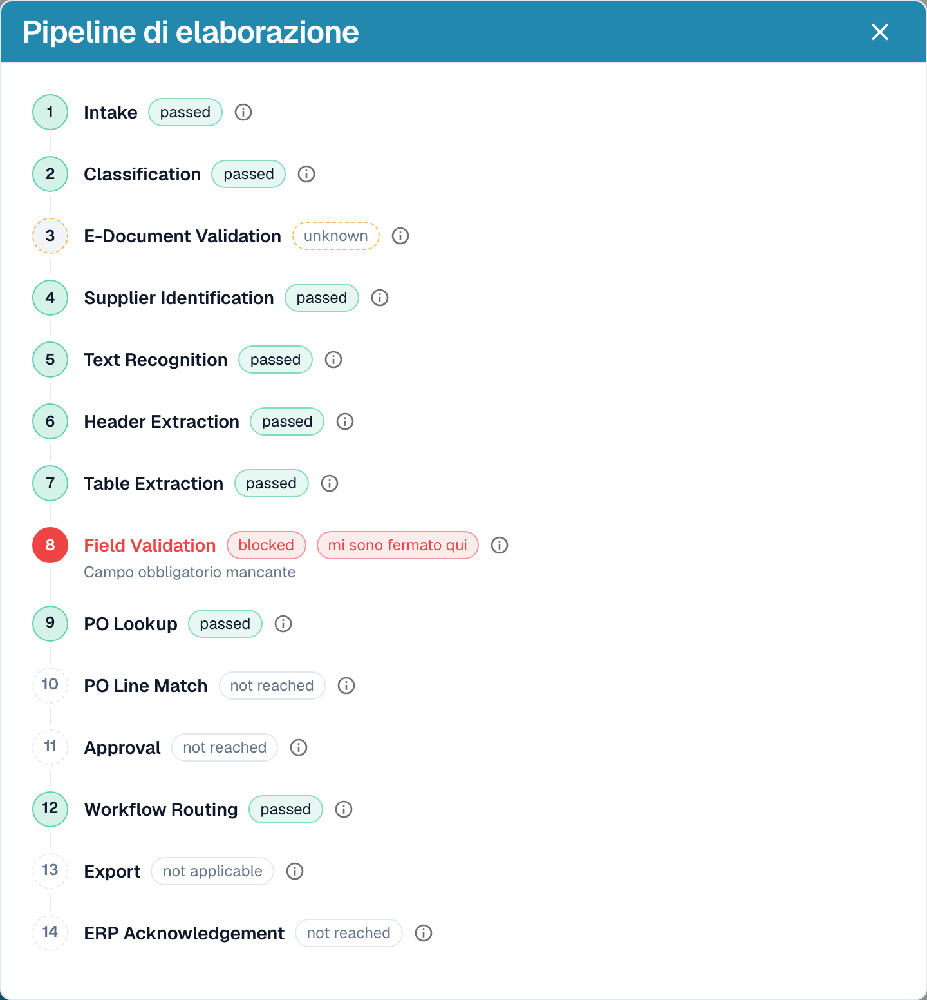<figcaption>
La pipeline di elaborazione mostra dove si è fermato un documento, qui alla validazione dei campi.
</figcaption></figure>

Queste spiegazioni appartengono al modulo **Dashboard di analisi**. Senza la licenza del modulo, oppure quando il tuo ruolo non ha accesso alla scheda Analisi, DocBits ti indica cosa chiedere al tuo amministratore (attivare il modulo in Impostazioni → Moduli, oppure assegnare la scheda al tuo ruolo in Impostazioni → Ruoli).

## Esempi pratici

| Situazione | Cosa fare |
| --- | --- |
| Un valore è nella colonna sbagliata, ad esempio *Prezzo Unitario* si trova in *Importo netto* | Fai clic sul nome della colonna e mappalo sulla colonna giusta. Poi **Salva come addestramento** se il fornitore lo stampa sempre così. |
| Una colonna resta vuota in ogni riga, ad esempio *Importo dello sconto* | Aggiungi la colonna in **Colonne aggiuntive per l'IA**, oppure scrivi un'istruzione con la dicitura usata in fattura, ad esempio *Compila la colonna Importo dello sconto con la colonna chiamata "Rabatt" in fattura.* Verifica con **Modifica del test**, poi **Applicare**. |
| L'AI non sa cosa fare (nulla nel prompt) | Fai clic su **Suggerisci con Nexus** e inserisci ciò che è adatto. |
| Un prezzo deve essere diviso o arrotondato | Scrivi la regola nel prompt, ad esempio *Il prezzo unitario è l'importo netto diviso per la quantità*. |
| Gli importi vengono letti con separatori errati (1.234,50 anziché 1,234.50) | Apri il menu con i tre puntini della colonna, scegli **Formattazione degli importi** e seleziona il formato giusto. |
| L'etichetta si trova sotto il valore | Menu con i tre puntini → **Estrai da** → **Sotto**. |
| Una colonna non serve per questo fornitore | Menu con i tre puntini → **Cancellare la colonna**. **Salva come addestramento** la mantiene nascosta per il fornitore. |
| Una riga è errata o mancante | Rimuovila con la **x**, oppure aggiungine una con **Aggiungere una nuova riga di tabella** e digita i valori. |
| Le stesse correzioni servono ripetutamente | Usa **Salva come addestramento** così i documenti successivi di questo fornitore vengono estratti correttamente. Per i layout complessi [addestra invece la tabella](../../../administration-and-setup/setup/document-training/training-line-fields-table-training/README.md). |


Non ogni riga di descrizione andata a capo può essere riparata con un'istruzione. Se le righe di un articolo sono suddivise in più righe di tabella, modifica le righe oppure usa l'addestramento classico della tabella.


## L'Assistente e la tabella AI

Fai clic su **Assistente** (icona della lampadina accanto a **Salva** nella schermata di validazione) per porre domande sul documento.

<figure>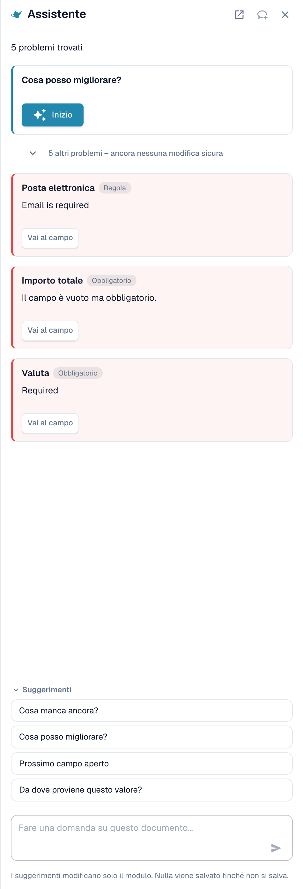<figcaption>
L'Assistente elenca i problemi aperti e propone domande da porre.
</figcaption></figure>

**Cosa fa l'Assistente per le tabelle.** Può portarti a una cella della tabella e, se puoi modificare il documento, impostare il valore di una cella o aggiungere una riga di tabella. Funziona sia nella AI Tabella estratta sia nella Tabella estratta. Risponde inoltre a domande come *Cosa manca ancora?* e *Cosa posso migliorare?*.

<figure>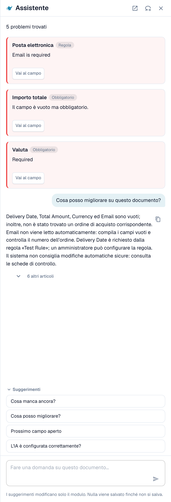<figcaption>
Chiedi <em>Cosa posso migliorare?</em> per ottenere un breve elenco di ciò che correggere come passo successivo.
</figcaption></figure>

**Cosa non fa.** L'Assistente **non** modifica le istruzioni per l'AI, le colonne aggiuntive, la mappatura delle colonne né l'addestramento. Per questo usa la scheda **Istruzioni per l'IA** (**Suggerisci con Nexus**, **Modifica del test**, **Applicare**, **Salva come addestramento**). Gli amministratori possono chiedere *L'IA è configurata correttamente?* per vedere consigli sulle impostazioni, ad esempio sulla combinazione tra la lettura della tabella AI e le regole di tabella salvate.

### Suggerire una regola al tuo amministratore

Molti problemi derivano da un **campo**, non dalla tabella: un'e-mail sempre obbligatoria ma vuota, una data nel formato sbagliato, un ID fornitore che richiede una ricerca. In questi casi chiunque possa aprire il documento può inviare una proposta tramite l'Assistente:

1. Chiedi *Cosa posso migliorare?* oppure apri una scheda di segnalazione nell'Assistente.
2. Se sei un amministratore, la scheda offre **Applica**. Se non lo sei, indica *An administrator can review this proposal.* e mostra **Suggest improvement**. Fai clic su di esso.
3. DocBits mostra *Your suggestion was sent to the administrators.* Se qualcuno ha già inviato lo stesso suggerimento, la tua richiesta viene conteggiata su quello anziché crearne un secondo.
4. La scheda mostra quindi **Requested**, poi **Implemented** oppure **Declined** (con il motivo, se l'amministratore lo ha indicato).

La proposta può essere una **regola di trasformazione**, una **regola di validazione** o una **ricerca (lookup)**. La invii dal documento e il server costruisce da solo la bozza della regola a partire dal problema rilevato, quindi non devi scrivere nulla. Il numero di suggerimenti è limitato a 20 per utente e per ora.


In questo modo non puoi proporre **istruzioni per la tabella AI, mappatura delle colonne o addestramento**. Se una tabella richiede una correzione, correggila nel documento e informa un amministratore, oppure chiedi al tuo amministratore di usare **Salva come addestramento** su un documento di quel fornitore. Gli amministratori possono salvare le regole; vedi [Chi può fare cosa](#chi-puo-fare-cosa).


**Cosa vede l'amministratore.** Gli amministratori ricevono una notifica con un task e un'e-mail. Aprono **Touchless Intelligence** e trovano la proposta sotto **Miglioramenti aperti** (scheda *Aperti*, cronologia in *Cronologia*). Un clic apre il pannello *Improvement suggestion* con documenti di esempio e un'anteprima. L'amministratore può **Approve** o **Reject**. Con l'approvazione, **Switch on right away** decide se la nuova regola è attiva subito; senza di esso la regola viene creata inattiva e l'amministratore la attiva nell'elenco delle regole. Il rifiuto richiede un motivo e una nota facoltativa per i richiedenti. Vedi [Touchless Intelligence](../../../administration-and-setup/touchless-intelligence.md).

<figure>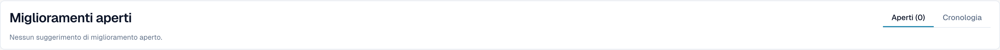<figcaption>
Gli amministratori trovano le proposte sotto <strong>Miglioramenti aperti</strong>.
</figcaption></figure>

## Chi può fare cosa

| Azione | Chi |
| --- | --- |
| Rimappare una colonna, **Cancellare la colonna**, **Formattazione degli importi**, **Extract From**, **Modifica del test**, **Applicare**, modificare le righe | Tutti coloro che possono modificare il documento |
| **Salva come addestramento** | Tutti coloro che possono modificare, a meno che sia attiva l'impostazione dell'organizzazione **Salva le regole di estrazione (solo amministratore)**. In tal caso solo gli amministratori dell'organizzazione possono salvare le regole; gli altri ricevono un messaggio di errore. |
| **Aggiungere una nuova colonna alla tabella** | Amministratori |
| Suggerire una regola tramite l'Assistente | Tutti coloro che possono aprire il documento |
| Approvare o rifiutare un suggerimento | Amministratori |
| **Spiegazione dell'estrazione**, **Consigli basati sull'IA** | Utenti il cui ruolo ha accesso al modulo Dashboard di analisi |

## Impostazioni per gli amministratori

Apri **Impostazioni → Elaborazione del documento → Tipi di Documento → Classificazione ed estrazione**, scheda **Generale**, sezione **Estrazione**.

<figure>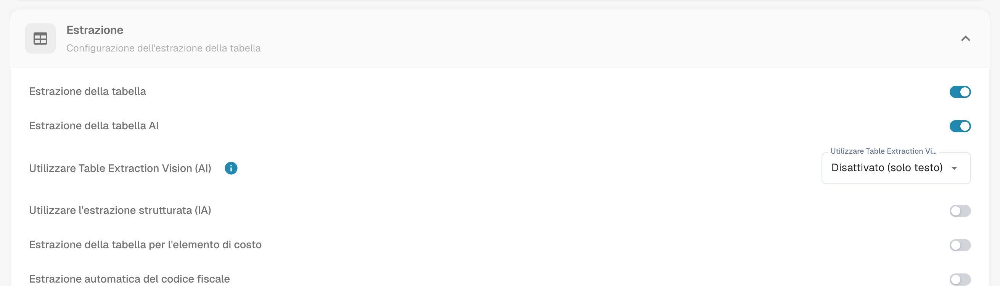<figcaption>
Gli interruttori che decidono se la tabella AI esiste.
</figcaption></figure>

* **Estrazione della tabella** attiva la tabella classica.
* **Estrazione della tabella AI** attiva o disattiva la tabella AI per l'organizzazione.
* **Utilizzare l'estrazione strutturata (IA)**: l'AI restituisce la tabella in una struttura fissa che si mappa direttamente sulle colonne configurate, invece di copiare le intestazioni del fornitore. I nomi delle colonne corrispondono quindi sempre alla tua configurazione; una colonna che il fornitore stampa ma che non hai configurato non viene estratta.
* **Salva le regole di estrazione (solo amministratore)**: se attivo, solo gli amministratori dell'organizzazione possono salvare ed esportare le regole di estrazione.

<figure>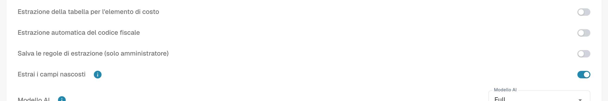<figcaption>
<strong>Salva le regole di estrazione (solo amministratore)</strong> controlla chi può usare <strong>Salva come addestramento</strong>.
</figcaption></figure>

### Usa AI per colonna

Ogni colonna della tabella ha un flag **Usa AI** (Impostazioni → Impostazioni Globali → Tipi di Documento → [Colonne della Tabella](../../../administration-and-setup/settings/global-settings/document-types/table-columns/README.md)). Con il flag attivo, l'AI compila quella colonna anche quando il fornitore ha regole salvate; le altre colonne continuano a provenire dalle regole. Uso tipico: una colonna di descrizione a testo libero che le regole addestrate acquisiscono male.

L'AI deduce quindi quella colonna dall'intera riga. Se vi inserisce sistematicamente il valore sbagliato, ad esempio il totale di riga in *Spese*, disattiva **Usa AI** per quella colonna oppure aggiungi un'istruzione che spieghi all'AI cos'è la colonna.

## Pagine correlate

* [Tag della tabella AI](ai-table-tags.md)
* [Campi di addestramento Linee/Tabella di addestramento](../../../administration-and-setup/setup/document-training/training-line-fields-table-training/README.md)
* [Touchless Intelligence](../../../administration-and-setup/touchless-intelligence.md)
