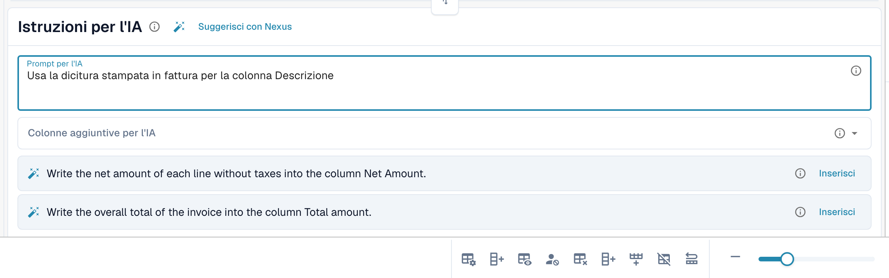

# Tag e istruzioni della tabella AI

I tag sono il modo in cui indichi all'AI cosa fare con una tabella. Nella scheda **Istruzioni per l'IA** sotto la tabella AI (vedi [Tabella AI](README.md)) puoi dare due tipi di tag:

| Tipo | Dove lo inserisci | Cosa ne fa l'AI |
| --- | --- | --- |
| **Istruzione** | **Prompt per l'IA**, una istruzione per riga | La segue durante la lettura della tabella, ad esempio come calcolare o quale dicitura usare. |
| **Colonna** | **Colonne aggiuntive per l'IA** | Deve restituire quella colonna in aggiunta a quelle consuete, anche se il documento non la etichetta chiaramente. |

Entrambi vengono memorizzati insieme come tag AI del fornitore quando usi **Salva come addestramento**.

<figure><figcaption>
Una istruzione per riga in <strong>Prompt per l'IA</strong>.
</figcaption></figure>

## Aggiungere i tag passo dopo passo

1. Apri il documento nella schermata di validazione e rimani nella scheda **AI Tabella estratta**.
2. In **Prompt per l'IA** scrivi cosa deve fare l'AI, una istruzione per riga. Digita **@** per inserire una colonna dalla tua configurazione.
3. Oppure apri **Colonne aggiuntive per l'IA** e scegli le colonne che l'AI deve restituire.
4. Non sai cosa scrivere? Fai clic su **Suggerisci con Nexus** e usa **Inserisci** o **Aggiungi colonna** su un suggerimento.
5. Fai clic su **Modifica del test** per confrontare il risultato con la tabella attuale. Non viene ancora scritto nulla.
6. Il risultato ti soddisfa? Fai clic su **Applicare** (oppure **Applica il risultato a questo documento** nella finestra di test) per inserire il risultato in questo documento.
7. Se serve a ogni documento di questo fornitore, fai clic su **Salva come addestramento**. **Cancellare** rimuove i tag e le regole salvati del layout del fornitore.


Ogni riga in **Prompt per l'IA** è un'istruzione, anche una sola parola (DocBits aggiunge un punto fermo affinché l'AI non la scambi per il nome di una colonna). Le colonne vanno in **Colonne aggiuntive per l'IA**.


## Scrivere buone istruzioni

* **Indica la colonna e la dicitura del documento.** *Compila la colonna Importo dello sconto con la colonna chiamata "Rabatt".* funziona meglio di *trova lo sconto*.
* **Una cosa per riga.** Le righe brevi sono più facili da testare e da rimuovere.
* **Descrivi i calcoli in modo semplice.** *Il prezzo unitario è l'importo netto diviso per la quantità.*
* **Di' cosa lasciare stare.** *Ignora le righe di spedizione in fondo alla tabella.*
* **Controlla l'intera tabella.** Un prompt modificato riesegue l'AI e può cambiare ogni colonna.
* **Non ripetere ciò che è già noto.** Un tag di colonna che duplica un altro tag, o che equivale a un campo di intestazione, viene ignorato.

## Esempi

| Problema | Tag |
| --- | --- |
| La colonna dello sconto resta vuota | Colonna aggiuntiva **Importo dello sconto** e l'istruzione *Compila la colonna Importo dello sconto con la colonna chiamata "Rabatt".* |
| Quantità e unità sono in un'unica cella | *Inserisci il numero in Quantità e l'unità di misura in Unità.* |
| Il prezzo unitario non è stampato | *Il prezzo unitario è l'importo netto diviso per la quantità.* |
| Le date devono essere in formato ISO | *Scrivi tutte le date come YYYY-MM-DD.* |
| Importi in una valuta estera | *Arrotonda tutti gli importi a due decimali.* |

Le colonne che puoi scegliere sono le colonne della tabella configurate per il tipo di documento, vedi [Colonne della Tabella](../../../administration-and-setup/settings/global-settings/document-types/table-columns/README.md).

## Prima di salvare

* Usa prima **Modifica del test**. Non scrive mai nulla.
* **Salva come addestramento** si applica al layout del fornitore, quindi i documenti successivi vengono letti con i tuoi tag. Verifica sul documento successivo che il chip indichi **Addestramento applicato**.
* Se **Salva le regole di estrazione (solo amministratore)** è attivo, chiedi a un amministratore dell'organizzazione di salvare.
* I tag cambiano il modo in cui l'AI legge la tabella. Per posizioni di colonna stabili in un layout ricorrente, [addestra invece la tabella](../../../administration-and-setup/setup/document-training/training-line-fields-table-training/README.md).
