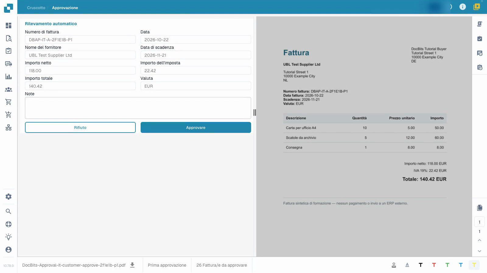
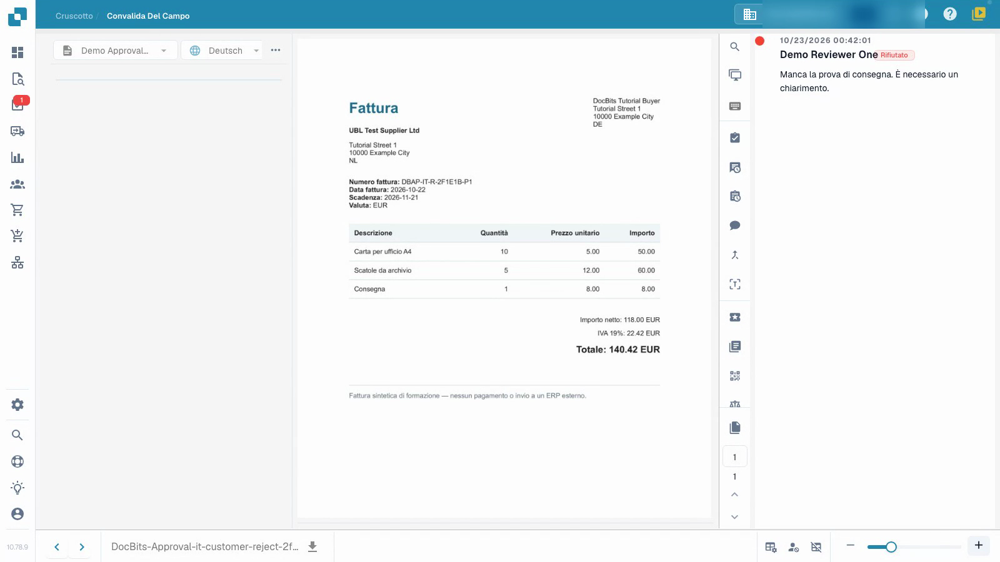

# Approvare o rifiutare una fattura

Il video mostra l’approvazione dal punto di vista di una verificatrice.


Approvare o rifiutare una fattura


[Guarda il video con i sottotitoli](https://docbits-videos.fra1.cdn.digitaloceanspaces.com/settings-assistant/invoice-approval-customer/v1/it.html)

Viene mostrata l'applicazione reale; la formulazione delle opzioni può dipendere dalla versione distribuita.

Usa l’approvazione per registrare la tua decisione dopo aver verificato il contenuto di una fattura già validata. Hai bisogno dell'accesso al documento e dell'autorizzazione per la sua attuale fase di approvazione. Il video utilizza un normale account di verifica.

## Rivedi e decidi

1. Apri la fattura a te assegnata e controlla l'attuale fase di approvazione.
2. Confronta il numero di fattura, il fornitore, le date e il totale con l'originale. Controlla anche le righe della fattura e l’imposta. La convalida tecnica non sostituisce la tua valutazione del contenuto.
3. Registra una nota di revisione chiara. Approva una fattura corretta o rifiutala con un motivo specifico quando necessita di chiarimenti. Attendi il completamento dell'operazione.
4. Riapri il documento e ispeziona la sua cronologia di approvazione. Controlla che il verificatore, l’ora, la decisione e la nota completa siano stati salvati correttamente.

<figure><figcaption>
Modulo fattura compilato rispetto all&#x27;originale.
</figcaption></figure>

<figure><figcaption>
Rifiuto salvato con la relativa motivazione.
</figcaption></figure>

## Controlla la fase successiva

Quando è configurata una seconda approvazione, la tua prima approvazione lascia la fattura in attesa di un altro verificatore autorizzato. Non è ancora completamente approvata. Un rifiuto necessita di chiarimenti sul contenuto; la correzione e la nuova presentazione seguono il processo configurato.

Una voce nella cronologia di approvazione non dimostra che i dati abbiano raggiunto un sistema ERP. In questo esempio isolato, il canale di recupero non ha una destinazione ERP esterna. Lo stato tecnico `pending_data_fetch`, quando visualizzato, significa che il documento è in attesa del recupero dei dati.

## Pagine correlate

- [Schermata di convalida](validation-screen/README.md)
- [Attività sui documenti](tasks.md)
