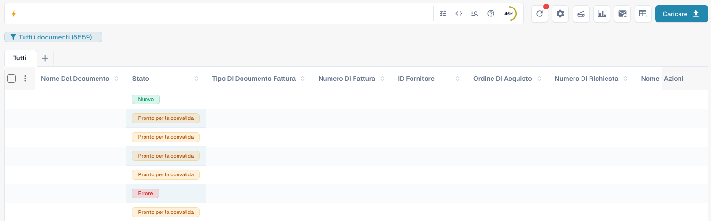
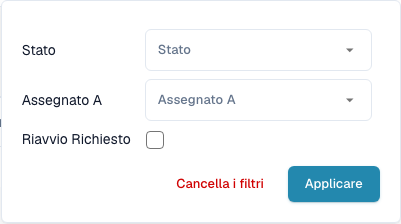
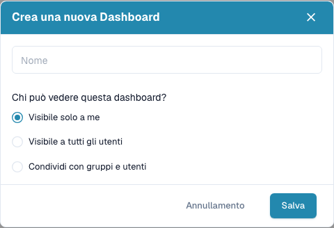
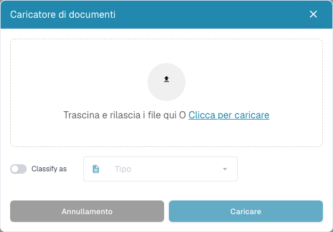

# Dashboard

La dashboard è la tua lista di lavoro quotidiana in DocBits. Trova i documenti importati, controllane lo stato, aprili per la convalida e organizza il lavoro del team.


Le funzioni disponibili dipendono dalle autorizzazioni, dallo stato del documento e dai moduli attivi nell’organizzazione. Alcuni comandi possono non essere presenti. Nelle finestre desktop più strette, le azioni aggiuntive si trovano in **Altro**.


<figure><figcaption>
La dashboard attuale con ricerca, strumenti, viste salvate, tipi di documento e tabella. I valori dei documenti sono nascosti per tutelare la riservatezza.
</figcaption></figure>

## Iniziare il lavoro quotidiano

1. Controlla l’organizzazione attiva e, se disponibile, la sotto-organizzazione.
2. Scegli un tipo di documento oppure mantieni **Tutti**.
3. Cerca e filtra i documenti necessari.
4. Controlla **Stato** e **Assegnato a**, quindi apri la riga per lavorare sul documento.
5. Aggiorna l’elenco dopo l’elaborazione o l’importazione di documenti.

## Cercare e filtrare i documenti

Inserisci un nome di documento, un numero di fattura o un altro valore aziendale e premi **Invio**. L’icona dei filtri nella ricerca permette di scegliere **Stato**, **Assegnato a** e i documenti che richiedono un riavvio. Conferma con **Applicare**. Rimuovi singoli filtri o cancella i filtri se un documento sembra mancare. Anche le schede dei tipi di documento e le viste salvate restringono l’elenco.

La barra offre filtri strutturati, una vista per la query diretta e una guida a campi e sintassi. Riprendi nomi dei campi ed esempi dalla guida. I nomi tecnici non cambiano con la lingua. Le funzioni avanzate dipendono dalle capacità di ricerca abilitate.

Con la ricerca a testo completo attiva, il menu dei contenuti controlla le ricerche di testo semplice: la modalità automatica cerca prima nei campi aziendali e passa al contenuto se non trova risultati; includere il contenuto aggiunge le corrispondenze nel documento; solo campi esclude il contenuto. Un indicatore segnala i risultati provenienti dal contenuto. Un `+` dopo il numero di risultati indica una finestra limitata: restringi ulteriormente la ricerca.

Se compare il controllo separato delle date, scegli un periodo di importazione predefinito o personalizzato. Con la ricerca full-text è nascosto: usa invece i campi data disponibili nella barra di ricerca.

<figure><figcaption>
Filtra per stato, persona assegnata e necessità di riavvio.
</figcaption></figure>

## Leggere e organizzare la tabella

Ogni riga rappresenta un documento. In base alle colonne configurate, mostra nome, stato, tipo, dati della fattura, fornitore, assegnatario, date e importi. Fai clic su un’intestazione ordinabile per cambiare l’ordine. Scorri orizzontalmente per altre colonne e usa la paginazione e il numero di documenti per pagina per esplorare i risultati.

Se il raggruppamento è disponibile, seleziona un campo sopra la tabella. Per i campi data, scegli giorno, settimana o mese. Apri un gruppo per vedere i suoi documenti oppure rimuovi il raggruppamento per tornare alla lista normale.

Usa **+** accanto alle schede per mostrare altri tipi di documento. Riordina le schede trascinandole. Rimuovere una scheda cambia solo la vista e non elimina documenti.

Apri l’ingranaggio e le impostazioni delle colonne. Sposta le colonne tra gli elenchi nascosti e visibili e trascina quelle visibili per ordinarle. Puoi aggiungere anche campi di un tipo di documento. Vedi [Modificare le colonne del documento](change-document-columns.md).

<figure><figcaption>
Scegli e ordina le informazioni della tabella nelle impostazioni delle colonne.
</figcaption></figure>

## Comprendere stati e azioni

Gli stati di elaborazione indicano passaggi come OCR, classificazione o esportazione. **Pronto per la convalida** indica che il documento può essere verificato. Gli stati di approvazione indicano un’approvazione in attesa. **Esportato** indica che l’esportazione del documento è terminata. Fai clic sullo stato **Errore** per consultare i dettagli disponibili.

Se sono disponibili i tempi di elaborazione, passa il puntatore sullo stato per vedere le fasi e la loro durata. Per i documenti con possibili duplicati compare un’icona: aprila per confrontare i documenti correlati.

Apri una riga per lavorare nella schermata di convalida. Il menu delle azioni offre le operazioni consentite, come assegnazione, download, cronologia o riavvio dell’elaborazione. Le varianti di download dipendono dal documento e possono includere annotazioni o formati di fattura elettronica.

Seleziona più documenti con le caselle e apri il menu nell’intestazione per le azioni collettive consentite: assegnazione, unione, riavvio, riavvio dell’esportazione o eliminazione. Controlla selezione e conferme. Queste azioni possono modificare i documenti; salvare una vista cambia solo la presentazione dell’elenco.

## Salvare una dashboard personale

Apri il pulsante blu della vista sotto la ricerca e crea una nuova dashboard. Assegna un nome e scegli se renderla privata, visibile a tutti oppure condivisa con gruppi e utenti specifici. Salva filtri, ordinamento e colonne per attività ricorrenti.

Seleziona le viste salvate dallo stesso menu. Salva le modifiche successive quando la vista è tua ed è stata modificata. Non puoi sovrascrivere una vista condivisa con te: creane una tua. Condividere una vista non concede ulteriori autorizzazioni sui documenti. Vedi [Dashboard personali](personal-dashboards.md).

<figure><figcaption>
Crea una dashboard con un nome e scegli chi può visualizzarla.
</figcaption></figure>

## Caricare documenti e usare gli strumenti

Scegli **Caricare**, trascina file nella finestra oppure selezionali dal computer, quindi avvia il caricamento. Se disponibile, usa l’opzione di classificazione per specificare un tipo di documento. Altrimenti DocBits classifica i file automaticamente.

Gli altri strumenti aggiornano l’elenco, aprono le impostazioni avanzate, avviano uno scanner, mostrano statistiche di stato, avviano l’importazione email configurata o richiedono un’esportazione CSV/Excel. Scansione ed esportazione richiedono la relativa configurazione. Esportare la tabella è distinto dall’esportazione di un documento verso l’ERP. Salva prima le modifiche alle colonne della dashboard personale, perché l’esportazione usa la configurazione salvata. Vedi [Strumenti della dashboard](dashboard-tools.md).

<figure><figcaption>
Carica file e, se necessario, scegli il loro tipo di documento prima dell’importazione.
</figcaption></figure>

## Se manca un documento o un comando

Controlla prima organizzazione, vista attiva, tipo di documento, testo cercato e filtri. Aggiorna l’elenco e consulta le altre pagine. Se una funzione manca ancora, chiedi all’amministratore di verificare autorizzazioni e moduli.

**Ctrl/Cmd + K** apre la ricerca rapida globale; **Ctrl/Cmd + Q** aggiorna la dashboard; **Ctrl/Cmd + H** apre la guida. Il menu dell’ingranaggio contiene i riferimenti alle scorciatoie. Il contatore dei documenti in attesa dell’intera organizzazione, se visibile, è un indicatore per amministratori e non il tuo contatore personale di attività.

Usa Ctrl su Windows/Linux e Cmd su macOS. Le scorciatoie del browser o del sistema possono avere la precedenza.
