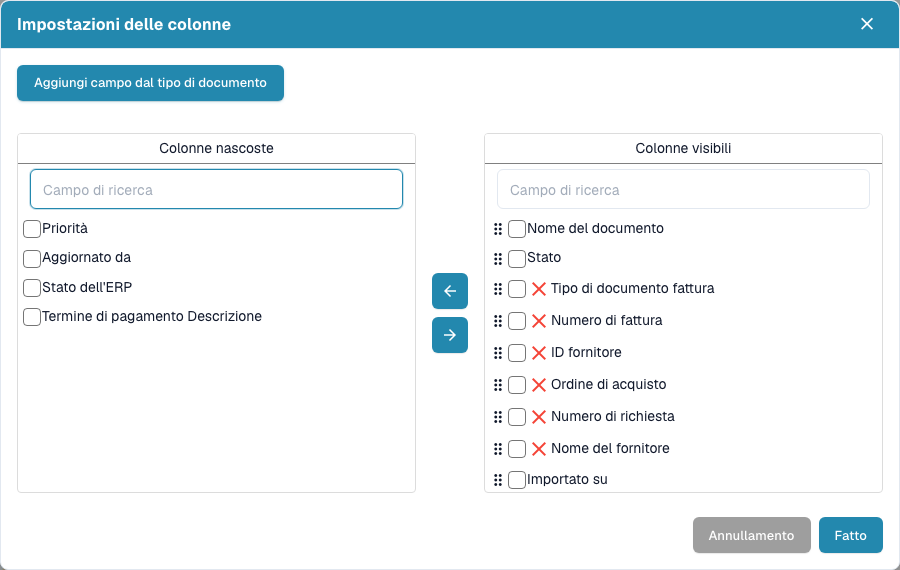

# Modificare le colonne del documento

1. Apri l’ingranaggio accanto alla ricerca.
2. Apri le impostazioni delle colonne.
3. Cerca nelle colonne nascoste o visibili. Seleziona le colonne e spostale con le frecce.
4. Trascina le maniglie delle colonne visibili per ordinarle.
5. Se necessario, aggiungi campi scegliendo un tipo di documento e i campi richiesti.
6. Scegli **Fatto** per applicare la configurazione.

In una tua dashboard salvata, salva anche le modifiche prima dell’esportazione. Le colonne esportate provengono dalla vista salvata. Chiudi o annulla la finestra per uscire senza applicare modifiche. Le colonne disponibili dipendono dal tipo di documento e dalla configurazione dell’organizzazione.

<figure><figcaption>
Scegli e ordina le informazioni della tabella nelle impostazioni delle colonne.
</figcaption></figure>
