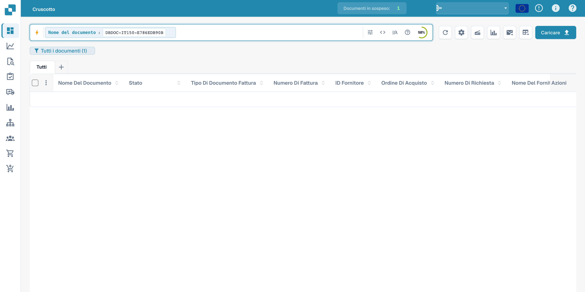
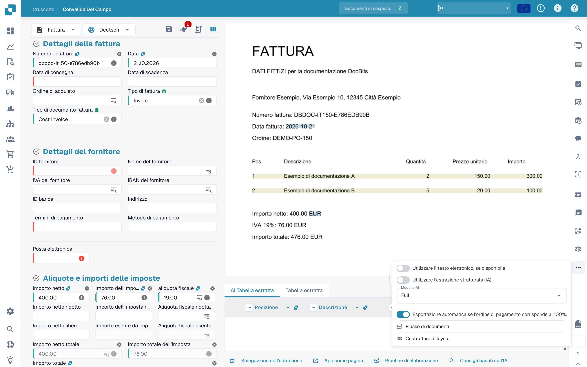
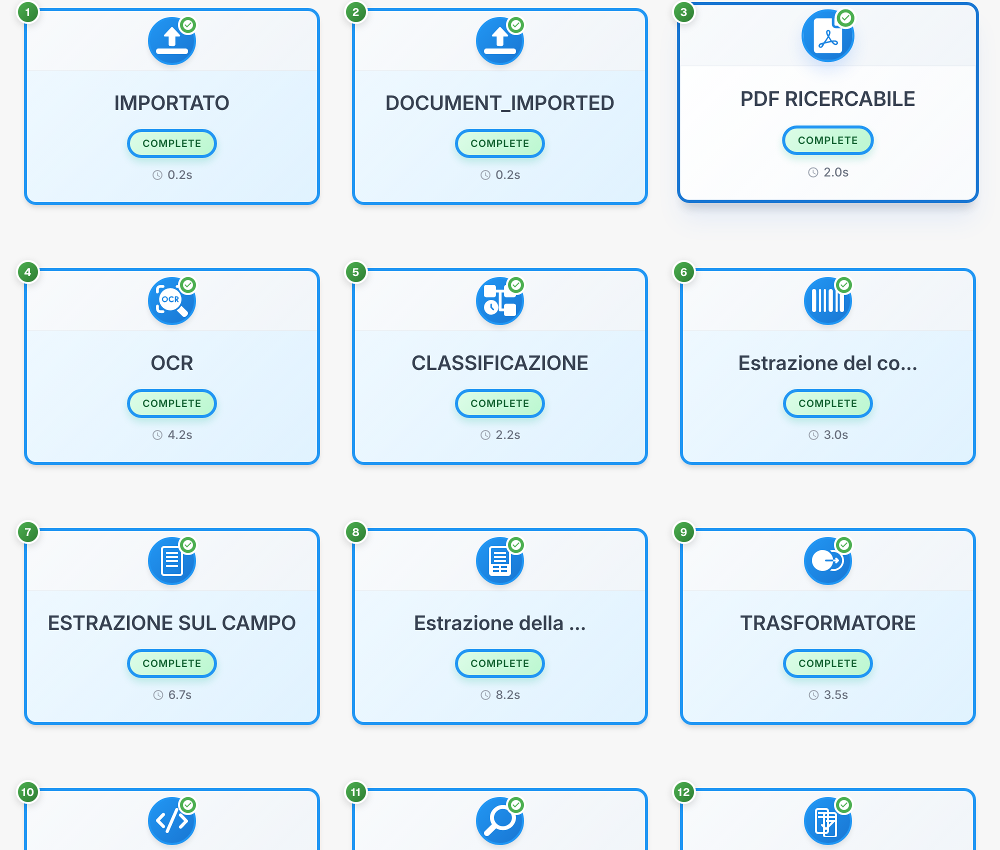

# Flusso del documento

Il flusso del documento mostra ordine, stato e durata delle fasi di elaborazione. L’esempio utilizza una fattura fittizia.

## Aprire il flusso

Cercare il documento nella dashboard. I valori dei documenti sono nascosti.

<figure><figcaption>
Ricerca del documento fittizio nella dashboard; i valori sono nascosti.
</figcaption></figure>

Aprire la convalida dei campi e il menu delle opzioni nella barra destra per consultare il flusso del documento.

<figure><figcaption>
Menu delle opzioni di convalida per aprire il flusso del documento.
</figcaption></figure>

## Leggere le fasi

Ogni scheda rappresenta una fase, come importazione, OCR, classificazione o estrazione dei campi. Seguire la numerazione.

<figure><figcaption>
Fasi di elaborazione di una fattura fittizia; i codici tecnici restano invariati.
</figcaption></figure>

Gli identificatori tecnici come DOCUMENT_IMPORTED e COMPLETE restano invariati. COMPLETE indica una fase completata.

## Consultare i dettagli

Selezionare una scheda per consultarne i dettagli e i registri disponibili.

| Dettaglio | Significato |
| --- | --- |
| Modulo | Componente di elaborazione della fase |
| Stato | Stato attuale della fase |
| Durata | Tempo di elaborazione registrato |
| Registri | Messaggi tecnici disponibili |

Esaminare i messaggi di una fase in attesa o non riuscita prima di riavviare l’elaborazione. Alcuni titoli diagnostici possono restare in inglese nel prodotto.

I dettagli di ogni fase presentano componente di elaborazione, stato, durata e registri tecnici disponibili.
