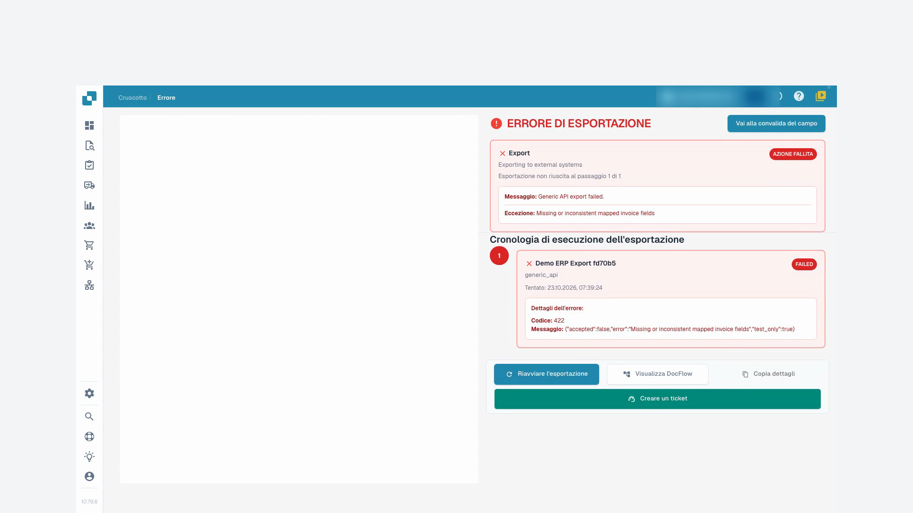
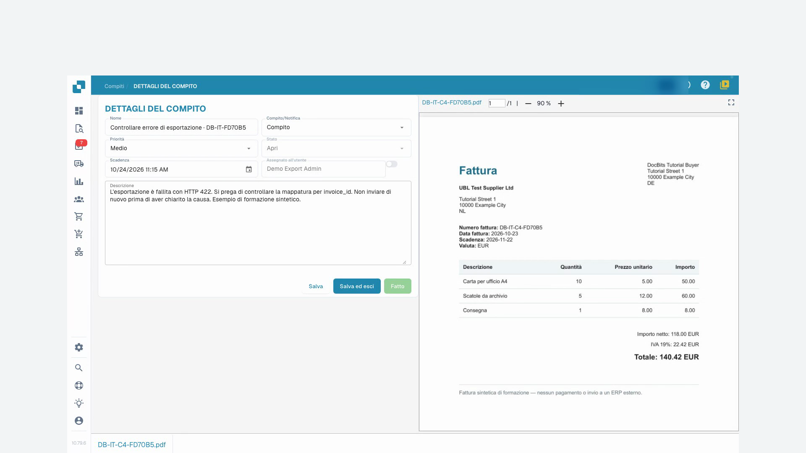

# Stato dei documenti

Gli stati di elaborazione indicano passaggi come OCR, classificazione o esportazione. **Pronto per la convalida** indica che il documento può essere verificato. Gli stati di approvazione indicano un’approvazione in attesa. **Esportato** indica che l’esportazione del documento è terminata. Fai clic sullo stato **Errore** per consultare i dettagli disponibili.

Se sono disponibili i tempi di elaborazione, passa il puntatore sullo stato per vedere le fasi e la loro durata. Per i documenti con possibili duplicati compare un’icona: aprila per confrontare i documenti correlati.

Apri una riga per lavorare nella schermata di convalida. Il menu delle azioni offre le operazioni consentite, come assegnazione, download, cronologia o riavvio dell’elaborazione. Le varianti di download dipendono dal documento e possono includere annotazioni o formati di fattura elettronica.

Seleziona più documenti con le caselle e apri il menu nell’intestazione per le azioni collettive consentite: assegnazione, unione, riavvio, riavvio dell’esportazione o eliminazione. Controlla selezione e conferme. Queste azioni possono modificare i documenti; salvare una vista cambia solo la presentazione dell’elenco.

La [guida alla dashboard](README.md) descrive ricerca, azioni e viste salvate.

## Video tutorial: Gestire le fatture bloccate

Il personaggio e la voce sono sintetici. La registrazione mostra la vera interfaccia di test DocBits con fatture di formazione sintetiche.


Gestire le fatture bloccate


[Guarda con sottotitoli e capitoli](https://docbits-videos.fra1.cdn.digitaloceanspaces.com/settings-assistant/blocked-invoices-customer/v1/it.html)

Alcune etichette native possono rimanere in un’altra lingua. Gli identificatori tecnici dei campi sono conservati.

Apro la fattura nella validazione dei campi. In questo esempio, manca il numero di fattura. Gli altri valori sono già compilati. Li confronto con l'originale prima di modificare qualsiasi cosa.

Ora inserisco il numero di fattura e lascio il campo. Dopodiché, salvo la fattura. Aspetto il riscontro e ricarico il documento. In questo modo vedo se la correzione viene davvero mantenuta.

Il numero è ancora presente dopo averlo riaperto. L'errore del campo obbligatorio è risolto. Tuttavia, il salvataggio non significa che la fattura sia stata approvata o esportata nell'ERP.

Per una seconda fattura, l'elenco mostra un errore di esportazione. Apro lo stato e leggo i dettagli. Il destinatario di test ha rifiutato i dati trasmessi con il codice di errore 422. Qui è necessario verificare la mappatura tecnica. Non mi limito a riavviare l'esportazione più volte.

<figure><figcaption>
Errore di esportazione e risposta del destinatario
</figcaption></figure>

Tra le attività del documento, creo un’attività precisa per il nostro amministratore di test. Indico il codice di errore e gli chiedo di verificare il numero di fattura nella mappatura. Per questa formazione, l’invio di e-mail rimane disattivato.

Dopo aver ricaricato, verifico che l'attività sia salvata e assegnata alla persona giusta. L'attività rimane aperta finché la causa non viene chiarita. Creare un'attività non equivale ancora a un'esportazione riuscita.

<figure><figcaption>
Attività salvata e assegnata all’amministratore
</figcaption></figure>
