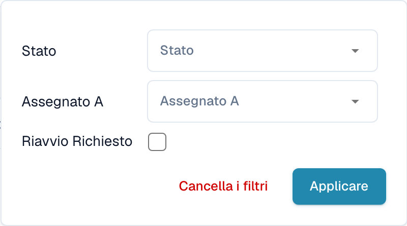

# Filtrare i documenti

Nella dashboard, seleziona l’icona **Filtri** (tre cursori) all’estremità destra della barra di ricerca. Puoi limitare l’elenco per **Stato**, **Assegnato a** o **Riavvio richiesto**.

<figure><figcaption>
Filtri della dashboard per assegnazione e necessità di riavvio.
</figcaption></figure>

Scegli lo stato o la persona responsabile prevista, quindi seleziona **Applicare**. Cancellare i filtri per rimuovere le limitazioni. Le opzioni di data dipendono da configurazione e vista. Verificare i filtri attivi prima di interpretare il numero dei documenti.
