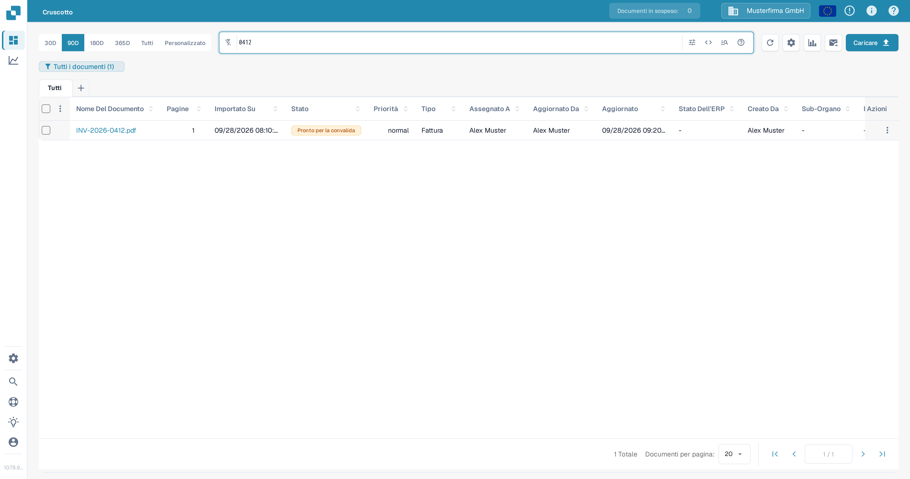
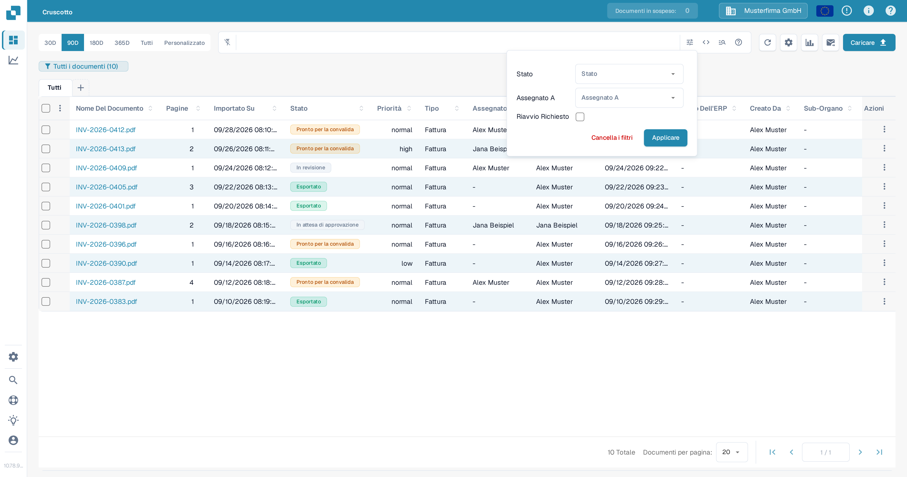
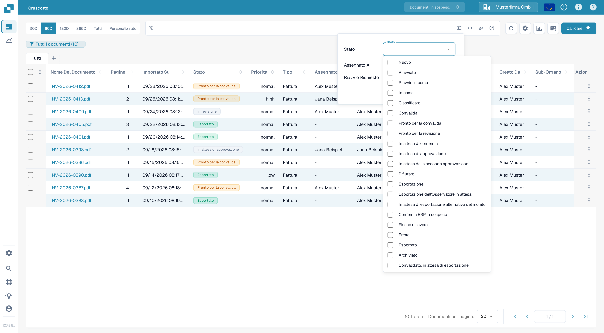
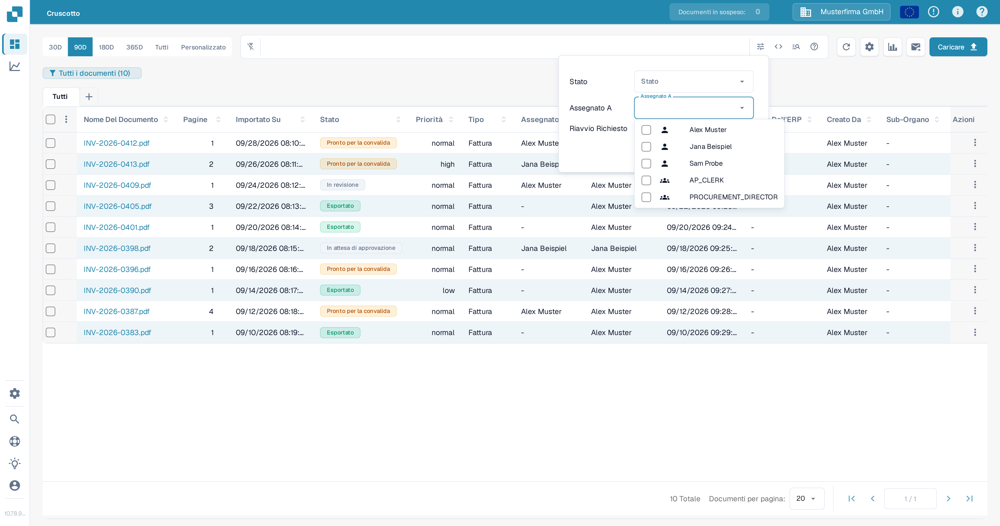
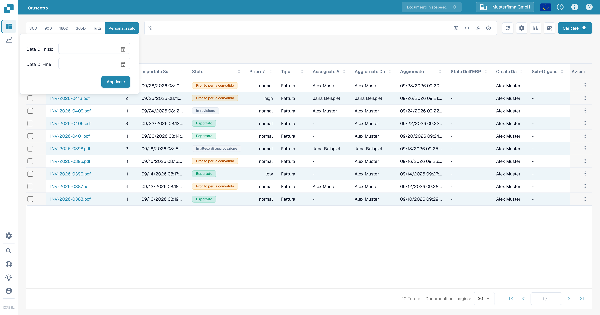
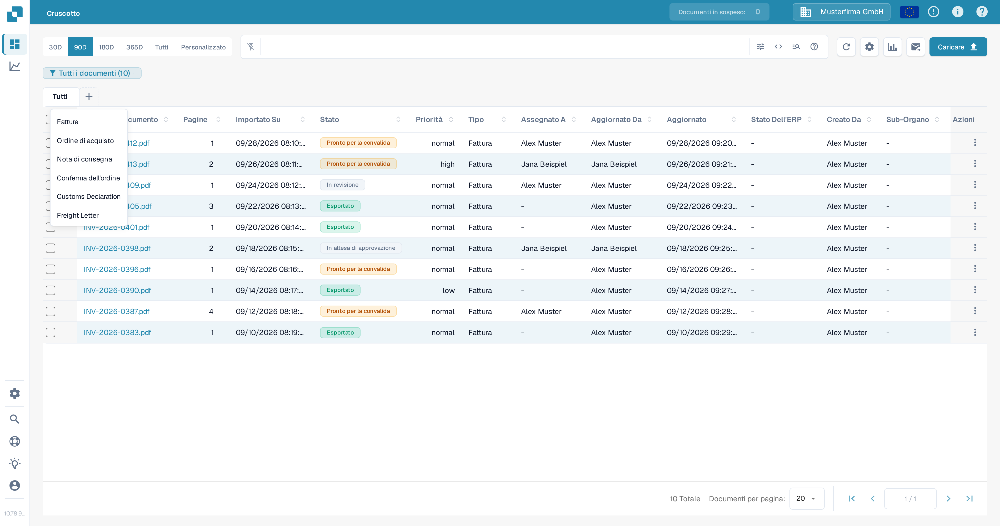
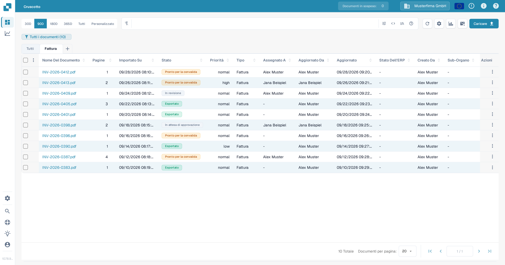

# Filtraggio dei documenti

Usa la barra di ricerca del Cruscotto, il pannello dei filtri, l'intervallo di date e le schede dei tipi di documento per restringere l'elenco dei documenti. I controlli funzionano insieme: un documento deve corrispondere alla ricerca e ai filtri attivi per restare nella tabella.

## Trova un documento per nome

1. Apri il **Cruscotto**.
2. Inserisci parte del nome di un documento nella barra di ricerca sopra la tabella e premi **Invio**. Il conteggio nel badge del cruscotto e la tabella si aggiornano per mostrare i documenti corrispondenti.
3. Sostituisci il termine di ricerca quando vuoi cercare un altro documento. Per le ricerche nei campi e la sintassi di ricerca, vedi [Ricerca rapida](quick-search.md).

<figure><figcaption>
Una ricerca per nome restringe l'elenco dei documenti.
</figcaption></figure>

## Filtra per stato, assegnatario o riavvio richiesto

1. Seleziona l'icona **Filtri** (cursori) all'estremità destra della barra di ricerca.
2. Scegli uno o più valori di **Stato**. Puoi selezionare più stati contemporaneamente.
3. In **Assegnato A**, seleziona gli utenti di cui vuoi vedere i documenti. Se la tua organizzazione ha abilitato i permessi di gruppo, i gruppi possono comparire nello stesso elenco. In questo pannello non esiste un campo separato **Assegnato al gruppo**.
4. Seleziona **Riavvio Richiesto** per mostrare i documenti che richiedono un riavvio.
5. Seleziona **Applicare**. Seleziona **Cancella i filtri** in questo pannello per rimuovere queste selezioni; il testo di ricerca e l'intervallo di date sono controlli separati.

<figure><figcaption>
Il pannello dei filtri attuale ha tre criteri e due azioni.
</figcaption></figure>

<figure><figcaption>
Seleziona gli stati di elaborazione che ti servono.
</figcaption></figure>

<figure><figcaption>
Seleziona un utente da Assegnato A.
</figcaption></figure>

Per la spiegazione di ogni stato di elaborazione, vedi [Stato del Documento](document-status.md).

## Scegli un intervallo di date di importazione

Sopra la barra di ricerca, seleziona **30D**, **90D**, **180D**, **365D** o **Tutti** per cambiare l'intervallo della data di importazione. Seleziona **Personalizzato**, scegli **Data Di Inizio** e **Data Di Fine**, quindi seleziona **Applicare** per un intervallo specifico. La scelta attuale è evidenziata.

<figure><figcaption>
Usa Personalizzato quando gli intervalli preimpostati non bastano.
</figcaption></figure>

## Usa le schede dei tipi di documento

1. Seleziona **+** accanto a **Tutti**. Il menu elenca i tipi di documento disponibili per la tua organizzazione.
2. Seleziona un tipo, ad esempio **Fattura**, per aggiungere la sua scheda. Poi seleziona la nuova scheda per filtrare la tabella su quel tipo. **Tutti** rimuove la restrizione del tipo senza eliminare la scheda.
3. Per rimuovere una scheda di tipo, seleziona la sua **×**. La scheda **Tutti** non può essere rimossa.

<figure><figcaption>
Aggiungi una scheda di tipo di documento dal menu più.
</figcaption></figure>

<figure><figcaption>
Scegli la scheda per applicare il filtro di tipo; usa × per rimuovere la scheda.
</figcaption></figure>

Se il menu **+** non mostra tipi, chiedi a un amministratore di verificare quali tipi di documento sono attivi per la tua organizzazione. Vedi [Document Types](../../../administration-and-setup/settings/global-settings/document-types/README.md). Per salvare una combinazione di filtri per dopo, vedi [Cruscotti personali](personal-dashboards.md).