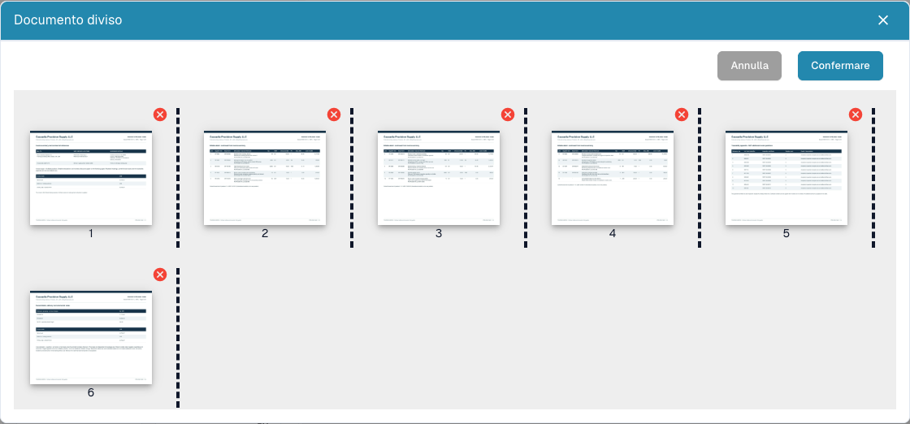

# Dividere un PDF e organizzare le pagine

<figure><figcaption>
Miniature, separatori e comandi di rimozione prima di inviare una divisione.
</figcaption></figure>

Usare la divisione manuale quando un PDF contiene documenti indipendenti: per esempio fattura A alle pagine 1–3, fattura B alle pagine 4–7 e documento di trasporto alle pagine 8–10. Ogni documento deve proseguire separatamente.

## Preparazione

Servono autorizzazione alla modifica e un documento con più pagine. Conservare l'originale. Chiarire eventuali blocchi con la persona responsabile prima di modificare.

## Procedura

1. Aprire il documento dalla dashboard e verificare tutte le pagine originali.
2. Nel visualizzatore, aprire le opzioni aggiuntive e scegliere la divisione del documento.
3. Controllare le miniature numerate. Posizionare i separatori dopo l'ultima pagina di ciascun documento: **3** e **7** nell'esempio.
4. Trascinare le miniature per correggere l'ordine. Ricontrollare ordine e separatori.
5. Rimuovere una pagina con la **croce rossa** solo se va esclusa. Una pagina separatrice vuota può essere superflua; un dettaglio fiscale o un allegato può essere essenziale.
6. Scegliere **Confermare**, leggere la richiesta e procedere quando i gruppi sono corretti. **Annulla** esce senza inviare la divisione.
7. Aprire ogni documento risultante nella dashboard. Verificare prima/ultima pagina, numero di pagine, tipo e valori estratti.

## Controllo e problemi

Ogni pagina originale deve appartenere a un documento previsto o essere esclusa intenzionalmente. La divisione non dimostra estrazione, approvazione o esportazione ERP riuscite.

Se manca l'opzione, controllare pagine, permessi, blocco e stato. Senza separatori, riordino o rimozioni può comparire un avviso di assenza di modifiche. Dopo un errore, verificare la dashboard prima di ripetere un'operazione dal risultato incerto.

Vedere [Unione documenti](document-merging.md) e [Classificazione ed estrazione](../../../administration-and-setup/settings/document-processing/classification-and-extraction/README.md) per la divisione automatica tramite barcode.
