# Ricerca rapida

La **Ricerca rapida** è il modo più veloce per trovare i documenti nella Dashboard. Digiti ciò che cerchi — un nome, uno stato, un importo, una data — e
l'elenco dei documenti si filtra all'istante.

Questa guida è organizzata secondo la struttura della ricerca:

1. **Campi standard** — le colonne che ha ogni documento (nome del documento, stato,
   date). Sempre disponibili.
2. **Campi fulltext** — contenuto estratto (fornitore, ordine di acquisto, numero
   fattura, importi, righe articolo). Disponibili quando la ricerca fulltext è attiva.
3. **Operatori, scorciatoie e ricette** — il riferimento completo, quando
   hai preso confidenza.

> Non devi memorizzare nulla: clicca sulla barra di ricerca e scegli un campo e
> un valore dall'elenco — la Ricerca rapida costruisce la query per te. Gli esempi qui sotto
> mostrano anche la forma digitata, così puoi copiarli direttamente.

<figure>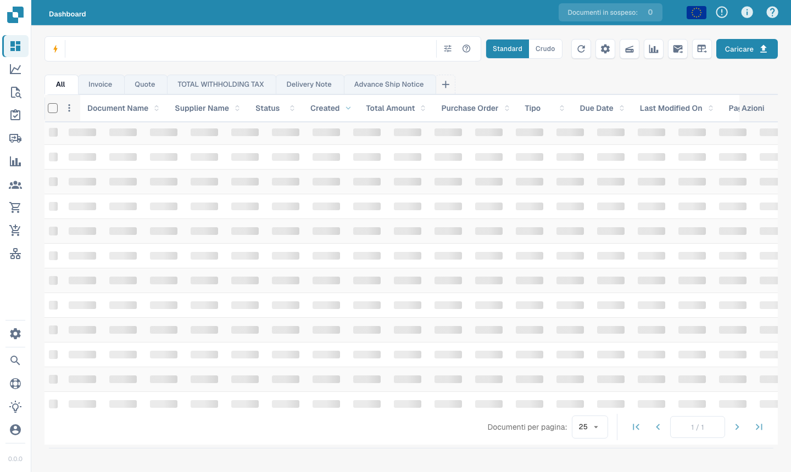<figcaption><p>La barra Ricerca rapida in cima alla Dashboard.</p></figcaption></figure>

---

## Come funziona la barra di ricerca — chip, barra degli strumenti e vista grezza

Prima dei campi veri e propri, è utile sapere come è organizzata la barra.

### Le condizioni diventano chip

Quando completi una condizione (un campo, un operatore e un valore) la Ricerca rapida
la trasforma in un **chip** — una pillola colorata all'interno della barra — e ne avvia uno nuovo. Un
chip mostra il **campo**, l'**operatore** e il **valore**, con una **×** per
rimuoverlo. I chip sono codificati per colore in base a dove risiedono i dati:

| Colore del chip | Tipo di campo |
|-------------|------------|
| **Blu** | Colonna standard (nome del documento, stato, date) |
| **Arancione** | Campo fulltext / estratto (fornitore, importo, numero fattura) |
| **Viola** | Ricerca vettoriale (semantica) |
| **Verde** | Ricerca nel testo OCR |

Clicca su un chip per modificarlo (torna a essere testo); clicca su **×** per eliminarlo.
Più chip combinati vengono letti come **AND** per impostazione predefinita.

### La barra degli strumenti

All'estremità destra della barra:

- **ⓘ Guida** — apre il riferimento integrato **Dashboard Search — Fields & Syntax**
  che elenca tutti i campi, gli operatori e le scorciatoie disponibili nel tuo workspace.
- **Filtri (tune)** — un pannello rapido per i filtri più comuni Stato / Utente / Riavvio,
  con **Clear filters** e **Apply**.
- **Anello dell'indice** — un piccolo anello di avanzamento che mostra quanta parte dell'indice fulltext
  è stata costruita (visibile solo quando la ricerca fulltext è attiva).

### Vista standard e vista grezza

La barra normalmente mostra la tua query come chip (**vista standard**). Passa alla **vista
grezza** per vedere e modificare la query come testo semplice (ad es.
`status=ready_for_validation AND supplier_name=Test`) — utile per copiare,
condividere o digitare direttamente una query lunga. La tua query resta valida dopo il passaggio e
viene ricordata quando ricarichi la Dashboard.

---

## Parte 1 — Campi standard

I campi standard sono le colonne proprie del documento. Sono **sempre disponibili**,
che la ricerca fulltext sia attiva o meno.

### Trovare documenti per nome

Il nome del documento è la ricerca più comune. Ci sono tre modi per cercarlo —
tutti **senza distinzione tra maiuscole e minuscole**:

#### `=` → inizia con

```
filename=invoice
```

Trova i documenti il cui nome **inizia con** «invoice». La ricerca ignora le maiuscole, quindi
tutti questi corrispondono a `filename=invoice`:

```
Invoice.pdf   iNVoice.pdf   iNvoiCE.pdf   INVOICE.pdf
Invoice.xml   iNVoice.xml   iNvoiCE.edi   …
```

**Non** corrisponde a `XYZ_Invoice.pdf` (qui «invoice» è nel mezzo — usa
`:` per questo caso).

<figure><figcaption><p><code>filename=invoice</code> — solo i nomi che <strong>iniziano con</strong> «invoice», con qualsiasi capitalizzazione (<code>Invoice.pdf</code>, <code>iNVoice.pdf</code>, <code>INVOICE_2026.pdf</code> … corrispondono tutti). Confronta con <code>:</code> qui sotto.</p></figcaption></figure>

#### `:` → contiene (ovunque)

```
filename:invoice
```

Usa `:` per cercare la parola **ovunque** nel nome — `2026_Invoice.pdf`,
`vietnam_einvoice_sample.xml`, `scan_invoice_copy.pdf`.

<figure>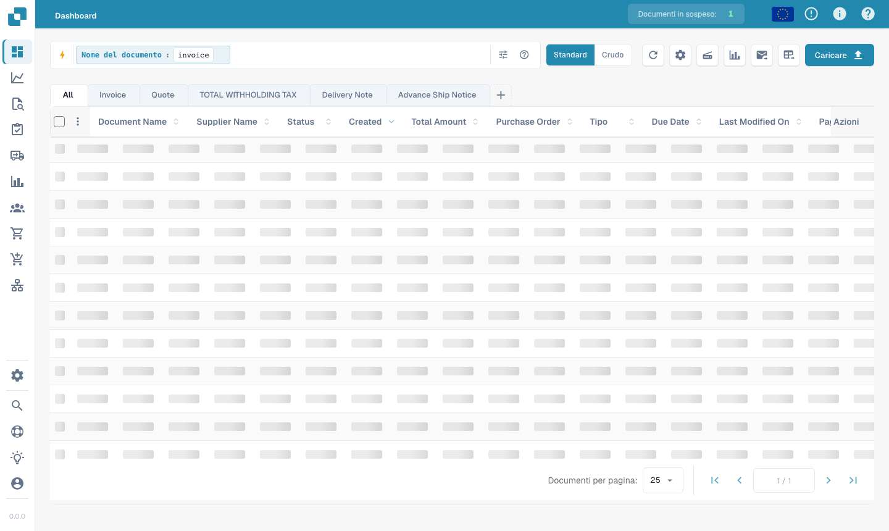<figcaption><p><code>filename:invoice</code> — corrisponde alla parola in qualsiasi punto del nome del documento.</p></figcaption></figure>

#### `="…"` → inizia *o* finisce con

```
filename="invoice"
```

Con le virgolette, `=` corrisponde ai nomi che **iniziano o finiscono** con il valore —
comodo per un codice iniziale o per la fine di un file.

> **Le tre in una riga:** `=` → inizia con · `:` → contiene · `="…"` →
> inizia o finisce con. Tutte ignorano maiuscole e minuscole. Puoi vedere questo riepilogo
> in qualsiasi momento tramite l'**icona della guida** nella barra di ricerca (sezione successiva).

### Trovare documenti per stato

```
status=ready_for_validation
```

Lo stato è un elenco fisso, quindi `=` è una corrispondenza **esatta** e la barra offre un selettore di valori
quando digiti `status=`.

<figure><figcaption><p><code>status=ready_for_validation</code> — corrispondenza esatta su un campo con elenco fisso.</p></figcaption></figure>

### Trovare documenti per data

```
created_on>2026-05-25
```

Usa `>`, `<`, `>=`, `<=` per gli intervalli di date. Puoi usare anche date **relative**:
`today()`, `today()-7` (ultimi 7 giorni), `today()+30` (prossimi 30 giorni).

<figure>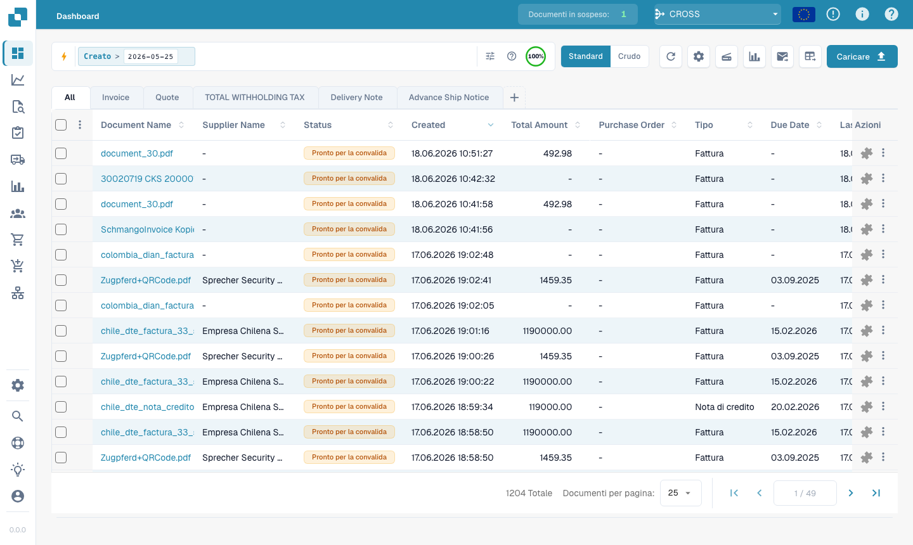<figcaption><p><code>created_on&#62;2026-05-25</code> — documenti creati dopo una data.</p></figcaption></figure>

### Trovare documenti per sotto-tipo di fattura

```
invoice_sub_type="Cost Invoice"
```

Il sotto-tipo di fattura è un elenco fisso (ad esempio **Cost Invoice** o **Purchase
Invoice**), quindi `=` è una corrispondenza **esatta** e la barra offre un selettore di valori quando
digiti `invoice_sub_type=`. Usa `invoice_sub_type!="Cost Invoice"` per
tutto tranne quel sotto-tipo.

---

## Parte 2 — Campi fulltext

I campi fulltext cercano nel **contenuto estratto** dei tuoi documenti — fornitore,
ordine di acquisto, numero fattura, importi, righe articolo. Appaiono in **arancione**
e sono disponibili quando la **ricerca fulltext è attiva** per la tua organizzazione. Le
regole di corrispondenza sono esattamente le stesse dei campi di testo standard
(`=` inizia con, `:` contiene, `="…"` inizia o finisce con).

### Trovare documenti di un fornitore

```
supplier_name=Test
```

Inizia con, applicato al nome del fornitore estratto. Usa `supplier_name:fuji` per cercare
ovunque, oppure `supplier_name:"Ruiz Foods"` per racchiudere tra virgolette un valore con spazi.

<figure><figcaption><p><code>supplier_name=Test</code> — il fornitore di ogni risultato inizia con «Test».</p></figcaption></figure>

### Trovare documenti per ordine di acquisto

```
purchase_order=PO
```

Inizia con, applicato al numero PO estratto — ottimo per un prefisso PO.

<figure>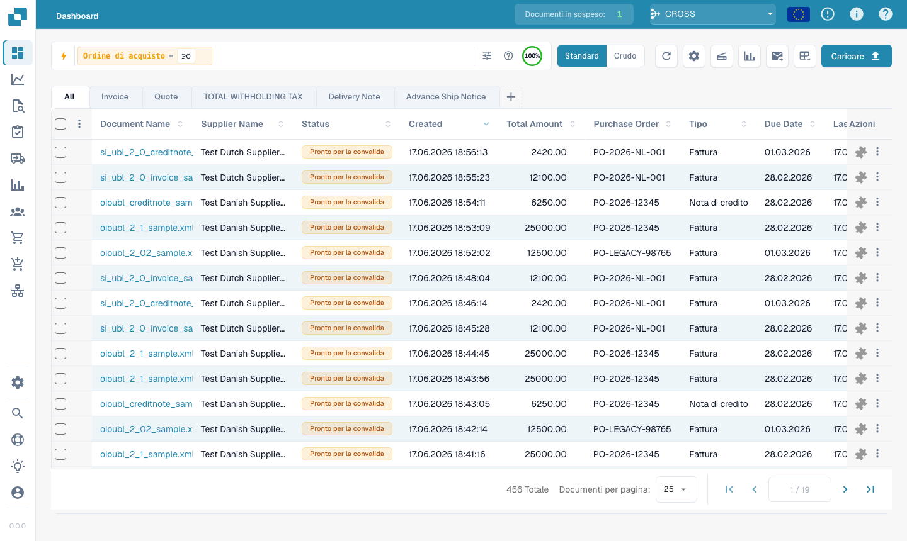<figcaption><p><code>purchase_order=PO</code> — documenti il cui numero PO inizia con «PO».</p></figcaption></figure>

### Trovare documenti per importo

```
total_amount>5000
```

Usa `>`, `<`, `>=`, `<=` oppure `between 100 and 500` per un intervallo.

<figure>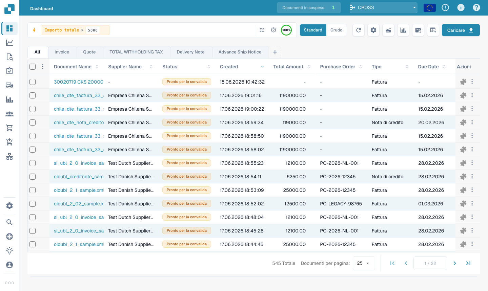<figcaption><p><code>total_amount&#62;5000</code> — fatture superiori a 5.000.</p></figcaption></figure>

Per una finestra di valori usa `between`:

```
total_amount between 1000 and 5000
```

È un'abbreviazione di `total_amount>=1000 AND total_amount<=5000`.

<figure>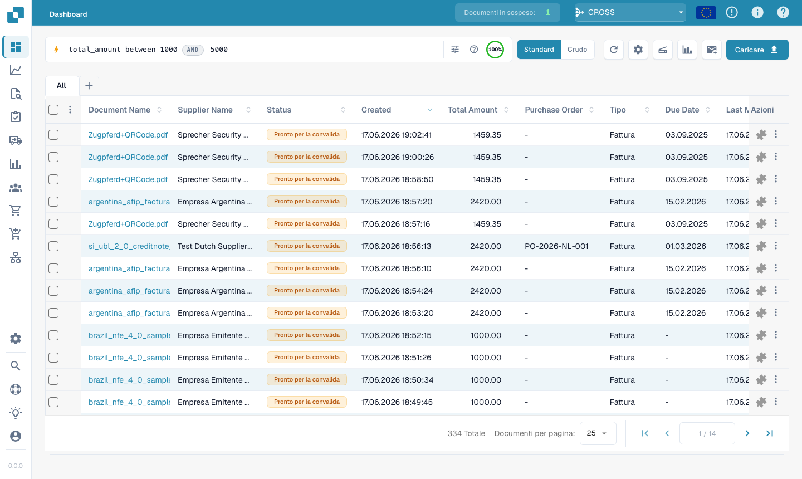<figcaption><p><code>total_amount between 1000 and 5000</code> — ogni risultato rientra nella finestra.</p></figcaption></figure>

### Trovare ciò che manca

```
supplier_name=""
```

`=""` significa «questo campo **non è impostato**»; `supplier_name!=""` significa «ha un
qualsiasi fornitore».

<figure>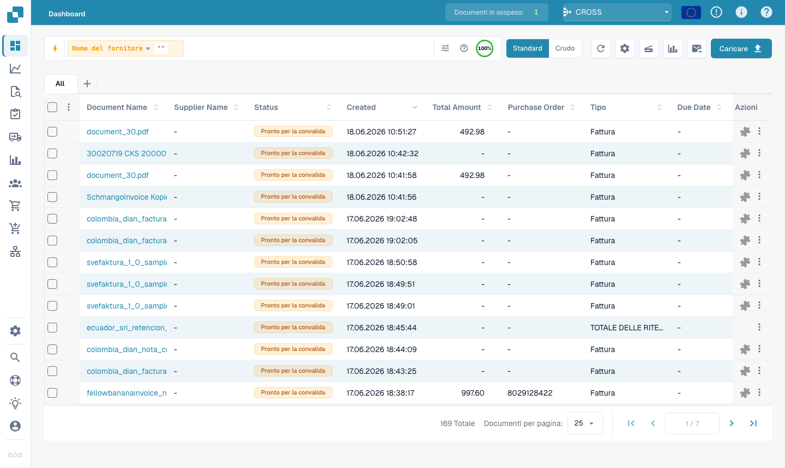<figcaption><p><code>supplier_name=""</code> — documenti che non hanno ancora un fornitore.</p></figcaption></figure>

Lo stesso controllo di presenza funziona su qualsiasi campo — ad esempio per i documenti a cui
manca ancora un codice di assegnazione AP:

```
ap_assignment_code=""
```

<figure>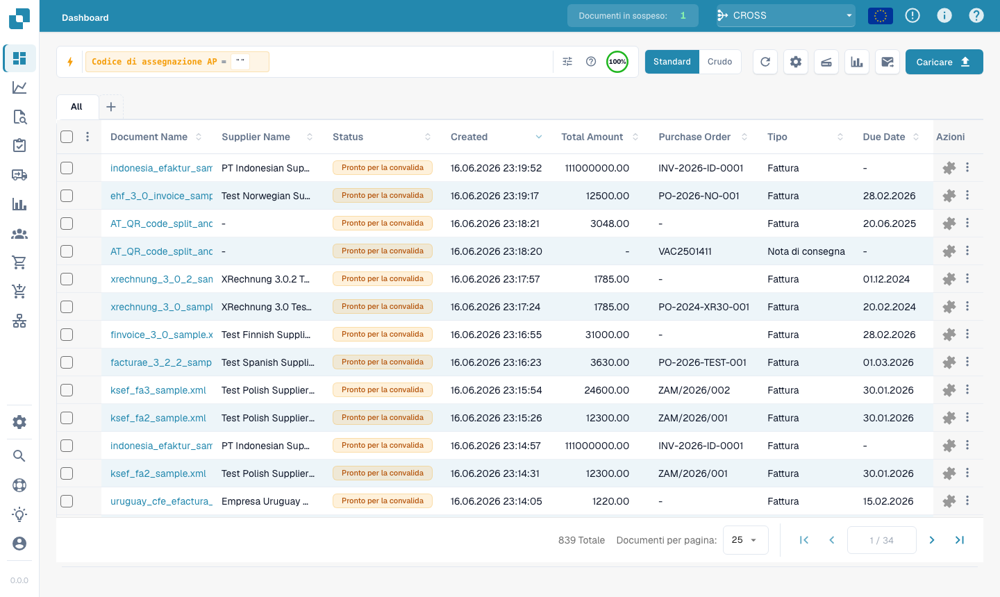<figcaption><p><code>ap_assignment_code=""</code> — documenti che non hanno un codice di assegnazione AP. Usa <code>ap_assignment_code!=""</code> per quelli che ce l'hanno.</p></figcaption></figure>

---

## Smart Filters — con un clic

In cima al menu a discesa della Ricerca rapida (clicca sulla barra di ricerca) trovi gli
**Smart Filters**: ricerche già pronte che applichi con un solo clic. Ognuno
è semplicemente una scorciatoia per una query che potresti anche digitare tu stesso:

| Smart Filter | Trova | Equivale a digitare |
|--------------|-------|----------------|
| ⚠️ **Overdue** | Scaduti | `invoice_due_date<today()` |
| 🕐 **Due soon** | Entro i prossimi 7 giorni | `invoice_due_date<=today()+7` |
| 👤 **Assigned to me** | Elementi in attesa di una tua azione | `assigned_to=<you>` |
| 📅 **Today's inbox** | Importati oggi | `imported_on>=today()` |
| 📋 **Pending validation** | Pronti per la validazione | `status=ready_for_validation` |
| 🧾 **Electronic documents** | Fatture elettroniche (XML, ZUGFeRD, EDI) | `is_edoc=true` |
| ✅ **Full PO match** | Corrispondenza completa con un ordine di acquisto | `po_match_status=full_matched` |
| ➗ **Partial PO match** | Corrispondenza parziale con un ordine di acquisto | `po_match_status=partial_matched` |
| 📉 **Under PO match** | Quantità o prezzo unitario inferiori all'ordine di acquisto | `po_match_status=under_matched` |

I tre filtri **PO match** e i campi fulltext richiedono che la ricerca fulltext
sia attiva per la tua organizzazione.

<figure>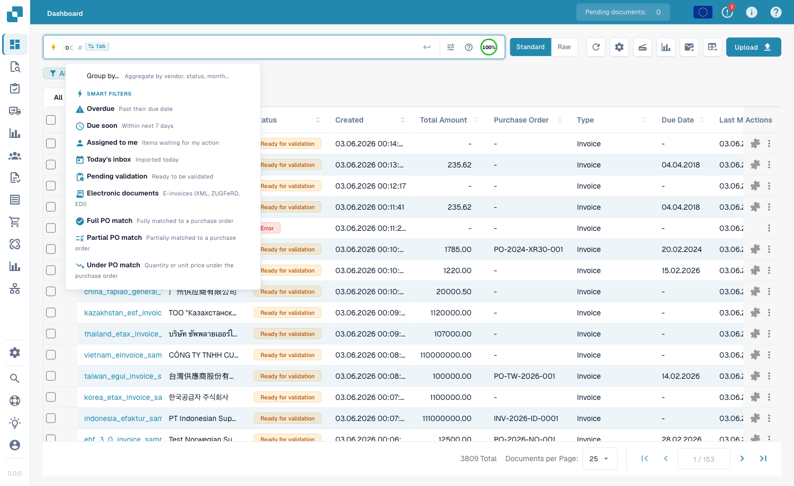<figcaption><p>Gli Smart Filters in cima al menu a discesa della Ricerca rapida — un clic applica il filtro (Overdue, Due soon, Assigned to me, Today's inbox, Pending validation, Electronic documents, Full / Partial / Under PO match).</p></figcaption></figure>

---

## Raggruppare i risultati

Invece di un elenco piatto, puoi **raggruppare** i risultati per qualsiasi campo — fornitore,
stato, tipo di documento, sotto-organizzazione o un intervallo di date. Aggiungi un raggruppamento dalla
barra di ricerca:

```
group by supplier_name
```

L'elenco mostra quindi **intestazioni di gruppo** comprimibili, ciascuna con il nome del gruppo e
un **conteggio** (ad es. *Ruiz Foods (12)*). Clicca su un'intestazione per espandere o comprimere quel
gruppo. Per i campi data puoi raggruppare per **giorno, settimana o mese**.

<figure>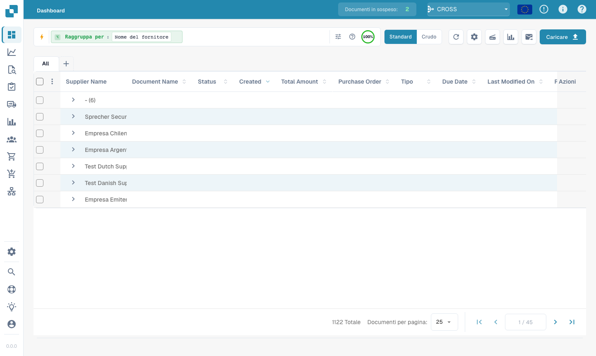<figcaption><p><code>group by supplier_name</code> — i risultati si raggruppano in un'intestazione espandibile per ogni fornitore.</p></figcaption></figure>

Il raggruppamento si combina con qualsiasi filtro — `status=ready_for_validation group by
supplier_name` raggruppa solo i documenti corrispondenti. Cliccando su un gruppo si
**approfondisce**: il valore di quel gruppo viene applicato come filtro e torni
all'elenco piatto per quella selezione.

---

## Parte 3 — Operatori, connettori, scorciatoie

### La guida integrata

L'**icona della guida** nella barra di ricerca apre un riferimento completo di tutti i campi,
gli operatori e le scorciatoie disponibili nel tuo workspace — compreso quali campi sono
standard e quali fulltext.

<figure><figcaption><p>La guida integrata <strong>Dashboard Search — Fields &#38; Syntax</strong>, che elenca ogni operatore e come vengono confrontati i valori.</p></figcaption></figure>

### Come corrisponde `=`, per tipo di campo

Tutte le corrispondenze di testo ignorano maiuscole e minuscole.

| Tipo di campo | Esempio | `=` significa |
|------------|---------|-----------|
| Testo (nome, fornitore, ordine di acquisto) | `filename=invoice` | **inizia con** |
| Testo, ovunque | `filename:invoice` | **contiene** |
| Testo, inizio *o* fine | `filename="invoice"` | **inizia o finisce con** |
| Stato / tipo / PO match (elenchi fissi) | `status=finished` | **esatto** |
| Identificatori (numero fattura, id fornitore) | `invoice_number=INV-100` | **esatto** |
| Numero | `total_amount>5000` | intervallo (`> < >= <= between`) |
| Data | `created_on>2026-01-01` | intervallo + `today()±N` |

### Operatori

| Operatore | Significato |
|----------|---------|
| `=` | inizia con (testo) / esatto (elenco, numero, data) |
| `:` | contiene (testo, ovunque) |
| `="…"` | inizia o finisce con (testo) |
| `!=` | l'opposto di `=` |
| `>` `<` `>=` `<=` | maggiore / minore di |
| `between … and …` | intervallo inclusivo |
| `field=""` / `field!=""` | è vuoto / è impostato |
| `today()`, `today()-7`, `today()+30` | date relative |

### Connettori

Combina le condizioni con **AND** (entrambe vere), **OR** (una delle due), **NOT** e
le parentesi `( … )` per raggruppare:

```
status=ready_for_validation AND supplier_name=Test
(status=error OR status=failed) AND created_on>today()-1
```

<figure>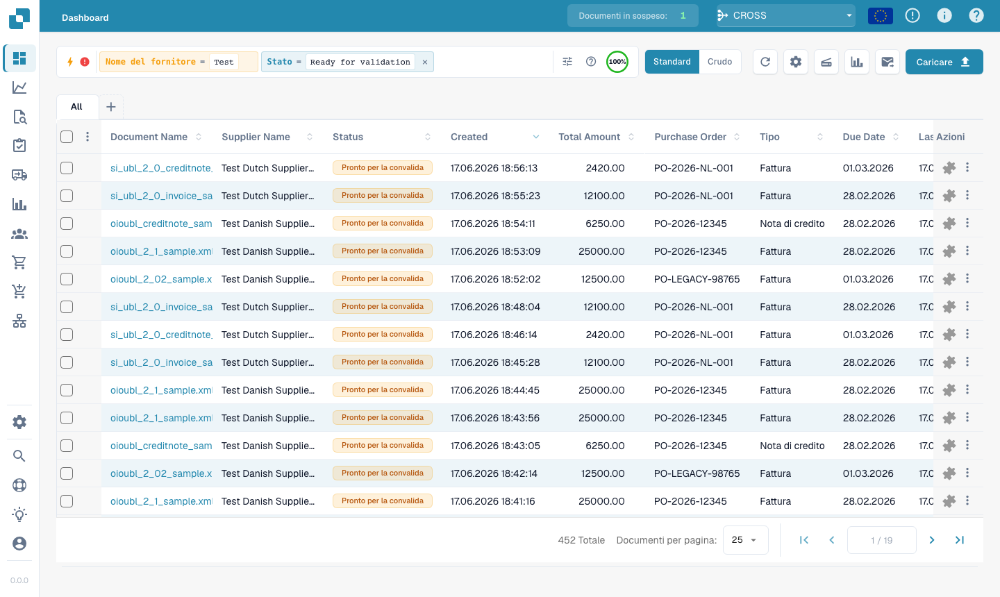<figcaption><p><code>status=ready_for_validation AND supplier_name=Test</code> — due condizioni combinate.</p></figcaption></figure>

### Scorciatoie

Formulazioni più brevi per le stesse query — usa quella che ti sembra più leggibile:

| Scorciatoia | Equivale a | Descrizione |
|-------------|------------|-------------|
| `total_amount gt 5000` | `total_amount>5000` | Alias in forma di parola per gli operatori di confronto (`gt`/`gte`/`lt`/`lte`/`eq`/`ne`) |
| `due_date > today` | `due_date>today()` | `today` / `yesterday` / `tomorrow` senza parentesi |
| `imported_on this_week` | `imported_on>=today()-7 AND imported_on<=today()` | Periodi relativi (`this_week`, `last_week`, `this_month`, …) |
| `ap_assignment_code is empty` | `ap_assignment_code=""` | Se un campo ha un valore qualsiasi |
| `status:open` | `status=ready_for_validation` | Etichetta di stato semplificata (`open`/`closed`/`failed`/`done`) |
| `total_amount not between 100, 200` | `total_amount<100 OR total_amount>200` | Valore fuori da una finestra |
| `status in (finished, error)` | `status=finished OR status=error` | Corrisponde a qualsiasi valore di un elenco |
| `not status=finished` | `status!=finished` | Nega qualsiasi predicato |
| `filename contains rechnung` | `filename:rechnung` | Corrispondenza di stringa (`contains`/`starts_with`/`ends_with`) |
| `total_amount > 5k` | `total_amount>5000` | Suffisso di valuta `k` (×1 000), `M` (×1 000 000) |
| `overdue` | `invoice_due_date<today() AND status!=finished` | Fatture non pagate scadute |
| `#INV-1234` | `invoice_id:INV-1234` | Prefisso in stile Twitter per l'id fattura |
| `@User` | `assigned_to:User` | Prefisso in stile Twitter per l'assegnatario |
| `$5000+` | `total_amount>=5000` | Prefisso `$` per le soglie di importo |

### Query con scorciatoie + galleria dei risultati

Questi esempi mostrano ogni schema di scorciatoia con la query da digitare e il risultato mostrato dalla Dashboard. Il primo gruppo usa campi standard e funziona anche quando la ricerca fulltext non è attiva. Il secondo gruppo usa campi solo fulltext come l'importo o la data di scadenza della fattura.

#### Funziona senza fulltext

##### Alias degli operatori

- Query: `created_on gt 2026-05-25`
- Equivale a: `created_on>2026-05-25`
- Risultato: Filtra per Created dopo il 25 maggio 2026.

<figure><figcaption><p><code>created_on gt 2026-05-25</code> - Filtra per Created dopo il 25 maggio 2026.</p></figcaption></figure>

##### Parole per date semplici

- Query: `created_on < today`
- Equivale a: `created_on<today()`
- Risultato: Espande la parola semplice today in today().

<figure><figcaption><p><code>created_on &lt; today</code> - Espande la parola semplice today in today().</p></figcaption></figure>

##### Periodo relativo

- Query: `created_on this_month`
- Equivale a: `created_on>=first day of this month AND created_on<=last day of this month`
- Risultato: Espande this_month in una finestra di date.

<figure>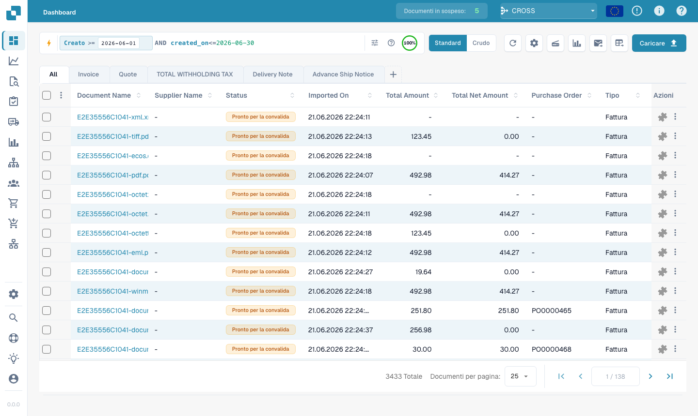<figcaption><p><code>created_on this_month</code> - Espande this_month in una finestra di date.</p></figcaption></figure>

##### Parole per vuoto o impostato

- Query: `assigned_to is empty`
- Equivale a: `assigned_to=""`
- Risultato: Trova i documenti senza assegnatario.

<figure>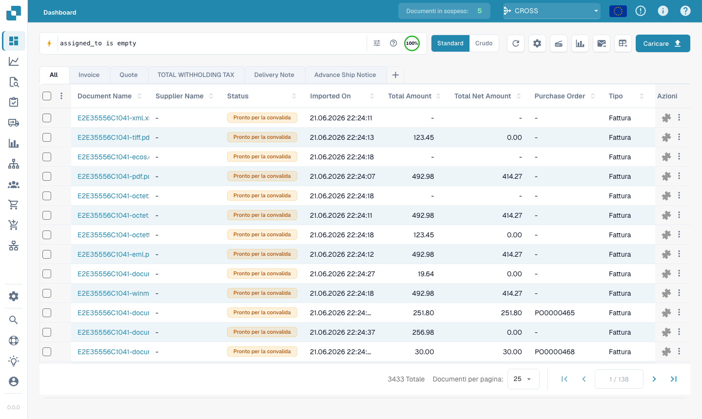<figcaption><p><code>assigned_to is empty</code> - Trova i documenti senza assegnatario.</p></figcaption></figure>

##### Stato semplificato

- Query: `status:open`
- Equivale a: `status=ready_for_validation`
- Risultato: Associa open allo stato di validazione.

<figure>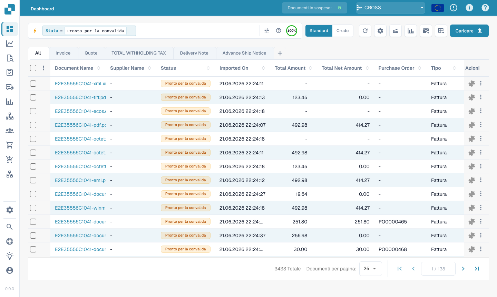<figcaption><p><code>status:open</code> - Associa open allo stato di validazione.</p></figcaption></figure>

##### Not between

- Query: `created_on not between 2026-06-01, 2026-06-15`
- Equivale a: `(created_on<2026-06-01 OR created_on>2026-06-15)`
- Risultato: Trova i valori al di fuori di una finestra di date.

<figure>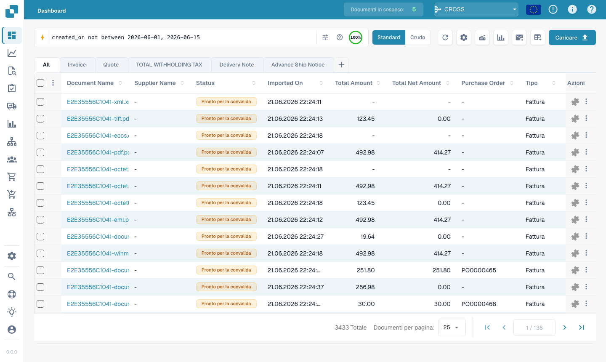<figcaption><p><code>created_on not between 2026-06-01, 2026-06-15</code> - Trova i valori al di fuori di una finestra di date.</p></figcaption></figure>

##### In-list

- Query: `status in (ready_for_validation, exported)`
- Equivale a: `status=ready_for_validation OR status=exported`
- Risultato: Corrisponde a qualsiasi stato elencato.

<figure><figcaption><p><code>status in (ready_for_validation, exported)</code> - Corrisponde a qualsiasi stato elencato.</p></figcaption></figure>

##### Prefisso di negazione

- Query: `not status=finished`
- Equivale a: `status!=finished`
- Risultato: Inverte il predicato dello stato finished.

<figure>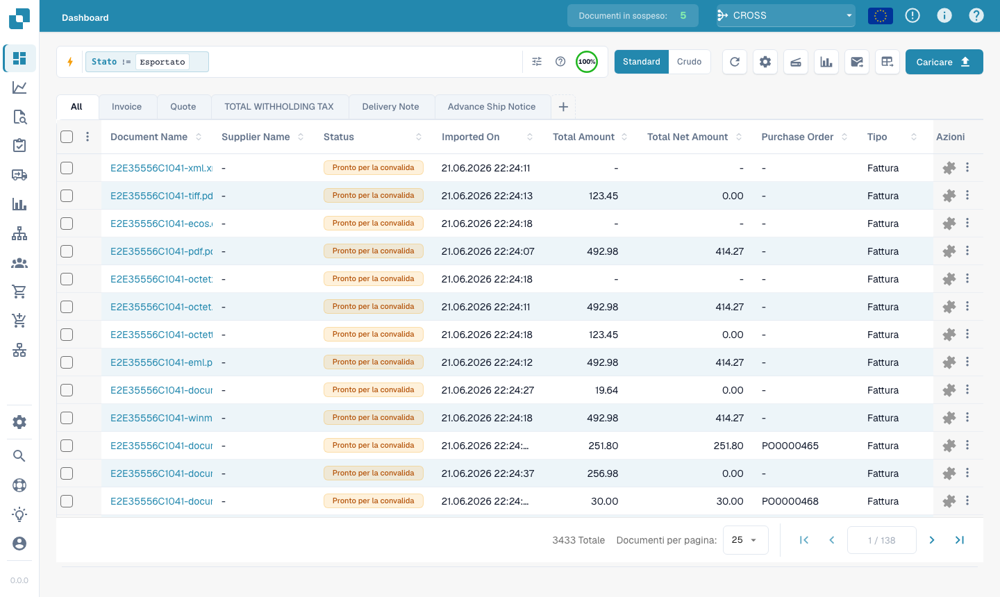<figcaption><p><code>not status=finished</code> - Inverte il predicato dello stato finished.</p></figcaption></figure>

##### La stringa contiene

- Query: `filename contains E2E`
- Equivale a: `filename:E2E`
- Risultato: Usa contains come ricerca di sottostringa nel nome file.

<figure><figcaption><p><code>filename contains E2E</code> - Usa contains come ricerca di sottostringa nel nome file.</p></figcaption></figure>

##### Prefisso fattura

- Query: `#INV-1234`
- Equivale a: `invoice_id:INV-1234`
- Risultato: Associa #... a una ricerca per id fattura.

<figure><figcaption><p><code>#INV-1234</code> - Associa #... a una ricerca per id fattura.</p></figcaption></figure>

##### Prefisso assegnatario

- Query: `@Daniel`
- Equivale a: `assigned_to:"Daniel"`
- Risultato: Associa @... a una ricerca per nome dell'assegnatario.

<figure><figcaption><p><code>@Daniel</code> - Associa @... a una ricerca per nome dell'assegnatario.</p></figcaption></figure>

#### Richiede la ricerca fulltext

Se usi la stessa scorciatoia con un campo solo fulltext, la query richiede comunque il fulltext. Ad esempio, `ap_assignment_code is empty` usa la stessa scorciatoia vuoto/impostato di `assigned_to is empty`, ma il campo di assegnazione AP è solo fulltext.

##### Suffisso di valuta

- Query: `total_amount > 5k`
- Equivale a: `total_amount>5000`
- Risultato: Espande k in migliaia su un campo importo.

<figure>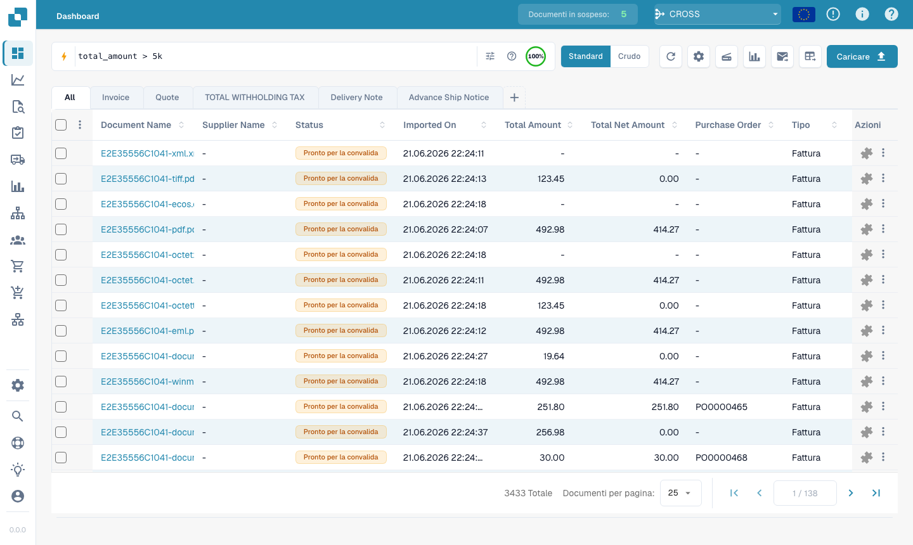<figcaption><p><code>total_amount &gt; 5k</code> - Espande k in migliaia su un campo importo.</p></figcaption></figure>

##### Scorciatoia overdue

- Query: `overdue`
- Equivale a: `invoice_due_date<today() AND status!=finished`
- Risultato: Trova le fatture non completate scadute.

<figure>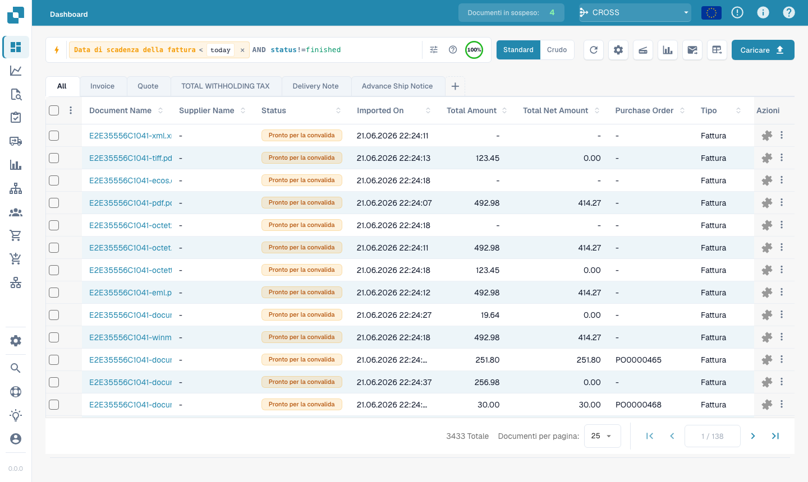<figcaption><p><code>overdue</code> - Trova le fatture non completate scadute.</p></figcaption></figure>

##### Prefisso importo

- Query: `$5000+`
- Equivale a: `total_amount>=5000`
- Risultato: Associa $...+ a una soglia di importo.

<figure><figcaption><p><code>$5000+</code> - Associa $...+ a una soglia di importo.</p></figcaption></figure>

---

## Parte 4 — Modalità di ricerca avanzate

Oltre alla ricerca per campo, tre modalità con prefisso cercano nel contenuto stesso dei documenti.

### Ricerca vettoriale (semantica) — `vector:`

Cerca per **significato**, non per testo esatto — utile per «trovare documenti su XYZ».
Richiede il modulo Vector; si applica al contenuto del documento.

```
vector: invoices about office supplies
vector: shipping delays with Hamburg port
```

<figure>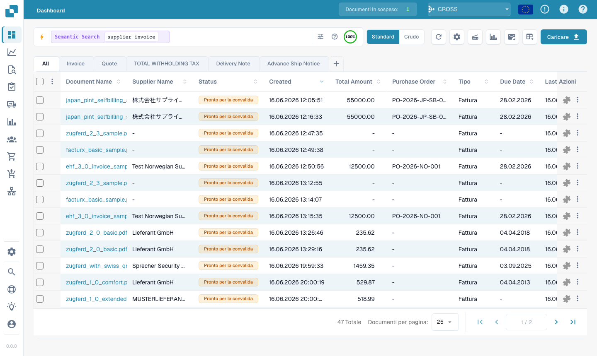<figcaption><p><code>vector: supplier invoice</code> — documenti semanticamente correlati, anche senza quelle parole esatte.</p></figcaption></figure>

### Ricerca nel testo OCR — `ocr:`

Cerca **all'interno del testo delle pagine** estratto dal motore OCR — non solo
nelle colonne strutturate. Utile quando il valore che ricordi si trova nel corpo del documento.

```
ocr: Versandkosten
ocr: "purchase order PO-12345"
ocr: Hamburg AND doc_type=INVOICE
ocr: IBAN
```

<figure>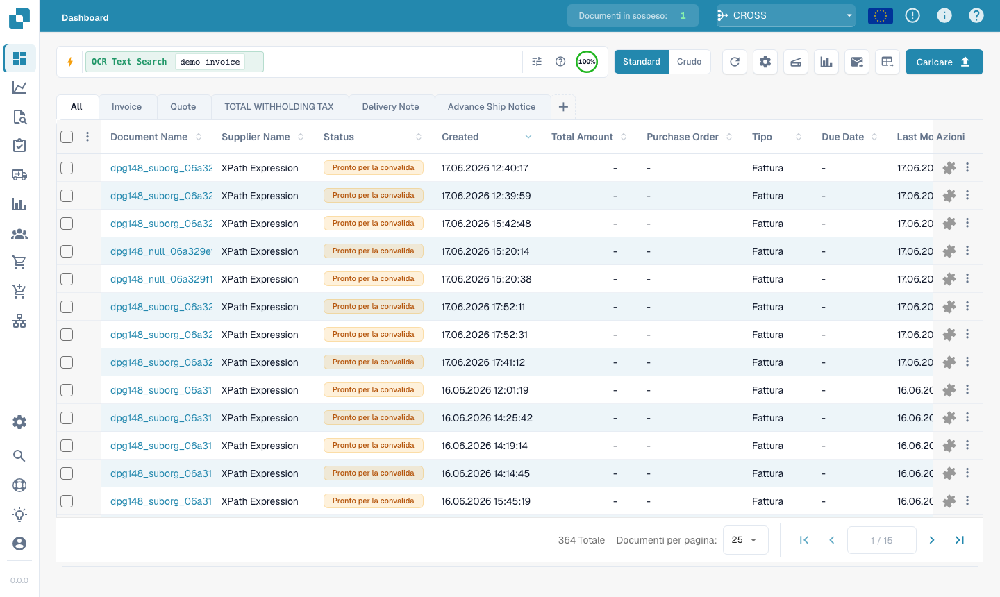<figcaption><p><code>ocr: demo invoice</code> — corrisponde al testo trovato in qualsiasi punto delle pagine del documento.</p></figcaption></figure>

### Ricerca in linguaggio naturale (AI) — `ai:`

Descrivi ciò che vuoi in linguaggio semplice; l'AI legge la tua frase ed estrae
filtri (fornitore, date, importi) in una query strutturata. A differenza di Vector,
**costruisce una query** invece di trovare documenti simili.

```
ai: invoices from Ruiz over 1000 last quarter
ai: overdue invoices waiting on approval
ai: shipping documents from Hamburg last month
```

<figure>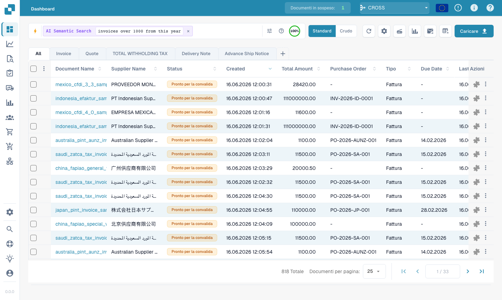<figcaption><p><code>ai: invoices over 1000 from this year</code> — l'AI trasforma automaticamente la frase in filtri.</p></figcaption></figure>

---

### Ricette

| Cosa vuoi… | Digita questo |
|-----------|-----------|
| Pronti per la validazione, con corrispondenza completa | `status=ready_for_validation AND po_match_status=full_matched` |
| Questo fornitore, questa settimana | `supplier_name=Test AND created_on>today()-7` |
| Fatture scadute di importo elevato | `total_amount>5000 AND invoice_due_date<today()` |
| Due fornitori contemporaneamente | `supplier_name=fuji OR supplier_name=acme` |
| Documenti in errore di oggi | `(status=error OR status=failed) AND created_on>today()-1` |
| Note di credito elettroniche | `is_edoc=true AND sub_doc_type=CREDIT_NOTE` |
| Per prefisso dell'ordine di acquisto | `purchase_order=PO-2026` |

> I campi arancioni (fulltext) richiedono che la **ricerca fulltext** sia attiva per la tua
> organizzazione. Un `%` o `_` letterale in un valore viene trattato come un carattere normale.
