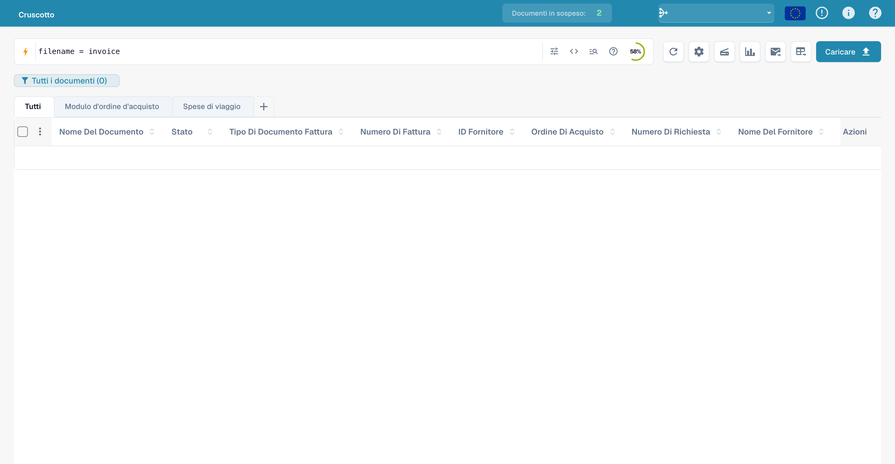
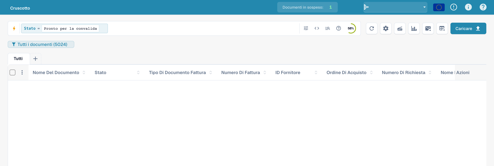
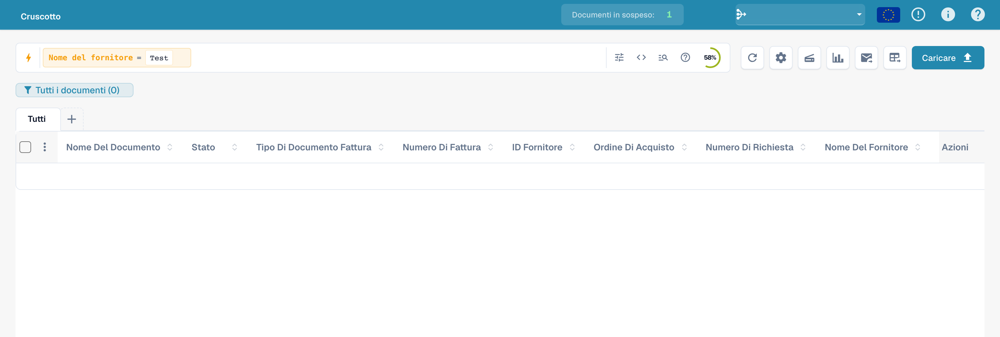
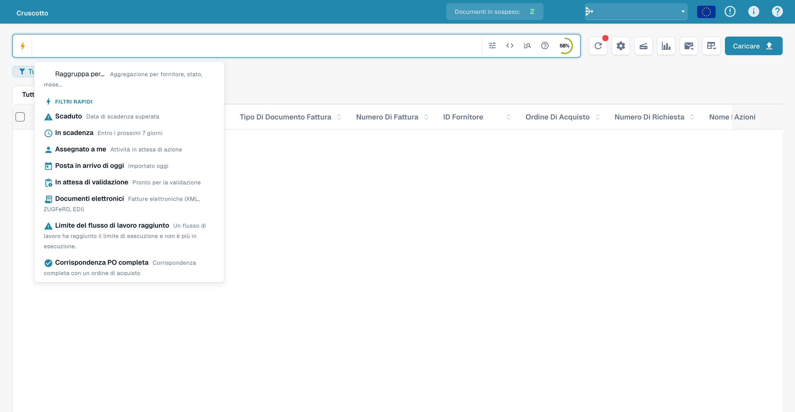
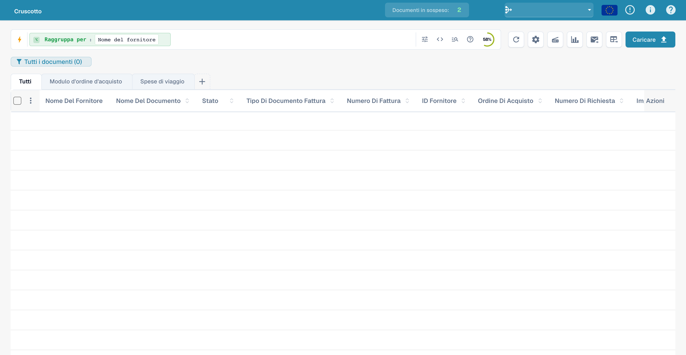
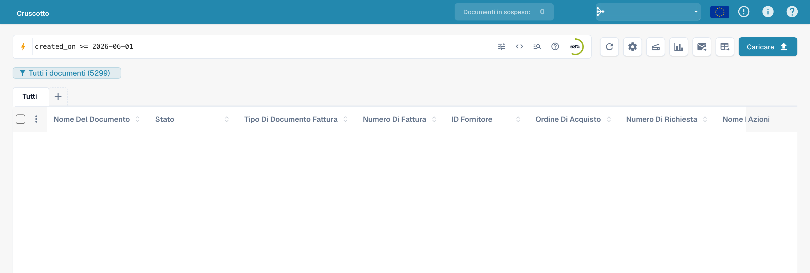
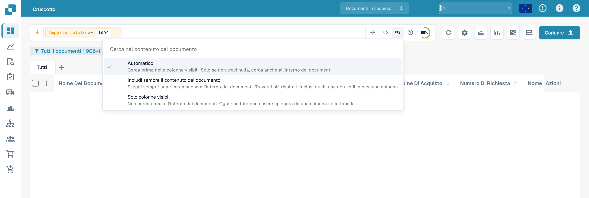
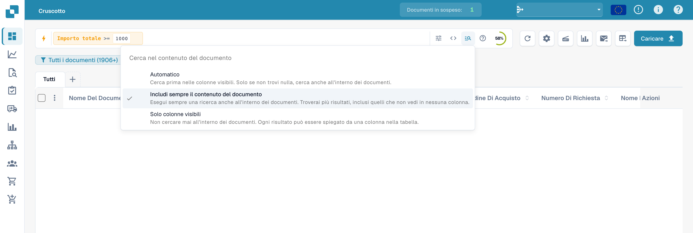
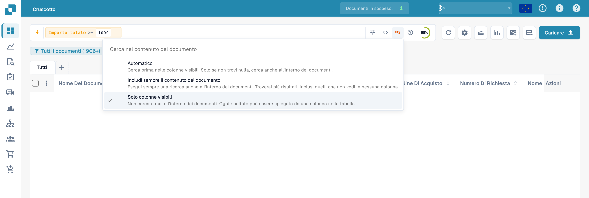

# Ricerca rapida

La **Ricerca rapida** è il modo più veloce per trovare i documenti nella Dashboard. Digiti ciò che cerchi — un nome, uno stato, un importo, una data — e
l'elenco dei documenti si filtra all'istante.

Questa guida è organizzata secondo la struttura della ricerca:

1. **Campi standard** — le colonne che ha ogni documento (nome del documento, stato,
   date). Sempre disponibili.
2. **Campi fulltext** — contenuto estratto (fornitore, ordine di acquisto, numero
   fattura, importi, righe articolo). Disponibili quando la ricerca fulltext è attiva.
3. **Operatori, scorciatoie e ricette** — il riferimento completo, quando
   hai preso confidenza.

> Non devi memorizzare nulla: clicca sulla barra di ricerca e scegli un campo e
> un valore dall'elenco — la Ricerca rapida costruisce la query per te. Gli esempi qui sotto
> mostrano anche la forma digitata, così puoi copiarli direttamente.

<figure><figcaption><p>Ricerca rapida nella dashboard italiana.</p></figcaption></figure>

---

## Come funziona la barra di ricerca — chip, barra degli strumenti e vista grezza

Prima dei campi veri e propri, è utile sapere come è organizzata la barra.

### Le condizioni diventano chip

Quando completi una condizione (un campo, un operatore e un valore) la Ricerca rapida
la trasforma in un **chip** — una pillola colorata all'interno della barra — e ne avvia uno nuovo. Un
chip mostra il **campo**, l'**operatore** e il **valore**, con una **×** per
rimuoverlo. I chip sono codificati per colore in base a dove risiedono i dati:

| Colore del chip | Tipo di campo |
|-------------|------------|
| **Blu** | Colonna standard (nome del documento, stato, date) |
| **Arancione** | Campo fulltext / estratto (fornitore, importo, numero fattura) |
| **Viola** | Ricerca vettoriale (semantica) |
| **Verde** | Ricerca nel testo OCR |

Clicca su un chip per modificarlo (torna a essere testo); clicca su **×** per eliminarlo.
Più chip combinati vengono letti come **AND** per impostazione predefinita.

### La barra degli strumenti

All'estremità destra della barra:

- **ⓘ Guida** — apre il riferimento integrato **Ricerca nella dashboard: campi e sintassi**
  che elenca tutti i campi, gli operatori e le scorciatoie disponibili nel tuo workspace.
- **Filtri** (tre barre di scorrimento) — un pannello rapido per i filtri più comuni
  **Stato**, **Assegnato a** e **Riavvio richiesto**, con **Cancella i filtri** e **Applicare**.
- **Anello dell'indice** — un piccolo anello di avanzamento che mostra quanta parte dell'indice fulltext
  è stata costruita (visibile solo quando la ricerca fulltext è attiva).

### Vista standard e vista grezza

La barra normalmente mostra la tua query come chip (**vista standard**). Passa alla **vista
grezza** per vedere e modificare la query come testo semplice (ad es.
`status=ready_for_validation AND supplier_name=Test`) — utile per copiare,
condividere o digitare direttamente una query lunga. La tua query resta valida dopo il passaggio e
viene ricordata quando ricarichi la Dashboard.

---

## Parte 1 — Campi standard

I campi standard sono le colonne proprie del documento. Sono **sempre disponibili**,
che la ricerca fulltext sia attiva o meno.

### Trovare documenti per nome

Il nome del documento è la ricerca più comune. Ci sono tre modi per cercarlo —
tutti **senza distinzione tra maiuscole e minuscole**:

#### `=` → inizia con

```
filename=invoice
```

Trova i documenti il cui nome **inizia con** «invoice». La ricerca ignora le maiuscole, quindi
tutti questi corrispondono a `filename=invoice`:

```
Invoice.pdf   iNVoice.pdf   iNvoiCE.pdf   INVOICE.pdf
Invoice.xml   iNVoice.xml   iNvoiCE.edi   …
```

**Non** corrisponde a `XYZ_Invoice.pdf` (qui «invoice» è nel mezzo — usa
`:` per questo caso).

<figure><figcaption><p>Inserimento di una query per nome del file.</p></figcaption></figure>

#### `:` → contiene (ovunque)

```
filename:invoice
```

Usa `:` per cercare la parola **ovunque** nel nome — `2026_Invoice.pdf`,
`vietnam_einvoice_sample.xml`, `scan_invoice_copy.pdf`.

<figure><figcaption><p>Inserimento di una ricerca su parte del nome del file: filename:invoice.</p></figcaption></figure>

#### `="…"` → inizia *o* finisce con

```
filename="invoice"
```

Con le virgolette, `=` corrisponde ai nomi che **iniziano o finiscono** con il valore —
comodo per un codice iniziale o per la fine di un file.

> **Le tre in una riga:** `=` → inizia con · `:` → contiene · `="…"` →
> inizia o finisce con. Tutte ignorano maiuscole e minuscole. Puoi vedere questo riepilogo
> in qualsiasi momento tramite l'**icona della guida** nella barra di ricerca (sezione successiva).

### Trovare documenti per stato

```
status=ready_for_validation
```

Lo stato è un elenco fisso, quindi `=` è una corrispondenza **esatta** e la barra offre un selettore di valori
quando digiti `status=`.

<figure><figcaption><p>Inserimento del filtro sullo stato tecnico ready_for_validation.</p></figcaption></figure>

### Trovare documenti per data

```
created_on>2026-05-25
```

Usa `>`, `<`, `>=`, `<=` per gli intervalli di date. Puoi usare anche date **relative**:
`today()`, `today()-7` (ultimi 7 giorni), `today()+30` (prossimi 30 giorni).

<figure><figcaption><p>Inserimento di una ricerca di documenti creati dopo il 25 maggio 2026.</p></figcaption></figure>

### Trovare documenti per sotto-tipo di fattura

```
invoice_sub_type="Cost Invoice"
```

Il sotto-tipo di fattura è un elenco fisso (ad esempio **Fattura dei costi** o **Purchase
Invoice**), quindi `=` è una corrispondenza **esatta** e la barra offre un selettore di valori quando
digiti `invoice_sub_type=`. Usa `invoice_sub_type!="Cost Invoice"` per
tutto tranne quel sotto-tipo.

---

## Parte 2 — Campi fulltext

I campi fulltext cercano nel **contenuto estratto** dei tuoi documenti — fornitore,
ordine di acquisto, numero fattura, importi, righe articolo. Appaiono in **arancione**
e sono disponibili quando la **ricerca fulltext è attiva** per la tua organizzazione. Le
regole di corrispondenza sono esattamente le stesse dei campi di testo standard
(`=` inizia con, `:` contiene, `="…"` inizia o finisce con).

### Trovare documenti di un fornitore

```
supplier_name=Test
```

Inizia con, applicato al nome del fornitore estratto. Usa `supplier_name:Example` per cercare
ovunque, oppure `supplier_name:"Example"` per racchiudere tra virgolette un valore con spazi.

<figure><figcaption><p>Esempio di query sul fornitore: supplier_name=Test.</p></figcaption></figure>

### Trovare documenti per ordine di acquisto

```
purchase_order=PO
```

Inizia con, applicato al numero PO estratto — ottimo per un prefisso PO.

<figure><figcaption><p>Esempio di query sull’ordine di acquisto: purchase_order=PO.</p></figcaption></figure>

### Trovare documenti per importo

```
total_amount>5000
```

Usa `>`, `<`, `>=`, `<=` oppure `between 100 and 500` per un intervallo.

<figure><figcaption><p>Inserimento di un filtro sull’importo totale superiore a 5000.</p></figcaption></figure>

Per una finestra di valori usa `between`:

```
total_amount between 1000 and 5000
```

È un'abbreviazione di `total_amount>=1000 AND total_amount<=5000`.

<figure><figcaption><p>Inserimento di una query sull’importo compreso tra 1000 e 5000.</p></figcaption></figure>

### Trovare ciò che manca

```
supplier_name=""
```

`=""` significa «questo campo **non è impostato**»; `supplier_name!=""` significa «ha un
qualsiasi fornitore».

<figure><figcaption><p>Inserimento di un filtro sul nome del fornitore vuoto.</p></figcaption></figure>

Lo stesso controllo di presenza funziona su qualsiasi campo — ad esempio per i documenti a cui
manca ancora un codice di assegnazione AP:

```
ap_assignment_code=""
```

<figure><figcaption><p>Inserimento di una ricerca senza assegnazione AP.</p></figcaption></figure>

---

## Filtri rapidi — con un clic

L'icona **fulmine** all'inizio del campo di ricerca apre il selettore dei campi. In cima a
questo selettore trovi i **Filtri rapidi**: ricerche già pronte che applichi con un solo
clic. Ognuno è semplicemente una scorciatoia per una query che potresti anche digitare
tu stesso:

| Filtro rapido | Trova | Equivale a digitare |
|--------------|-------|----------------|
| ⚠️ **Scaduto** | Scaduti | `invoice_due_date<today()` |
| 🕐 **In scadenza** | Entro i prossimi 7 giorni | `invoice_due_date<=today()+7` |
| 👤 **Assegnato a me** | Elementi in attesa di una tua azione | `assigned_to=<you>` |
| 📅 **Posta in arrivo di oggi** | Importati oggi | `imported_on>=today()` |
| 📋 **In attesa di validazione** | Pronti per la validazione | `status=ready_for_validation` |
| 🧾 **Documenti elettronici** | Fatture elettroniche (XML, ZUGFeRD, EDI) | `is_edoc=true` |
| ✅ **Corrispondenza PO completa** | Corrispondenza completa con un ordine di acquisto | `po_match_status=full_matched` |
| ➗ **Corrispondenza parziale dell'ordine di acquisto** | Corrispondenza parziale con un ordine di acquisto | `po_match_status=partial_matched` |
| 📉 **In base alla corrispondenza PO** | Quantità o prezzo unitario inferiori all'ordine di acquisto | `po_match_status=under_matched` |

I tre filtri **Corrispondenza PO** e i campi fulltext richiedono che la ricerca fulltext
sia attiva per la tua organizzazione.

<figure><figcaption><p>Guida alle query e ai filtri della ricerca rapida.</p></figcaption></figure>

---

## Raggruppare i risultati

Invece di un elenco piatto, puoi **raggruppare** i risultati per qualsiasi campo — fornitore,
stato, tipo di documento, sotto-organizzazione o un intervallo di date. Aggiungi un raggruppamento dalla
barra di ricerca:

```
group by supplier_name
```

L'elenco mostra quindi **intestazioni di gruppo** comprimibili, ciascuna con il nome del gruppo e
un **conteggio** (ad es. *Example (12)*). Clicca su un'intestazione per espandere o comprimere quel
gruppo. Per i campi data puoi raggruppare per **giorno, settimana o mese**.

<figure><figcaption><p>Inserimento di una query con raggruppamento per fornitore.</p></figcaption></figure>

Il raggruppamento si combina con qualsiasi filtro — `status=ready_for_validation group by
supplier_name` raggruppa solo i documenti corrispondenti. Cliccando su un gruppo si
**approfondisce**: il valore di quel gruppo viene applicato come filtro e torni
all'elenco piatto per quella selezione.

---

## Parte 3 — Operatori, connettori, scorciatoie

### La guida integrata

L'**icona della guida** nella barra di ricerca apre un riferimento completo di tutti i campi,
gli operatori e le scorciatoie disponibili nel tuo workspace — compreso quali campi sono
standard e quali fulltext.

<figure><figcaption><p>La guida integrata <strong>Dashboard Search — Fields &#38; Syntax</strong>, che elenca ogni operatore e come vengono confrontati i valori.</p></figcaption></figure>

### Come corrisponde `=`, per tipo di campo

Tutte le corrispondenze di testo ignorano maiuscole e minuscole.

| Tipo di campo | Esempio | `=` significa |
|------------|---------|-----------|
| Testo (nome, fornitore, ordine di acquisto) | `filename=invoice` | **inizia con** |
| Testo, ovunque | `filename:invoice` | **contiene** |
| Testo, inizio *o* fine | `filename="invoice"` | **inizia o finisce con** |
| Stato / tipo / PO match (elenchi fissi) | `status=finished` | **esatto** |
| Identificatori (numero fattura, id fornitore) | `invoice_number=INV-100` | **esatto** |
| Numero | `total_amount>5000` | intervallo (`> < >= <= between`) |
| Data | `created_on>2026-01-01` | intervallo + `today()±N` |

### Operatori

| Operatore | Significato |
|----------|---------|
| `=` | inizia con (testo) / esatto (elenco, numero, data) |
| `:` | contiene (testo, ovunque) |
| `="…"` | inizia o finisce con (testo) |
| `!=` | l'opposto di `=` |
| `>` `<` `>=` `<=` | maggiore / minore di |
| `between … and …` | intervallo inclusivo |
| `field=""` / `field!=""` | è vuoto / è impostato |
| `today()`, `today()-7`, `today()+30` | date relative |

### Connettori

Combina le condizioni con **AND** (entrambe vere), **OR** (una delle due), **NOT** e
le parentesi `( … )` per raggruppare:

```
status=ready_for_validation AND supplier_name=Test
(status=error OR status=failed) AND created_on>today()-1
```

<figure><figcaption><p>Inserimento di condizioni di stato e fornitore collegate con AND.</p></figcaption></figure>

### Esempi di query

Le immagini mostrano le query inserite nell’interfaccia italiana. I dati dei documenti sono nascosti. Un’immagine della barra dei filtri non dimostra un numero preciso di risultati.

#### Operatore di confronto testuale

```
created_on gt 2026-05-25
```

<figure><figcaption><p>Operatore di confronto gt in una query sulla data.</p></figcaption></figure>

#### Prima di oggi

```
created_on < today()
```

<figure><figcaption><p>Confronto di created_on con today().</p></figcaption></figure>

#### Da una data di creazione

```
created_on >= 2026-06-01
```

<figure><figcaption><p>Inserimento di una data di creazione a partire dal 1° giugno 2026.</p></figcaption></figure>

#### Senza responsabile assegnato

```
assigned_to is empty
```

<figure><figcaption><p>Inserimento di una ricerca di documenti senza responsabile assegnato.</p></figcaption></figure>

#### Filtro sullo stato

```
status=ready_for_validation
```

<figure><figcaption><p>Esempio di filtro sullo stato nella ricerca rapida.</p></figcaption></figure>

#### Fuori da un periodo

```
created_on not between 2026-06-01 and 2026-06-15
```

<figure><figcaption><p>Inserimento di una ricerca fuori da un intervallo di date.</p></figcaption></figure>

#### Stati alternativi

```
status=ready_for_validation OR status=exported
```

<figure><figcaption><p>Inserimento di due stati tecnici collegati con OR.</p></figcaption></figure>

#### Escludere una condizione sul fornitore

```
NOT supplier_name=Test
```

<figure><figcaption><p>Esclusione di una condizione sul fornitore con NOT.</p></figcaption></figure>

#### Parte del nome del file

```
filename:invoice
```

<figure><figcaption><p>Ricerca di un termine nei nomi dei file.</p></figcaption></figure>

#### Query sul numero di fattura

```
invoice_number=INV
```

<figure><figcaption><p>Esempio di query con invoice_number.</p></figcaption></figure>

#### Assegnazione vuota

```
assigned_to=""
```

<figure><figcaption><p>Inserimento di un’assegnazione vuota: assigned_to=&quot;&quot;.</p></figcaption></figure>

#### Query sulla valuta

```
currency=EUR
```

<figure><figcaption><p>Inserimento di una query in euro: currency=EUR.</p></figcaption></figure>

#### Scadenza precedente a oggi

```
invoice_due_date<today()
```

<figure><figcaption><p>Inserimento di una data di scadenza precedente a today().</p></figcaption></figure>

#### Soglia dell’importo

```
total_amount>=1000
```

<figure><figcaption><p>Inserimento di un importo totale di almeno 1000.</p></figcaption></figure>

## Includere il contenuto dei documenti

Il menu di ricerca nel contenuto stabilisce se la ricerca include anche il testo dei documenti. Questa scelta è distinta dai prefissi tecnici come vector:, ocr: e ai:.

### Automatico

Cerca prima nelle colonne visibili. Se non trova corrispondenze, include il contenuto quando l’organizzazione dispone delle funzioni necessarie.

<figure><figcaption><p>Inclusione automatica del contenuto dei documenti nella ricerca rapida.</p></figcaption></figure>

### Includere sempre il contenuto

Include esplicitamente il contenuto dei documenti. Devono essere disponibili le funzioni di ricerca corrispondenti.

<figure><figcaption><p>Inclusione sistematica del contenuto dei documenti nella ricerca rapida.</p></figcaption></figure>

### Solo colonne visibili

Limita la ricerca alle colonne visibili della dashboard.

<figure><figcaption><p>Ricerca limitata alle colonne visibili.</p></figcaption></figure>

### Ricette

| Cosa vuoi… | Digita questo |
|-----------|-----------|
| Pronti per la validazione, con corrispondenza completa | `status=ready_for_validation AND po_match_status=full_matched` |
| Questo fornitore, questa settimana | `supplier_name=Test AND created_on>today()-7` |
| Fatture scadute di importo elevato | `total_amount>5000 AND invoice_due_date<today()` |
| Due fornitori contemporaneamente | `supplier_name=ExampleA OR supplier_name=ExampleB` |
| Documenti in errore di oggi | `(status=error OR status=failed) AND created_on>today()-1` |
| Note di credito elettroniche | `is_edoc=true AND sub_doc_type=CREDIT_NOTE` |
| Per prefisso dell'ordine di acquisto | `purchase_order=PO-2026` |

> I campi arancioni (fulltext) richiedono che la **ricerca fulltext** sia attiva per la tua
> organizzazione. Un `%` o `_` letterale in un valore viene trattato come un carattere normale.
