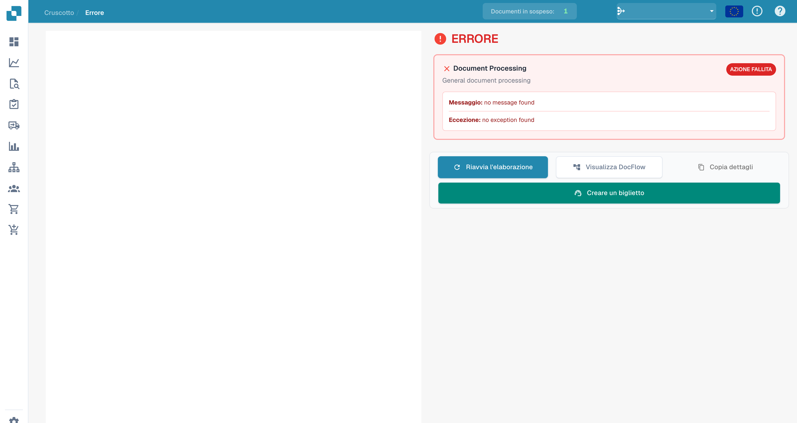
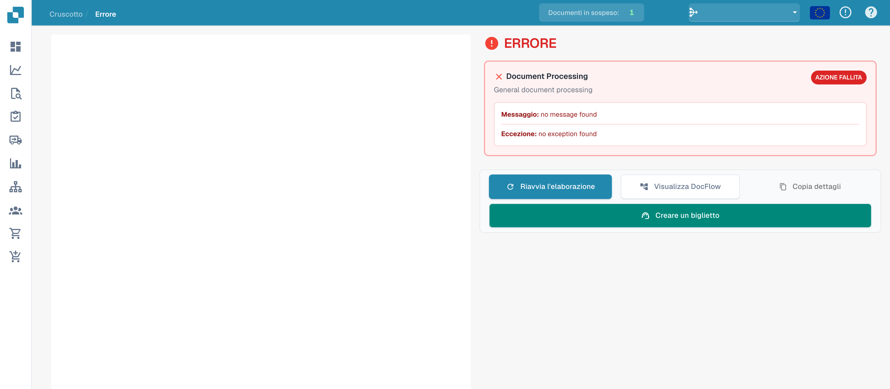

# Vista di errore

Quando un’elaborazione non riesce, la vista di errore consente di esaminare la fase interessata, il messaggio e l’eccezione disponibili.

## Esaminare i dettagli

<figure><figcaption>
Messaggio ed eccezione della vista di errore senza messaggio registrato. Le diciture Document Processing, no message found e no exception found restano in inglese.
</figcaption></figure>

Questo esempio presenta l’interfaccia senza un errore registrato. I testi no message found e no exception found non costituiscono la diagnosi di un incidente. Per un errore reale, esaminare i messaggi disponibili e il flusso del documento.

## Azioni disponibili

<figure><figcaption>
Azioni della vista di errore; nessun dettaglio di errore è registrato nell’esempio. Le diciture Document Processing, no message found e no exception found restano in inglese.
</figcaption></figure>

| Azione | Utilizzo |
| --- | --- |
| Riavviare l’elaborazione | Riprovare dopo avere verificato o corretto la causa. |
| Aprire DocFlow | Esaminare le fasi e i relativi stati. |
| Copiare i dettagli | Raccogliere le informazioni tecniche disponibili. |
| Creare un ticket | Preparare una richiesta di assistenza. |

I comandi del documento e dell’anteprima dipendono dal caricamento del documento. La vecchia barra degli strumenti PDF non fa parte in modo affidabile di questa vista.

Se l’errore si ripresenta, indicare all’assistenza ID del documento, messaggio esatto, orario e verifiche effettuate. Controllare le informazioni riservate prima di condividere i dettagli.
