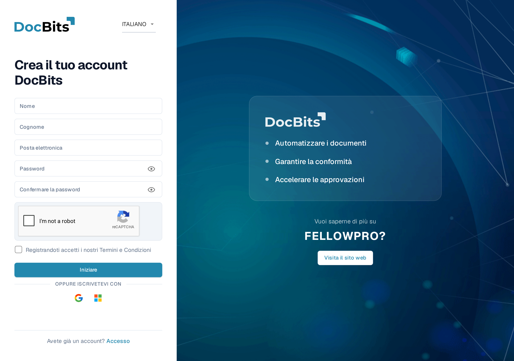
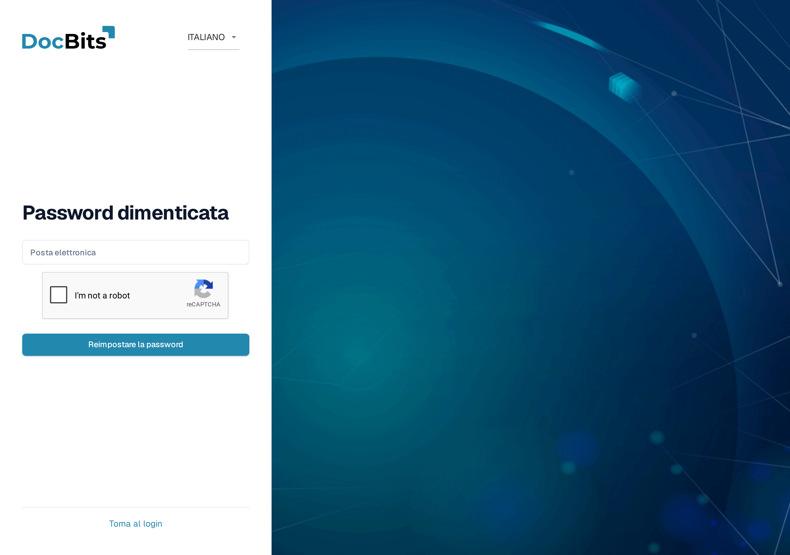
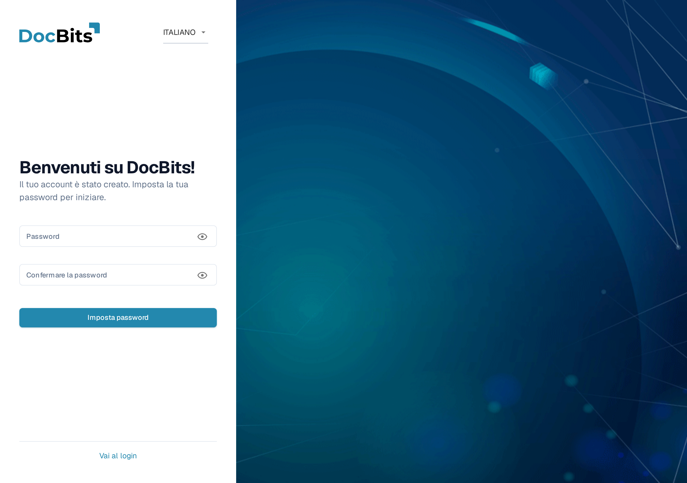

# Ottenere l'accesso e accedere

Questa pagina spiega come ottenere un account DocBits e come accedere quando non hai la tua password:

* [Registrazione](getting-access-and-signing-in.md#registrazione) — crea il tuo account DocBits.
* [Password dimenticata](getting-access-and-signing-in.md#password-dimenticata) — reimposta la tua password con un link di reimpostazione.
* [Prima password per gli account creati dall'amministratore](getting-access-and-signing-in.md#prima-password-per-gli-account-creati-dallamministratore) — imposta la prima password di un account che il tuo amministratore ha creato per te.

L'accesso con un account esistente e l'Autenticazione a Due Fattori sono trattati in [Autenticazione a Due Fattori (2FA)](../../overview-and-basics/two-factor-authentication.md). Usa il menu della lingua in alto a destra di questi moduli se ti serve un'altra lingua di visualizzazione.

## Registrazione

Puoi creare tu stesso un account DocBits nella pagina di registrazione. Aprila dal link **Registro** nella schermata di accesso, oppure vai a `https://app.docbits.com/register` (usa l'indirizzo web che è stato comunicato alla tua organizzazione).

<figure><figcaption>
Il modulo di registrazione. Tutti i campi sono obbligatori salvo diversa indicazione.
</figcaption></figure>

Compila il modulo:

1. **Nome** e **Cognome** — il tuo nome così come deve apparire in DocBits.
2. **Posta elettronica** — il tuo indirizzo email di lavoro. È il tuo identificativo di accesso.
3. **Password** e **Confermare la password** — vedi le regole per la password più sotto. Una lista di controllo sotto il campo della password mostra quali regole la tua password soddisfa già.
4. Se la pagina mostra un widget **reCAPTCHA**, completalo. Il widget appare solo quando il tuo deployment DocBits ha la protezione dai bot attivata.
5. Spunta la casella per confermare che accetti i **Termini e Condizioni**.
6. Fai clic su **Iniziare**. Se hai già un account, fai clic su **Accesso** in fondo per tornare alla schermata di accesso. **Visita il sito web** apre il sito web di DocBits per le informazioni sul prodotto.

Usa l'icona a forma di occhio accanto a un campo della password per mostrare o nascondere i caratteri che hai inserito.

### Regole per la password

La tua password deve:

* essere lunga tra **8 e 20 caratteri**,
* contenere almeno una lettera **maiuscola** e una **minuscola**,
* contenere almeno una **cifra**,
* contenere almeno un **carattere speciale** (`!@#$%^&*()_+=\[{]\};:,.<>?/\|~-`).

Sono ammessi solo lettere, cifre e questi caratteri speciali.

### Iscriviti con Google o Microsoft

Invece di una password, puoi fare clic sul pulsante **Google** o **Microsoft** sotto **OPPURE ISCRIVETEVI CON**. DocBits crea il tuo account tramite il tuo provider di identità, e in seguito accedi allo stesso modo.

### Conferma il tuo indirizzo email

Dopo aver inviato il modulo, DocBits mostra una pagina di conferma e invia una **email di verifica** all'indirizzo che hai inserito. Apri l'email e fai clic sul link al suo interno — ti porta a una pagina di conferma che verifica il tuo indirizzo. Se l'email non arriva, la pagina di conferma offre un'opzione di **reinvio**. Una volta verificato l'indirizzo, fai clic su **Accesso** ed effettua l'accesso con la tua email e la tua password.

## Password dimenticata

DocBits memorizza le password come hash unidirezionali con salt. Una password esistente non può essere recuperata dal suo hash, quindi questa procedura ne imposta una nuova. Vedere [Archiviazione sicura delle credenziali](../../overview-and-basics/secure-storage-of-credentials.md).

Se hai dimenticato la tua password:

1. Nella schermata di accesso, fai clic su **Ha dimenticato la password?**.
2.  Nella pagina **Password dimenticata**, inserisci il tuo indirizzo di **Posta elettronica** e fai clic su **Reimpostare la password**. Se viene mostrato un widget reCAPTCHA, completalo prima.

    <figure><figcaption>
La pagina Password dimenticata. Inserisci l'email del tuo account e DocBits ti invierà un link di reimpostazione.
</figcaption></figure>

    Se non vuoi reimpostare la tua password, fai clic su **Torna al login** per tornare all'accesso.
3. DocBits ti invia per email un **link di reimpostazione della password**. Apri l'email e fai clic sul link — si apre la pagina di reimpostazione.
4. Inserisci la tua **nuova password due volte**. Si applicano le stesse regole per la password della [registrazione](getting-access-and-signing-in.md#regole-per-la-password), e una lista di controllo mostra quali regole sono soddisfatte.
5. Fai clic su **Reimpostare la password**. DocBits conferma la modifica e ti riporta alla schermata di accesso, dove puoi accedere con la nuova password.


I link di reimpostazione scadono dopo poco tempo. Se il link non funziona più, ripeti i passaggi precedenti per richiederne uno nuovo.


## Prima password per gli account creati dall'amministratore

Quando il tuo amministratore ti aggiunge come utente (vedi [Utenti](../../administration-and-setup/settings/global-settings/groups-users-and-permissions/users/)), ricevi un'email con i tuoi dati di accesso e un link per impostare la tua **prima password**. Il link apre la pagina **Imposta password**:

<figure><figcaption>
La pagina Imposta password, mostrata dopo che un amministratore ha creato il tuo account.
</figcaption></figure>

1. Fai clic sul link nell'email di invito. La pagina ti accoglie con "Benvenuti su DocBits! Il tuo account è stato creato. Imposta la tua password per iniziare."
2. Inserisci la tua password due volte — si applicano le stesse [regole per la password](getting-access-and-signing-in.md#regole-per-la-password).
3. Fai clic su **Imposta password**. Puoi quindi accedere con la tua email e questa password.

Le icone a forma di occhio mostrano o nascondono ciò che hai inserito. Se esci prima di impostare una password, **Vai al login** riporta alla schermata di accesso.

Il link è legato al tuo account e funziona una sola volta. Se scade prima che tu lo usi, chiedi al tuo amministratore di inviare nuovamente l'invito oppure usa **Ha dimenticato la password?** con il tuo indirizzo email.
