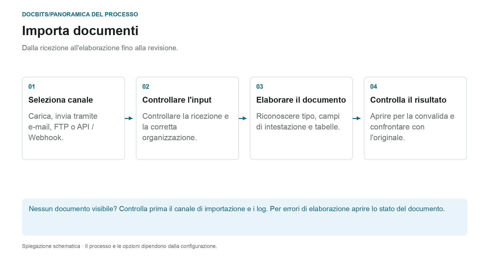

# Come Importare Documenti

## Dalla ricevuta a un documento pronto per la revisione

<figure><figcaption>
Dalla ricezione all&#x27;elaborazione fino alla revisione. Il diagramma è schematico; le impostazioni attive della tua organizzazione determinano il comportamento effettivo.
</figcaption></figure>

Selezionare innanzitutto il percorso di importazione. L'invio corretto di un'e-mail o l'invio di una richiesta API non dimostra che il documento sia stato completamente elaborato. Controlla la sua ricevuta in DocBits e poi lo stato del suo documento.

1. **Seleziona canale di importazione:** utilizza il caricamento manuale per singoli file o un canale automatico impostato per input regolari.
2. **Controlla la ricevuta:** individua il documento nell'organizzazione corretta. Per le email in arrivo, controlla i log di importazione, se necessario; il formato e le regole del mittente supportano l'allegato?
3. **Attendere l'elaborazione:** DocBits elabora il documento in base al tipo di documento e alle impostazioni attive. Per PDFs, OCR o il testo PDF esistente può essere utilizzato; i documenti elettronici possono fornire dati strutturati. Non tutte le importazioni seguono lo stesso percorso di estrazione.
4. **Apri il risultato:** Una volta che il documento è pronto per la convalida, confronta i valori riconosciuti con l'originale. L'importazione di un documento non lo approva né lo esporta nello ERP.

### Trova il percorso di importazione corretto

| Ingresso | Istruzioni |
| --- | --- |
| Carica singoli documenti | [Importazione manuale](manual-import.md) |
| Connetti la casella di posta o inoltra le email | [Importazione e-mail](email/README.md) |
| Recupera i file tramite un canale FTP configurato | [FTP](ftp.md) |
| Trasferire documenti da un'applicazione | [Webhook / API](webhook.md) |

**Se manca qualcosa:** Controlla prima il canale di ingresso. Se il documento esiste già in DocBits, [Stato del documento](../dashboard/document-status.md) e [Flusso di documenti](../dashboard/document-flow.md) aiutano a trovare la fase di elaborazione interessata.


DocBits Tutorial sull'importazione: caricamento di documenti, trascinamento della selezione + classificazione manuale o automatica


Una guida per caricare documenti su DocBits.
