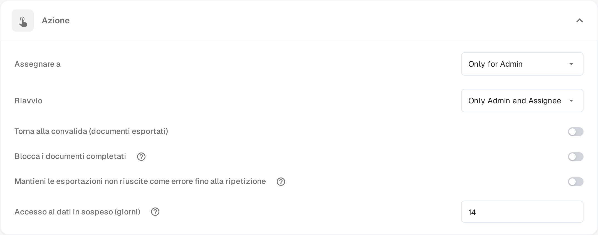

# Pending Input

**Pending Input** sospende un documento mentre si attende la risposta di un collega. La domanda si scrive nel flusso di attività del documento e si identificano le persone che devono rispondere. Il documento lascia la coda attiva finché non rispondono, e le persone identificate possono aprirlo in sola lettura tramite un link ricevuto per e-mail.

Lo stato compare nella [dashboard](dashboard/README.md) come **Pending Input** ed è possibile filtrare l'elenco di lavoro per questo stato.

## Chiedere un'informazione

1. Aprite il documento in una schermata che offre il flusso di attività — le schermate di approvazione e di revisione lo offrono — e selezionate l'icona a fumetto nella barra degli strumenti.
2. Scrivete la domanda e digitate **@** seguito dal nome della persona da interpellare. Sceglietela dall'elenco che compare. È l'identificazione a concedere l'accesso: solo le persone identificate ricevono il link al documento.
3. Quando una persona è identificata, sotto il campo di scrittura compare un riquadro con due possibilità:

* **Comment only** (solo commento) – la domanda viene pubblicata nel flusso di attività e lo stato resta invariato. Usate questa possibilità se vi serve solo una risposta e non volete trattenere il documento.
* **Send & set to Pending Input** (inviare e impostare Pending Input) – la domanda viene pubblicata e il documento va in attesa. Lascia la coda attiva e resta sospeso finché la persona identificata non risponde.

Le persone identificate ricevono un'e-mail con un link al documento. **Invio** o l'icona di invio pubblicano ancora un commento normale senza concedere accesso; **Maiusc+Invio** inizia una nuova riga. Su un documento già sospeso, o su un documento che non può ancora essere sospeso, il riquadro offre la domanda senza l'opzione di sospensione.

## Rispondere a una richiesta

Ricevete una richiesta di informazione quando un collega vi identifica nel flusso di attività.

* Aprite il link dell'e-mail. La pagina **Pending Input** mostra a sinistra le pagine del documento e a destra il flusso di attività, con il badge **Pending Input**.
* Il vostro accesso è in sola lettura: potete leggere il documento e rispondere nel flusso di attività, ma non potete modificare campi né esportare.
* Scrivete la risposta nel flusso di attività e inviatela. Chi ha posto la domanda viene avvisato e la conversazione resta nella cronologia del documento.
* L'intestazione della pagina indica per quanto tempo vale il vostro accesso, per esempio **Read-only access until 09.11.2026**. L'accesso termina anche appena il documento prosegue.

Se aprite il link dopo che la richiesta ha ricevuto risposta o dopo la scadenza dell'accesso, la pagina vi indica che la richiesta è stata gestita o è scaduta e che non serve alcuna azione.

## Chiudere la richiesta

Il documento resta sospeso finché la persona assegnata non riprende la risposta.

1. Aprite il documento dalla dashboard. Un documento sospeso si apre direttamente sulla sua pagina **Pending Input**.
2. Leggete la risposta nel flusso di attività.
3. Selezionate **Resolve & Proceed** (chiudere e proseguire). Il documento riprende con lo stato successivo del suo flusso di lavoro, quindi arrivate direttamente alla schermata in cui continuare il lavoro.

Solo la persona assegnata al documento, o un membro del gruppo a cui è assegnato, può chiudere la richiesta. Gli amministratori e gli approvatori possono aprire un documento sospeso in sola lettura per vedere perché è in attesa.

## Impostare il periodo di accesso

La funzione è disponibile in tutte le organizzazioni. Ciò che potete configurare è per quanto tempo una persona interpellata mantiene l'accesso al documento:

1. Aprite **Impostazioni → Dashboard**.
2. Esplorate la sezione **Azione**.
3. In **Accesso ai dati in sospeso (giorni)** inserite un numero intero di giorni. Il valore predefinito è **14** ed è richiesto almeno un giorno.
4. Salvate le modifiche.

Il periodo parte con l'invio della richiesta. Termina prima se il documento viene chiuso o passa a un altro stato.

<figure><figcaption>
Accesso ai dati in sospeso (giorni) nella sezione Azione delle impostazioni della dashboard. I valori dei permessi sopra il campo sono ancora mostrati in inglese dal prodotto.
</figcaption></figure>
