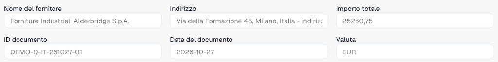
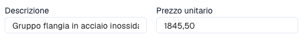

# Verificare righe e prezzi di un'offerta

La vista offerte riguarda documenti configurati per questo processo. Tipo, layout, permessi e workflow determinano campi e azioni. È distinta dall'abbinamento degli ordini.

<figure><figcaption>
Intestazione di un preventivo fittizio italiano di tre pagine in DocBits: fornitore, riferimento, data, valuta e totale. L’immagine mostra i primi sei campi.
</figcaption></figure>

Scarica il preventivo fittizio di tre pagine (PDF)



## Verificare e correggere

<figure><figcaption>
Descrizione e prezzo unitario della prima riga selezionata. Nessun valore è stato modificato o salvato.
</figcaption></figure>

1. Aprire l'offerta corretta. Confrontare fornitore, riferimento, data e valuta con l'originale.
2. Verificare articoli, descrizioni, quantità, unità, prezzi e importi. Un articolo corrispondente non prova prezzo o unità corrispondenti.
3. Selezionare una riga per mostrarne i dettagli sotto la tabella.
4. Usare la ricerca anagrafica configurata, se disponibile. Verificare selezione e valori riportati; approfondire gli avvisi.
5. Correggere e scegliere **Salva** oppure **Salva e successivo**. **Annulla** chiude l'editor senza inviare quelle modifiche alla riga.
6. Copiare i valori predefiniti sulla riga successiva solo quando appropriati. Verificare i valori copiati.
7. Riaprire documento e riga per controllare i valori salvati. Per una riga rifiutata leggere la nota disponibile e risolvere il motivo commerciale.

## Casi particolari

Aggiungere una riga crea una posizione manuale quando consentito. Confrontarla con l'originale e completare i campi obbligatori. Rimuoverla è un'azione separata; non eliminare una posizione reale per far coincidere i totali.

Per documenti in sola lettura verificare permessi, blocco e fase. Per righe mancanti verificare originale, estrazione e layout.

I controlli automatici sui prezzi gestiti, ultimi o contrattuali usano le [Schede di confronto offerte](../../administration-and-setup/workflow/cards-overview/quote-comparison-guide.md). Salvare non dimostra esecuzione dei controlli, approvazione o esportazione ERP completata.
