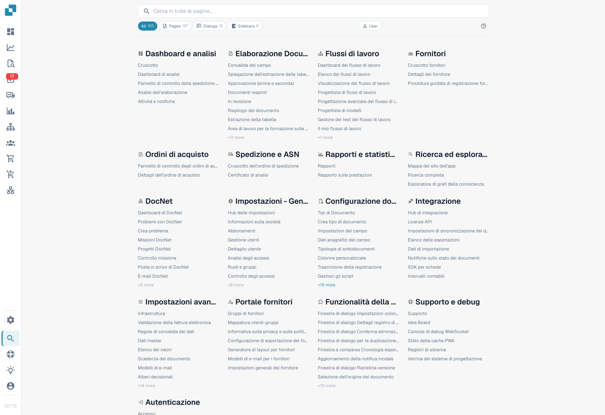
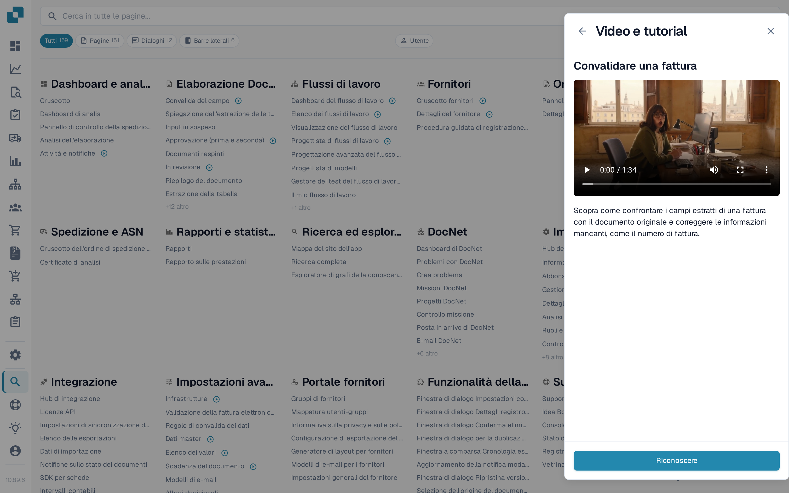

# Mappa del Sito

La Mappa del Sito è l'indice completo e ricercabile di tutto ciò che DocBits espone — ogni pagina, finestra, voce della barra laterale, azione e funzione interna alla pagina, raggruppata per categoria. È il complemento esteso della [Ricerca Rapida Globale](global-quick-search.md).

## Come accedere

Apri la Mappa del Sito dalla barra laterale (voce in fondo) o premi <kbd>Cmd</kbd>/<kbd>Ctrl</kbd> + <kbd>K</kbd> e scegli **Vedi tutti i risultati**. L'URL diretto è `/sitemap`.

<figure><figcaption>
Catalogo delle pagine in italiano. I filtri fissi All, Pages, Dialogs, Sidebars e User e le indicazioni more restano in inglese nella versione illustrata.
</figcaption></figure>

## Sfogliare il catalogo

La Mappa del Sito è raggruppata per categorie che rispecchiano la struttura dell'applicazione — Impostazioni, Elaborazione documenti, Workflow, Validazione e così via. Ogni categoria elenca prima le sue pagine e poi le funzioni interne raggruppate per sottocategoria.

Le voci sono colorate per tipo:

* **Pagina** — un percorso navigabile completo.
* **Finestra** — un modale aperto da un altro punto dell'applicazione.
* **Barra laterale / Pannello / Menu** — un'area di navigazione o di contesto.
* **Azione** — un pulsante o una scorciatoia che esegue qualcosa senza navigare.

Clicca su qualsiasi voce per saltarvi direttamente. Le voci che richiedono un parametro (un tipo di documento o un identificativo) includono un selettore incorporato — scegli il valore prima di cliccare.

## Video di formazione nell'elenco

Le voci delle pagine che hanno un video di formazione mostrano un'icona video dopo il nome — non solo nelle Impostazioni, ma in tutto il catalogo, per esempio nella Dashboard, nella Validazione dei campi o nelle pagine del Workflow. Selezioni l'icona per riprodurre il video di quella pagina nel pannello **Video e tutorial**, restando sulla mappa del sito.

<figure><figcaption>
Le voci con un video di formazione riportano un'icona video; selezionandola si apre il video nel pannello.
</figcaption></figure>

Il pannello continua a elencare ogni video per tema, quindi può anche sfogliare e cercare l'intera raccolta dall'icona nella barra superiore. Vedi [Video e tutorial](videos-and-tutorials.md).

## Cerca e filtra

L'intestazione fissa in alto contiene la casella di ricerca e i filtri a forma di pillola. Digita pochi caratteri per filtrare la lista in tempo reale per nome e descrizione. Usa le pillole di tipo per restringere a un singolo tipo di voce — per esempio solo **Finestra**.

La ricerca e il filtro correnti vengono aggiunti all'URL, così una vista filtrata può essere salvata o condivisa.

<mark>La Mappa del Sito rispetta gli stessi permessi del resto di DocBits. Le pagine a cui non hai accesso non compaiono.</mark>

## Modalità sviluppatore

Un interruttore **Utente / Dev** nell'intestazione attiva informazioni aggiuntive per gli sviluppatori partner:

* Il percorso interno di ogni voce.
* I tag dei parametri (`:docType`, `:docId`, chiavi di deep link).

La modalità sviluppatore viene ricordata nel browser. Torna in modalità Utente per la normale lettura.

## Torna su

La Mappa del Sito è lunga. Una volta superata la prima schermata, in basso a destra appare un pulsante Torna su.
