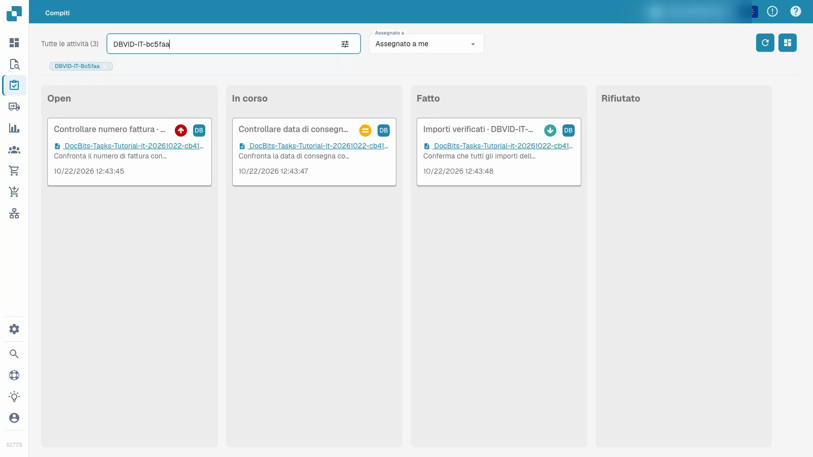
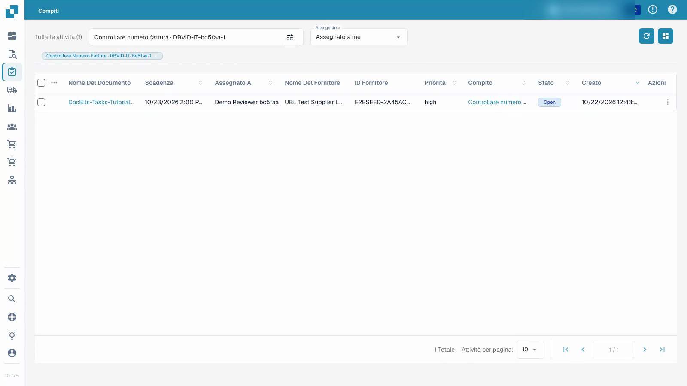

# Attività

Il video mostra un normale utente di test che lavora su un'attività con documenti sintetici.


Attività


[Guarda con i sottotitoli](https://docbits-videos.fra1.cdn.digitaloceanspaces.com/settings-assistant/document-tasks-customer/v1/it.html)

Nota: alcune etichette dei prodotti nativi potrebbero non essere tradotte. La registrazione preserva l'interfaccia utente effettiva.

Usa la panoramica delle attività per trovare il lavoro assegnato e seguirne i progressi. La bacheca raggruppa le attività per stato; l'elenco fornisce maggiori dettagli. Filtra per assegnazione e usa la ricerca per individuare un'attività particolare. La priorità e la scadenza aiutano a pianificare l'ordine del lavoro.

## Lavorare su un'attività di documento assegnata

1. Apri un'attività e leggi la sua descrizione e assegnazione.
2. Ispeziona il documento originale collegato. Il solo titolo di un'attività non dimostra che il documento sia corretto.
3. Imposta l'attività su in corso e salva mentre svolgi il lavoro.
4. Registra il risultato nella descrizione dell'attività.
5. Completa l'attività, salvala e ricarica per confermare lo stato e il feedback memorizzati. Controlla la sua posizione nella panoramica delle attività.

Il video utilizza un normale utente di test e documenti sintetici. Il completamento di un'attività è separato dall'approvazione o dall'esportazione della relativa fattura. Le azioni disponibili dipendono dalle autorizzazioni dell'account.

<figure><figcaption>
Panoramica delle attività con dati sintetici. Open resta in inglese nella colonna iniziale della versione illustrata; il completamento di un’attività è distinto dall’approvazione o esportazione della fattura. Immagine conservata, non una nuova esecuzione durante questa revisione.
</figcaption></figure>

<figure><figcaption>
Elenco delle attività con dati dimostrativi sintetici. I valori Open e high restano in inglese nella versione illustrata. Immagine conservata da una pubblicazione indipendente; questa revisione non ha eseguito nuove attività.
</figcaption></figure>

## Registrazione aggiuntiva


Attività

