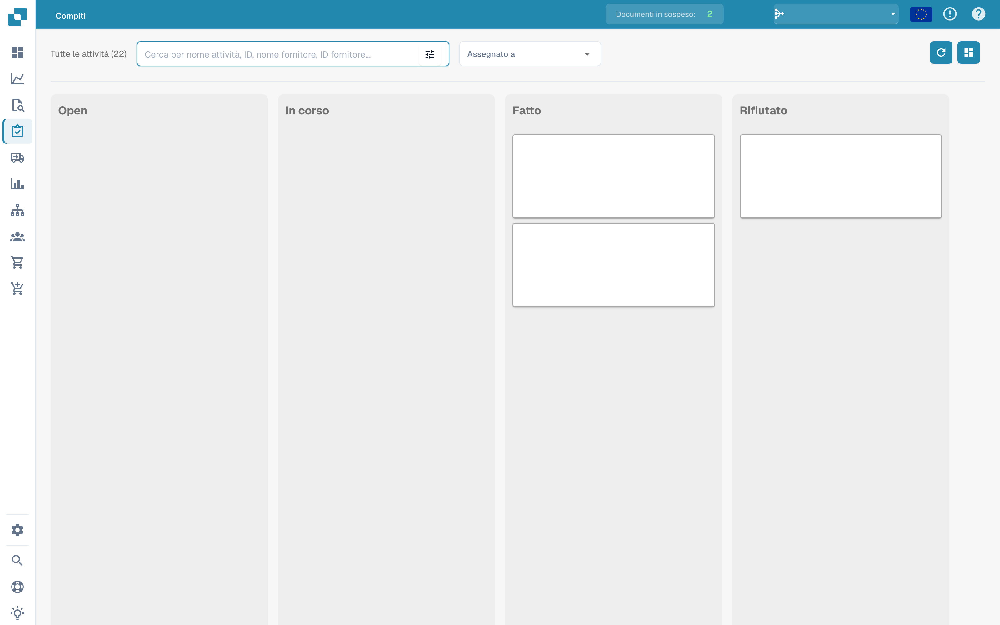
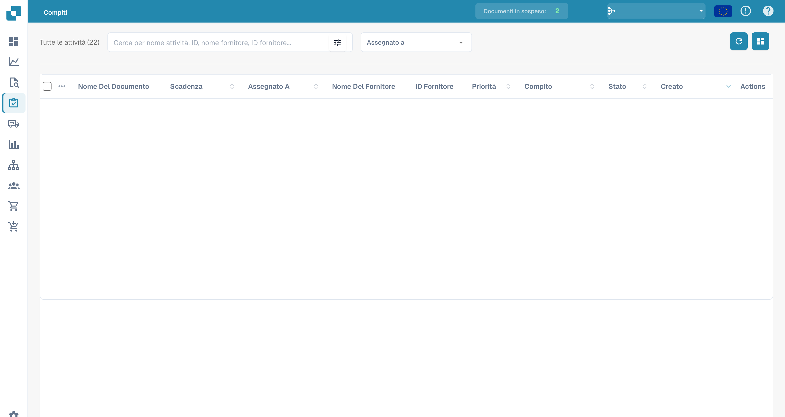

# Attività


DocBits Tutorial su attività e notifiche: assegna lavoro, monitora lo stato e gestisci le attività del flusso di lavoro


Questo è il luogo dove puoi tenere d'occhio le tue attività. Puoi scegliere tra due layout diversi: uno è un po' più dettagliato dell'altro. Puoi anche filtrare le attività in base a diversi criteri, come se sono assegnate a te o lo stato dell'attività.

<figure><figcaption>
Bacheca delle attività per stato; il contenuto delle attività è nascosto.
</figcaption></figure>

<figure><figcaption>
Elenco delle attività con i dati dei documenti nascosti.
</figcaption></figure>
