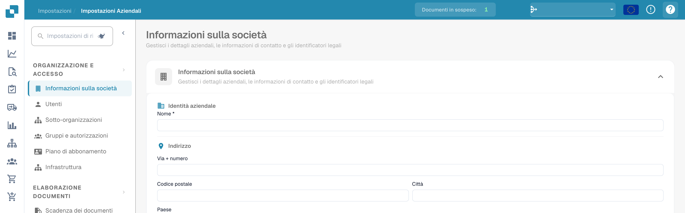

# Icone di aiuto

Le icone di aiuto sono state posizionate in tutto DocBits per aiutarti a imparare e capire cosa fa veramente una funzionalità e come può aiutarti con l'elaborazione dei documenti.

Queste icone di aiuto appaiono come segue

<figure><figcaption>
Icona della guida in alto a destra nelle impostazioni.
</figcaption></figure>
