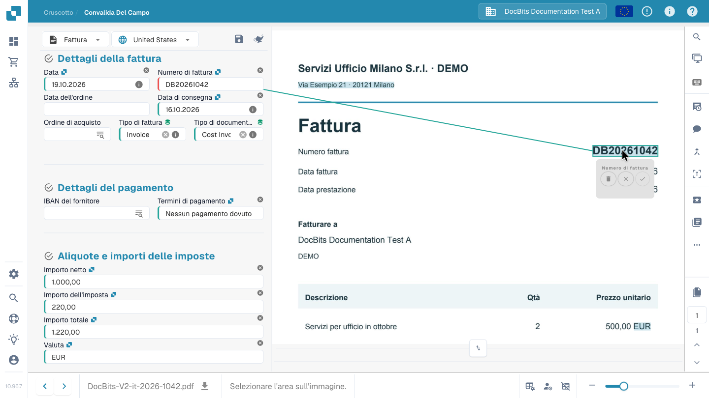

# Schermo di validazione

## Controllare una fattura e completare la verifica

Segui una fattura dalla dashboard al passaggio successivo: confronta fornitore, date, numero, importi e valuta con l’originale e leggi un avviso relativo a un campo obbligatorio. Seleziona il numero direttamente nel documento, conferma l’associazione e conserva la regola di estrazione con Salva regole. In questo esempio, la fattura verificata viene poi inoltrata per approvazione. Le azioni disponibili dipendono dai tuoi permessi e dal processo aziendale.



## Aprire e usare la schermata di validazione

Apri un documento dalla dashboard. Nella **validazione dei campi**, confronta i campi modificabili con l’originale visualizzato accanto. Il tipo di documento e il layout configurato determinano campi, tabelle e pulsanti disponibili. Sposta il divisore per dare più spazio ai campi o al documento.

Per un documento di più pagine usa i comandi di pagina; usa lo zoom per leggere i caratteri piccoli. Le frecce in basso passano da un documento all’altro e sono distinte dai comandi di pagina.

### Origine del documento

Controlla l’**origine del documento** prima di date e importi. Determina l’interpretazione dei formati di data e numero; non traduce il documento e non cambia la lingua dell’interfaccia. Scegli l’origine corrispondente al documento e confronta i valori con l’originale.

## Correggere un campo e insegnare a DocBits dove leggerlo

Se il numero di fattura non è stato letto correttamente:

1. Seleziona il campo **Numero fattura**.
2. Fai doppio clic sul numero completo nell’originale oppure seleziona l’area che lo contiene.
3. Controlla il campo proposto e conferma l’associazione con il segno di spunta, se richiesto.
4. Verifica il valore e l’area di origine evidenziata. Ripeti la selezione se il numero è incompleto o associato al campo sbagliato.
5. Salva il documento. Per conservare l’apprendimento di estrazione, usa anche **Salva regole / Save Rules** e conferma la finestra.

<figure><figcaption>
Il numero selezionato sull’originale e la sua associazione al campo. Conferma l’associazione prima di salvare la regola.
</figcaption></figure>


Digitare un valore sostitutivo corregge questo documento, ma non crea l’associazione all’area di origine necessaria per questo apprendimento. Seleziona il valore sull’originale, conferma l’associazione e salva la regola per riutilizzarla sui documenti corrispondenti di questo fornitore. L’apprendimento dall’immagine non è disponibile per i documenti letti direttamente come dati di fattura elettronica.


## Salvare, conservare le regole e proseguire

| Azione | Effetto |
| --- | --- |
| **Salva** — dischetto sopra i campi | Memorizza le modifiche al documento corrente. Da sola non lo approva né lo esporta. |
| **Salva regole / Save Rules** | Conserva le regole di estrazione a partire dal documento e dalle associazioni alle aree di origine. È distinto dal salvataggio dei valori. |
| **Export**, approvazione o altra azione configurata | Invia il documento alla fase successiva configurata dopo i controlli pertinenti. L’azione e lo stato risultante dipendono dal processo e dai permessi. |

Nel video la fattura verificata viene inviata per approvazione. Un pulsante **Export** non garantisce che la fattura sia già arrivata nell’ERP di destinazione. Controlla il nuovo stato nella dashboard ed eventuali errori di elaborazione.

## Campi obbligatori e messaggi di controllo

Un bordo rosso o un’icona di avviso richiama l’attenzione su un campo. Leggi il messaggio informativo: manca un valore obbligatorio, occorre verificare l’estrazione oppure un controllo configurato è fallito? La presenza di un valore non ne dimostra da sola la validità.

Confronta fornitore, numero, date, importi e valuta con l’originale. Per i totali controlla i campi di intestazione interessati e le eventuali righe. Correggi la causa indicata prima di proseguire. I controlli dipendono dal tipo di documento e dalla configurazione dell’organizzazione; vedi [Controlli automatici](automatic-checks-on-the-validation-screen.md).

## Usare l’assistente

Il pulsante **Assistente** sopra i campi mostra i problemi di validazione aperti. Aprilo e usa **Vai al campo** per controllare il campo interessato. Domande e suggerimenti IA dipendono dall’attivazione per l’organizzazione e dai tuoi permessi. Se non sono disponibili, leggi il messaggio nel pannello. I suggerimenti modificano il modulo: controllali e salva il documento per conservare le modifiche.

## Selezionare i dati anagrafici

I campi con una ricerca configurata possono consultare fornitori, ordini d’acquisto o altri dati anagrafici. Apri la ricerca del campo, filtra i risultati e seleziona il record corretto. La selezione può compilare più campi collegati: controllali a loro volta. I valori provengono dall’anagrafica e possono differire dal testo stampato. Vedi [Dati fuzzy](fuzzy-data.md).

## Verificare le righe della fattura

Se il layout comprende tabelle, confronta righe, descrizioni, quantità, prezzi e importi con il documento. **Tabella estratta** e **Tabella estratta dall’IA** sono viste di estrazione diverse. La loro disponibilità dipende dai metodi attivati e dal layout. Una scheda vuota o assente non basta a spiegare un problema di estrazione.

Correggi celle e righe mancanti o duplicate con i comandi disponibili. Le modifiche riguardano il documento corrente. L’addestramento riutilizzabile delle tabelle, i tag IA e l’addestramento dei campi di intestazione sono operazioni distinte. Vedi [Tag delle tabelle IA](../ai-table/ai-table-tags.md) e [Addestramento delle tabelle](../../../administration-and-setup/setup/document-training/training-line-fields-table-training/README.md).

Leggi gli avvisi su colonne obbligatorie, calcoli di riga e totali. Prima di applicare una nuova estrazione IA o riestrarre una tabella, leggi la conferma: potrebbe essere necessario rimuovere e ricreare gli abbinamenti agli ordini d’acquisto.

## Visualizzazione e collaborazione

Passa il puntatore su un’icona per leggerne il nome. Alcuni strumenti dipendono dai moduli, dal tipo di documento o dai permessi.

| Strumento | Uso |
| --- | --- |
| **Lente** e zoom | Leggere i piccoli dettagli dell’originale. |
| **Apri immagine in una nuova finestra** | Visualizzare la stessa immagine in una finestra separata, per esempio su un altro monitor. L’interfaccia la indica come funzione per Chrome. |
| **Scorciatoie da tastiera** | Aprire la guida; vedi [Scorciatoie da tastiera](keyboard-shortcuts.md). |
| **Attività** | Creare e seguire incarichi interni assegnati a persone o gruppi. |
| **Flusso delle attività** | Consultare le attività registrate sul documento. |
| **Cronologia approvazioni** | Consultare approvazioni e rifiuti se la funzione è attiva. |
| **Modalità annotazione** | Aggiungere note sul documento se le annotazioni sono attive. |
| **Unisci / aggiungi pagine** | Unire documenti o aggiungere pagine mancanti tramite la finestra disponibile. Controllare le pagine selezionate prima di confermare. |
| **Vista OCR** | Consultare il testo già riconosciuto. L’apertura non avvia una nuova estrazione OCR. Non è disponibile per alcuni documenti elettronici. |
| **Crea ticket** | Preparare una richiesta di assistenza con il contesto del documento e la descrizione del problema. Le attività interne sono gestite separatamente. |
| **Log degli script** | Consultare i messaggi degli script del documento se il modulo è attivo. È una vista dei log, non un editor di script. |

## Altre opzioni e impostazioni amministrative

Per le fatture, **Altre opzioni → Flusso del documento** apre il percorso di elaborazione. Secondo accesso e configurazione, il menu può anche offrire la divisione dei documenti, l’accesso al modello di layout e le preferenze di estrazione del fornitore.

**Usa E-Text se disponibile**, **Usa estrazione strutturata (IA)** e **Modello IA** sono impostazioni di estrazione del fornitore, non normali correzioni dei campi. Solo gli amministratori autorizzati possono modificarle. Segui la conferma di riavvio quando è necessaria una nuova elaborazione. Un modello di layout configura il modulo di validazione; non modifica l’aspetto stampato della fattura. Vedi [Modello IA per fornitore](supplier-specific-ai-model-for-field-and-table-extraction.md).

## Se non puoi modificare o proseguire

Leggi il motivo visualizzato: il documento può essere bloccato, in sola lettura, in un altro stato o limitato dal tuo ruolo. Risolvi i messaggi di controllo e chiedi alla persona responsabile o all’amministratore per accesso e configurazione. Se l’errore rimane, consulta la [Risoluzione dei problemi](troubleshooting/README.md) oppure prepara un ticket con il documento e il messaggio esatto.
