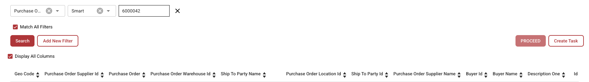

# Dati Fuzzy

### **Panoramica**

I campi Dati Fuzzy consentono agli utenti di compilare campi correlati in base a corrispondenze approssimative con i dati master. Questi campi sono identificati da una **icona blu** accanto ad essi.

<figure><figcaption></figcaption></figure>

### **Funzionalità**

#### **Cosa fanno i campi Dati Fuzzy?**

* Compilano i campi correlati in base al loro valore o al testo inserito.
* I tre campi standard che usano i Dati Fuzzy sono:
  * **Purchase Order**
  * **Supplier**
  * **Vendor ID**

#### **Utilizzo dei campi Dati Fuzzy**

1. **Selezione di un Purchase Order**
   *   Cliccando sull'**icona blu** accanto al campo Purchase Order si apre una **finestra di selezione**.

       <figure><figcaption></figcaption></figure>
   * Questa finestra contiene una tabella con tutti gli ordini di acquisto della **tabella di lookup dei dati master**.
   * Attivando l'opzione **"Display all columns"** vengono mostrati ulteriori dettagli.
   * Seleziona un **Purchase Order** e clicca su **Proceed**:
     * Se il sistema trova un Purchase Order nel documento, lo filtra automaticamente.
     * Se non viene trovata alcuna corrispondenza, puoi **creare filtri personalizzati** per trovare il Purchase Order corretto.
     * È possibile aggiungere più filtri; attivando **"Match all filters"** si assicura che tutte le condizioni siano soddisfatte.
     * Opzioni di filtro disponibili:
       * **Smart**
       * **Contains**
       * **Exact**
       * **Starts with**
       * **Ends with**
   * Un pulsante accanto a **Proceed** permette di **creare una nuova attività/notifica**.
2. **Selezione di un Supplier o Vendor ID**
   * Il procedimento è lo stesso dei Purchase Order.
   * La differenza è che i campi **Supplier e Vendor ID usano la tabella dei dati master dei fornitori** invece della tabella dei dati master delle testate degli ordini di acquisto.

#### **Indicazione di compilazione del campo**

* Se un campo viene compilato tramite Dati Fuzzy anziché essere estratto dal documento, compare una **piccola icona di suggerimento o informazione** che indica che i dati **non sono stati estratti dal documento** ma compilati in base ai dati master.

### **Configurazione dell'amministratore**


[fuzzy-data-configuration-with-master-data.md](../../../administration-and-setup/setup/document-types/fuzzy-data-configuration-with-master-data.md)



[fuzzy-data-configuration-with-list-of-values.md](../../../administration-and-setup/setup/document-types/fuzzy-data-configuration-with-list-of-values.md)



