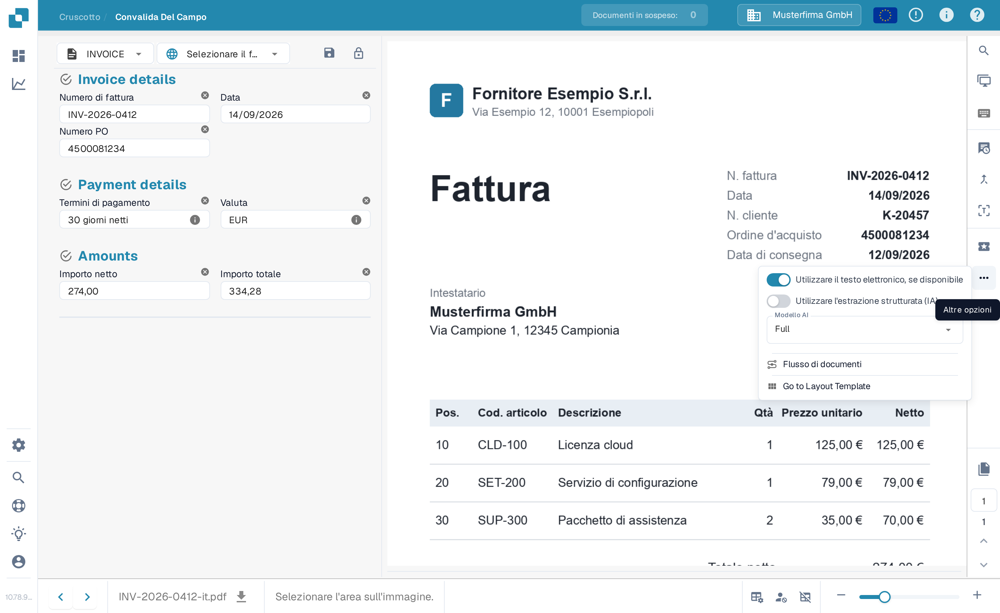
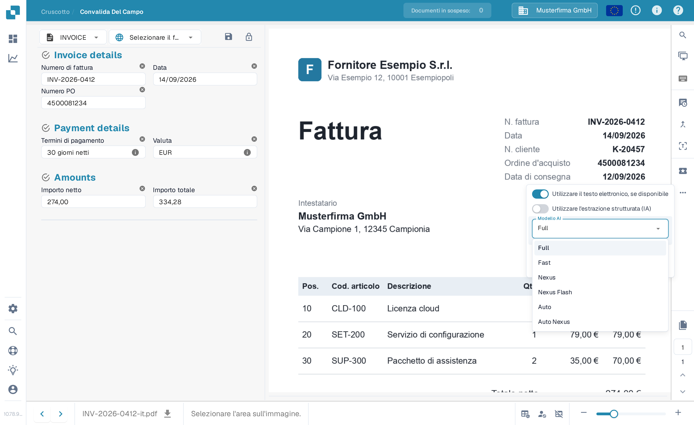

# Modello di IA Specifico per Fornitore per l'Estrazione di Campi e Tabelle

Nella sezione degli strumenti della **Schermata di validazione**, puoi scegliere il modello di IA utilizzato per l'**Estrazione dei campi** e l'**Estrazione delle tabelle**.\
Il **modello di IA** selezionato viene applicato solo a tutti i documenti del fornitore corrente.

Per cambiare il modello, apri il menu delle opzioni cliccando sul pulsante **Altre opzioni** (i tre punti) sul lato destro dello schermo, quindi scegli uno dei modelli disponibili: 

* **Full** – Precisione massima; costa 2 token per documento
* **Fast** – Livello predefinito; costa 1 token per documento
* **Nexus** – Costa 1 token per documento
* **Nexus Flash** – Livello più rapido della famiglia Nexus; costa 1 token per documento
* **Auto** – DocBits decide documento per documento se basta Fast o se serve Full; costa 1 token per documento
* **Auto Nexus** – Come Auto, ma limitato alla famiglia di modelli Nexus; costa 1 token per documento

<figure><figcaption>
Apri il menu delle opzioni e scegli il modello di IA per questo fornitore.
</figcaption></figure>

<figure><figcaption>
Il menu a discesa Modello AI con le sei opzioni disponibili.
</figcaption></figure>

Se i risultati dell'**estrazione dei campi** o dell'**estrazione delle tabelle** non sono soddisfacenti, prova a passare a un altro modello per migliorare la precisione.

Per configurare il modello di IA **globalmente per i fornitori senza un modello personalizzato** o per **gestire quale modello è attivo per ogni fornitore**, consulta la documentazione corrispondente [**qui**](../../../administration-and-setup/settings/document-processing/classification-and-extraction/ai-model.md).
