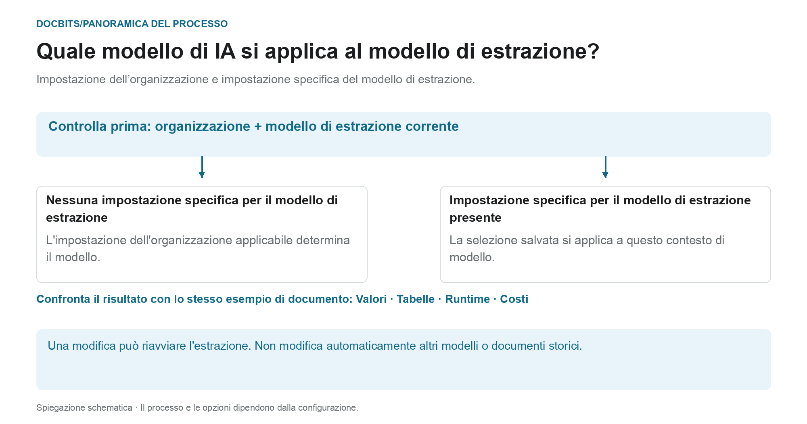

# Modello di IA Specifico per Fornitore per l'Estrazione di Campi e Tabelle

## Da standard organizzativo a modello efficace

<figure><figcaption>
Impostazione dell’organizzazione e impostazione specifica del modello di estrazione. Il diagramma è schematico; le impostazioni attive della tua organizzazione determinano il comportamento effettivo.
</figcaption></figure>

La voce nella schermata di convalida è chiamata modello AI specifico del fornitore. Tuttavia, il **contesto corrente del modello di estrazione** è fondamentale: l'override viene salvato per organizzazione e modello. Un fornitore può avere più modelli con impostazioni diverse.

1. **Determinare il contesto:** esamina l'organizzazione, il documento e il modello di estrazione corrente prima di modificare un modello.
2. **Controlla l'override:** se un modello è memorizzato per questo modello, questa selezione avrà effetto nel suo ambito. Se manca una sostituzione, viene applicata l'impostazione dell'organizzazione applicabile.
3. **Conferma deliberatamente la modifica:** seleziona solo un'opzione disponibile nel tuo ambiente. Una modifica potrebbe richiedere una conferma e attivare nuovamente l'estrazione. La sola apertura del menu non modifica la selezione.
4. **Confronta i risultati:** controlla i valori dei campi, le tabelle, il tempo di esecuzione e i costi con un campione fisso. Un livello di modello diverso non garantisce una migliore estrazione, una convalida riuscita o una corrispondenza PO.

**Esempio:** Il fornitore A utilizza i modelli “Fattura nazionale” e “Fattura estera”. Una sostituzione per "Fattura nazionale" non modifica tutte le fatture di quel fornitore. Per un altro documento, controlla nuovamente il modello e l'impostazione effettiva.

Il grafico mostra la gerarchia di selezione, non una raccomandazione per un livello di modello specifico. Le informazioni sulla diagnosi [Standard organizzativi e override](../../../administration-and-setup/settings/document-processing/classification-and-extraction/ai-model.md) e [Quale percorso di estrazione è stato utilizzato?](../../../overview-and-basics/faq/document-processing/which-extraction-path-was-used.md) aiutano a classificare il risultato effettivo.

Gli strumenti della schermata di convalida consentono di scegliere il modello per l’estrazione di campi e tabelle nel contesto del template corrente. La preferenza è salvata per organizzazione e template di estrazione (`tfidf_id`); non modifica automaticamente tutti i template o i documenti storici dello stesso fornitore. In assenza di una preferenza specifica viene usata la configurazione applicabile dell’organizzazione.

Aprire **Altre opzioni** e il selettore del modello AI. Il menu offre **Full**, **Fast**, **Nexus**, **Nexus Flash**, **Auto** e **Auto Nexus**. Verificare disponibilità e costi attuali dell’ambiente e le condizioni concordate. Nessuna opzione è sempre la più precisa o veloce; Fast non è un valore predefinito universale.

Un cambio può richiedere conferma e riavviare l’estrazione. Controllare prima il documento e l’ambito della modifica. Aprire il menu non cambia la preferenza; le illustrazioni non dimostrano l’esecuzione di un cambio di modello.

<figure><figcaption>
Esempio conservato della schermata di convalida con dati sintetici e Altre opzioni → Modello AI. I titoli configurati Invoice details, Payment details, Amounts e il collegamento Go to Layout Template restano in inglese. La preferenza riguarda organizzazione e template corrente, non tutti i documenti del fornitore. Non è una nuova cattura né un cambio di modello eseguito.
</figcaption></figure>

<figure><figcaption>
Esempio conservato con dati sintetici e menu Modello AI: Full, Fast, Nexus, Nexus Flash, Auto e Auto Nexus. I nomi sono livelli del prodotto; la selezione illustrata non dimostra prestazioni, costi o rielaborazione. Non è una nuova cattura.
</figcaption></figure>

Confrontare i modelli con documenti di test autorizzati e controllare valori, tempi e costi. Un cambio può rielaborare un documento e non garantisce un miglioramento. Per configurare il valore dell’organizzazione o esaminare le preferenze dei template, consultare la documentazione collegata.

[**qui**](../../../administration-and-setup/settings/document-processing/classification-and-extraction/ai-model.md)
