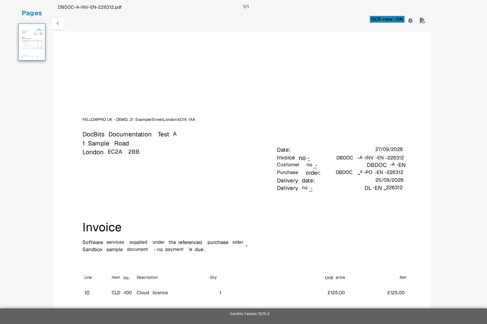

# Risoluzione dei problemi

Se un valore manca nella schermata di validazione, controlla prima se il testo è visibile nel documento e se DocBits lo ha riconosciuto. Questo ti aiuta a distinguere un problema di lettura da un problema di campo o di regola.

1. Apri il documento interessato in **Validazione**.
2. Confronta il documento originale con la **vista OCR**. Controlla la stessa pagina e la stessa area in cui dovrebbe comparire il valore.
3. Se il testo manca nella vista OCR, segui [Testo mancante nell'estrazione OCR](missing-text-in-ocr-extraction.md).
4. Se il testo è presente nella vista OCR ma il campo resta vuoto, chiedi a un amministratore di controllare la configurazione dei campi del tipo di documento. Indica il tipo di documento, il nome del campo, la pagina e un esempio di prova sicuro.

<figure><figcaption>Vista OCR attuale in inglese della Sandbox di una fattura sintetica Test A. L'esempio serve per l'orientamento; non mostra un'estrazione fallita.</figcaption></figure>

Non includere documenti dei clienti o dati personali in uno screenshot per il supporto. La [panoramica della schermata di Validazione](../README.md) spiega i controlli principali se non conosci ancora questa schermata.
