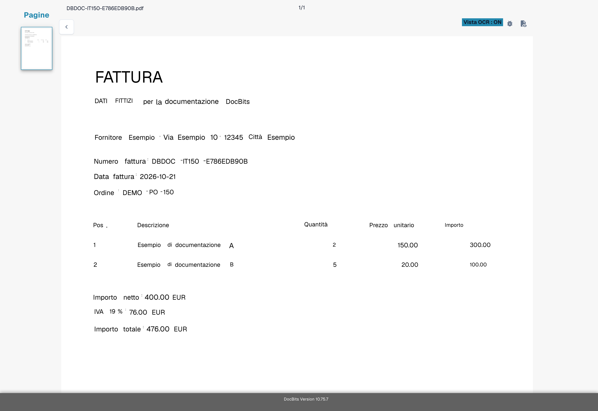
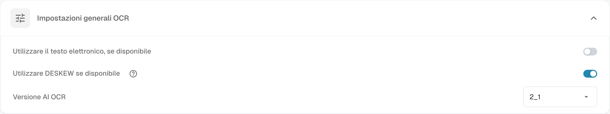
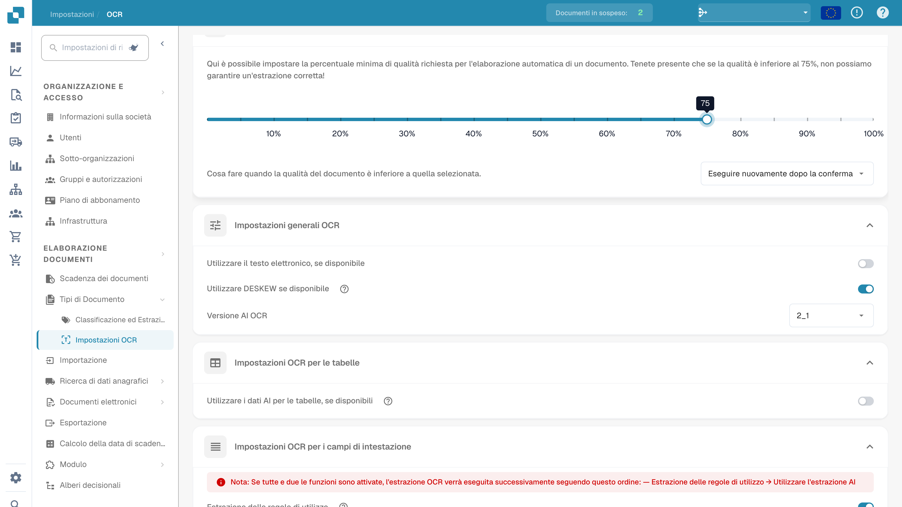

# Testo mancante nell'estrazione OCR

## **Problema**

In alcuni casi, il testo potrebbe sembrare mancante nella **Vista OCR**, il che impedisce di essere estratto utilizzando la funzione di estrazione.

<figure><figcaption>
Verifica dei campi estratti da una fattura fittizia.
</figcaption></figure>

Per verificare questo, fai clic sul pulsante **Vista OCR** nella barra degli strumenti a destra. Se il testo non appare lì, significa che non è disponibile per l'estrazione.

<figure><figcaption>
Vista OCR del testo riconosciuto sulla fattura fittizia.
</figcaption></figure>

## **Causa**

La causa più probabile è che il testo che stai cercando di estrarre fa parte di un'immagine (ad es. un logo o una sezione scansionata) all'interno del documento.\
Quando la funzione E-Text è attivata, il testo che appare su immagini o loghi non è incluso nel livello di testo estratto. Di conseguenza, questo testo non può essere accessibile o estratto tramite la logica di estrazione standard.

## **Soluzione**

Per risolvere questo problema, disabilita la funzione E-Text—sia per il [fornitore specifico](missing-text-in-ocr-extraction.md#disabilita-e-text-per-un-fornitore-specifico) sia per [l'intera organizzazione](missing-text-in-ocr-extraction.md#disabilita-e-text-per-lintera-organizzazione). Una volta disattivato E-Text, DocBits si baserà esclusivamente su OCR, che è in grado di estrarre testo da immagini e loghi all'interno del documento.

### **Disabilita E-Text per un Fornitore Specifico**

1. Apri un documento del fornitore specifico in **Validazione del campo**.
2.  Fai clic sul menu a tre punti nella barra degli strumenti a destra.

<figure><figcaption>
Menu delle opzioni aggiuntive nella convalida dei campi.
</figcaption></figure>

3.  Deseleziona **Utilizzare il testo elettronico, se disponibile**.

<figure><figcaption>
Opzione di utilizzo del testo elettronico nel menu del documento.
</figcaption></figure>

4.  Fai clic su **Confermare** per riavviare l'elaborazione del documento.

<figure><figcaption>
Conferma prima di modificare l’utilizzo del testo elettronico.
</figcaption></figure>

### Disabilita E-Text per l'Intera Organizzazione

1.  Vai su **Impostazioni → Elaborazione dei documenti → Impostazioni OCR**.

<figure><figcaption>
Impostazioni OCR nell’interfaccia italiana.
</figcaption></figure>

2.  Sotto **Impostazioni generali OCR**, deseleziona l'opzione **Utilizzare il testo elettronico, se disponibile**.

<figure><figcaption>
Impostazioni OCR generali con l’opzione di utilizzo del testo elettronico.
</figcaption></figure>

Le immagini utilizzano una fattura fittizia con testo OCR disponibile. Illustrano verifiche dell’interfaccia, non un incidente riprodotto di testo mancante.
