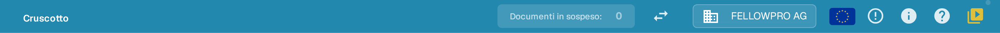
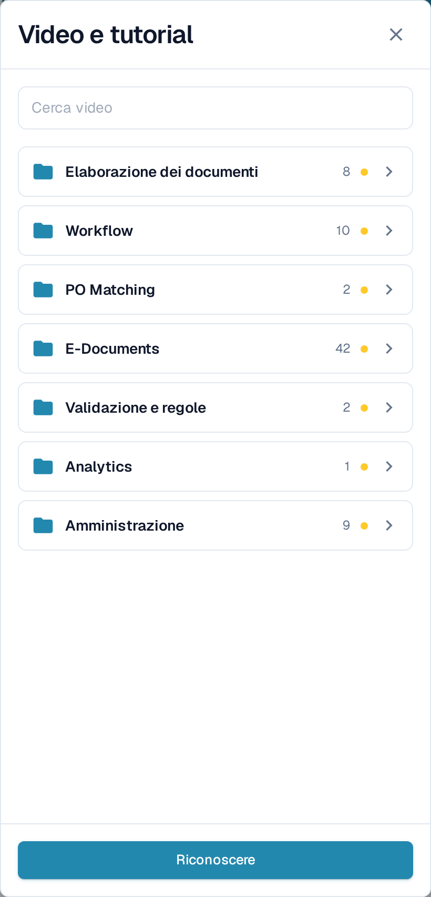
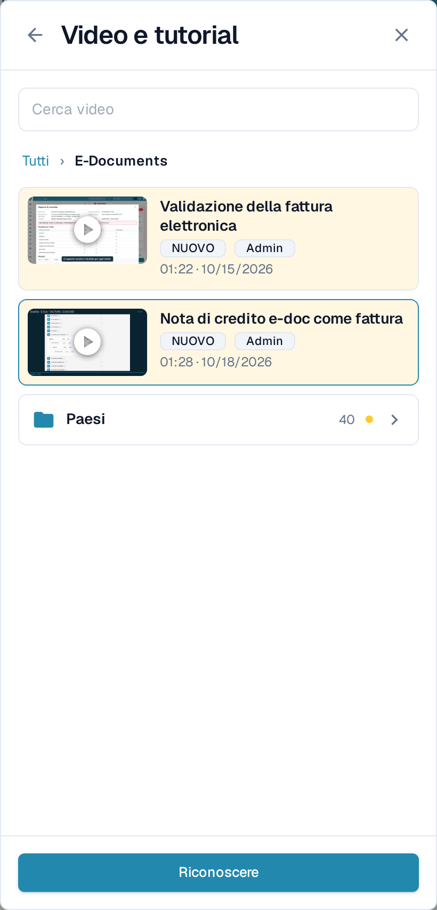
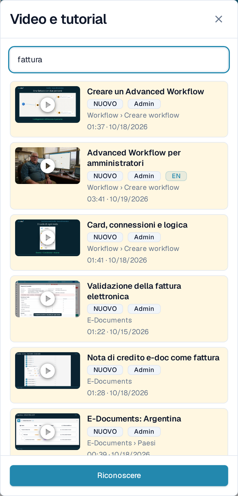
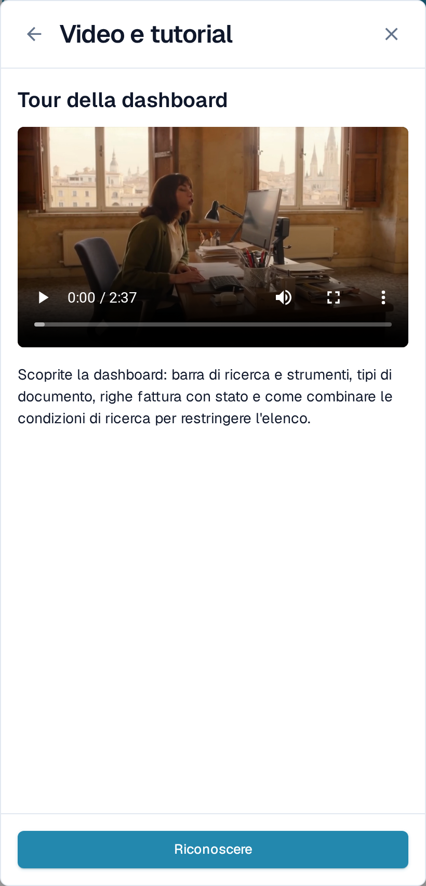

# Video e tutorial

**Video e tutorial** riproduce brevi video di DocBits senza farvi lasciare la pagina su cui state lavorando. I video sono raggruppati per argomento, così trovate subito quello adatto all'attività che avete davanti.

## Aprire il pannello

L'icona del video si trova all'estremità destra della barra superiore, dopo l'icona della guida.

<figure><figcaption>
L'icona del video è l'ultima icona della barra superiore.
</figcaption></figure>

* L'icona è **gialla con un puntino** finché almeno un video non è stato confermato.
* Assume il colore delle altre icone della barra non appena avete confermato tutti i video.

Selezionate l'icona per aprire **Video e tutorial** come pannello sul lato destro.

<figure><figcaption>
Il pannello si apre sull'elenco degli argomenti. Ogni argomento è una cartella con il proprio numero di video.
</figcaption></figure>

## Sfogliare un argomento

Il pannello si apre sulle **cartelle degli argomenti**, per esempio **Elaborazione dei documenti**, **Workflow**, **E-Documents** o **Amministrazione**. Una cartella indica quanti video contiene e mostra il contrassegno **NUOVO** finché contiene un video che non avete ancora confermato.

Selezionate una cartella per aprirla. All'interno trovate i video di quell'argomento e, quando l'argomento è ampio, altre cartelle che li raggruppano, come **Paesi** dentro **E-Documents**. Il percorso in alto e la freccia Indietro vi riportano di un livello. Un video aperto da una cartella torna in quella cartella quando lo chiudete.

<figure><figcaption>
Aprite un argomento per vederne i video e le sottocartelle.
</figcaption></figure>

## Cercare un video

Digitate in **Cerca video** per consultare tutti gli argomenti in una volta sola. Ogni risultato indica la cartella a cui appartiene, per esempio **Workflow › Creare workflow**, così sapete dove si trova il video. La ricerca trova anche i nomi di argomenti e cartelle e ignora maiuscole e accenti.

<figure><figcaption>
La ricerca copre tutti gli argomenti e mostra la cartella di ogni risultato.
</figcaption></figure>

Svuotate il campo di ricerca per tornare alle cartelle degli argomenti.

## Guardare un video e confermarlo

Selezionate un video per riprodurlo nel pannello. Il titolo e una breve descrizione indicano di cosa tratta.

<figure><figcaption>
Riproducete il video nel pannello, poi confermatelo.
</figcaption></figure>

Selezionate **Riconoscere** dopo aver guardato il video. In questo modo risulta visto solo per la vostra utenza: il contrassegno **NUOVO** sparisce per voi sul video e sulla sua cartella, e l'icona nella barra superiore diventa grigia non appena non resta nulla da confermare. Gli altri utenti continuano a vedere i propri video non confermati.

## Video per amministratori e per utenti

* I video contrassegnati con **Admin** sono destinati agli amministratori. Gli amministratori vedono nel pannello sia i video per amministratori sia quelli per utenti finali; gli utenti finali vedono solo questi ultimi.
* Se un video non è disponibile nella lingua della vostra interfaccia, viene mostrata la versione inglese con un codice lingua come **EN**.


Le schermate mostrano l'organizzazione di test di DocBits con l'applicazione impostata in italiano.

