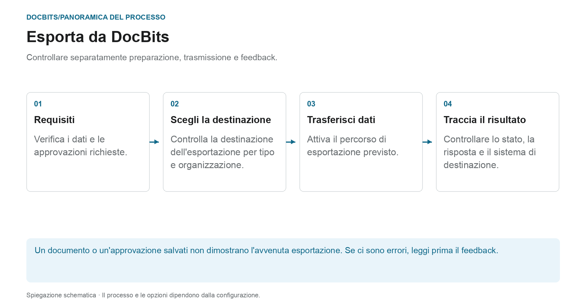

# Esportazione in DocBits

## Dal documento controllato al sistema di destinazione

<figure><figcaption>
Controllare separatamente preparazione, trasmissione e feedback. Il diagramma è schematico; le impostazioni attive della tua organizzazione determinano il comportamento effettivo.
</figcaption></figure>

Durante l'esportazione, DocBits trasferisce documenti e dati a una connessione stabilita. Il fatto che un'esportazione venga offerta o attivata automaticamente dipende dal tipo di documento, dallo stato, dal flusso di lavoro e dalla configurazione dell'esportazione.

1. **Verifica i prerequisiti:** esamina i dati del documento, le attività aperte e le approvazioni richieste dal processo. La corretta corrispondenza PO non sostituisce questi passaggi.
2. **Chiarire la destinazione dell'esportazione:** controlla quale configurazione si applica al tipo di documento e all'organizzazione o sottoorganizzazione. La gestione delle esportazioni supporta, tra gli altri, Infor, Infor & IDM, Webhook e SFTP. L'effettivo volume della fornitura dipende dal collegamento realizzato.
3. **Attiva trasferimento:** utilizza l'azione del documento prevista o il flusso di lavoro configurato. Un'esportazione alternativa viene impostata separatamente; il suo stato di disponibilità non è lo stato da impostare dopo l'esportazione.
4. **Controlla il feedback:** controlla lo stato del documento e le risposte disponibili dei destinatari. Per un controllo end-to-end si controlla anche il relativo processo nel sistema di destinazione. Per Infor, ulteriori fasi di elaborazione possono seguire in ION e ERP.

### Se l'esportazione fallisce

Aprire i dettagli dell'errore prima di esportare nuovamente. L'invio ripetuto non risolverà una mappatura errata o un rifiuto da parte del destinatario. Utilizzare la risposta per verificare i valori del documento, la mappatura e la configurazione di destinazione e verificare se una transazione è già stata creata nel sistema di destinazione.

### Ulteriori istruzioni

- [Modulo di esportazione](export-module.md): Iniziare con l'amministrazione.
- [Esporta configurazione](../../administration-and-setup/settings/document-processing/export.md): Connessioni e ambiti.
- [Esportazione alternativa](alternate-export.md): percorso di esportazione separato per tipo e stato del documento.
- [Esporta in Infor](../exporting-to-infor/README.md): elaborazione Infor a valle.

Una guida per esportare documenti in DocBits.
