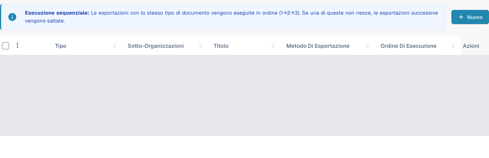
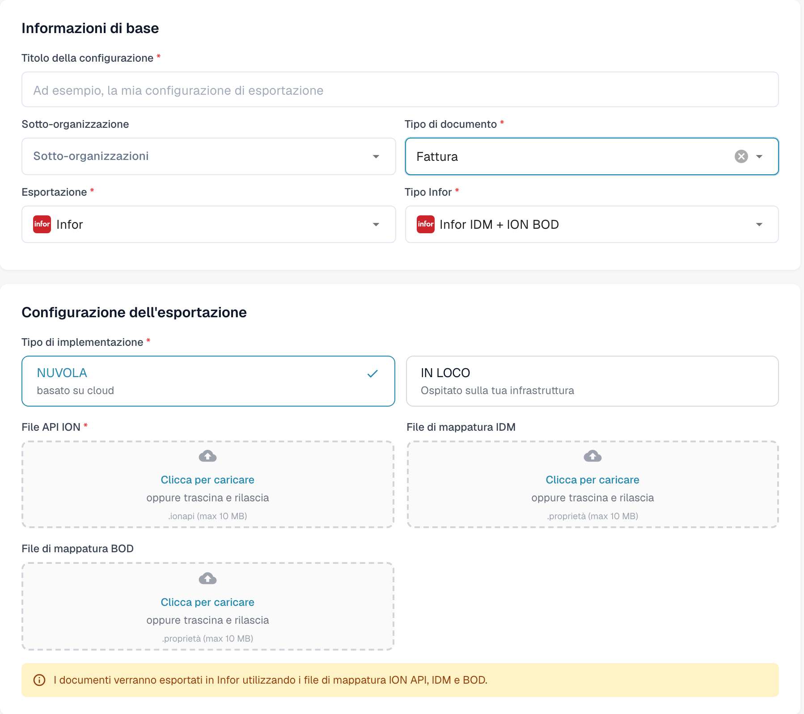

# Creazione di un endpoint API ION per le esportazioni DocBits

Un amministratore Infor configura l'endpoint API Gateway per il **singolo ambiente e organizzazione DocBits**. Le immagini vecchie di questa pagina mostravano un unico tenant Infor storico, un esempio fisso `api.docbits.com` e un modulo di esportazione DocBits più vecchio. Utilizzare l'URL di destinazione, la chiave API e il documento OpenAPI approvati per l'ambiente effettivo. Per questo aggiornamento non è stato collegato alcun tenant Infor né salvato alcun endpoint.

## Prima di iniziare

Raccogliere dall'amministratore di integrazione l'URL dell'API DocBits di destinazione, la chiave API approvata con il nome della sua intestazione, l'URL OpenAPI e gli ambienti Infor e DocBits previsti. Tenere le chiavi e i file `.ionapi` fuori dai ticket, dagli screenshot e dal repository Git. Verificare che un endpoint di prova non possa instradare verso la produzione.

## Configurare Infor API Gateway

1. In **Available APIs**, creare una suite API di tipo **Custom or Non-Infor** per l'ambiente di destinazione. Consultare le [istruzioni di Infor sulla suite API](https://docs.infor.com/inforos/2025.x/en-us/useradminlib_cloud/apigatewayag_cloud/gyy1489512842881.html).
2. Aggiungere alla suite un endpoint con l'**URL dell'endpoint di destinazione** approvato. Selezionare il tipo di autenticazione richiesto da quell'endpoint. Per **API Key**, Infor richiede **Nome chiave** e **Valore chiave**; usare il nome previsto dal contratto dell'API DocBits e la chiave emessa per questa organizzazione. Consultare i [campi dell'endpoint](https://docs.infor.com/inforos/2024.x/en-us/useradminlib_cloud/apigatewayag_cloud/bmg1489588707659.html) di Infor. Non copiare una chiave da un ambiente diverso.
3. Aggiungere l'URL OpenAPI/Swagger dell'ambiente nelle impostazioni **Documentation** dell'endpoint, seguendo le [istruzioni di Infor sulla documentazione](https://docs.infor.com/inforos/2025.x/en-us/useradminlib_cloud/apigatewayag_cloud/tzr1489597424134.html). Verificare che l'endpoint compaia nei [metadati dell'API](https://docs.infor.com/inforos/2025.x/en-us/useradminlib_cloud/apigatewayag_cloud/tdr1489674063627.html).
4. Con l'amministratore Infor, verificare l'URL di destinazione, l'autenticazione, il percorso del proxy e una chiamata sicura fuori produzione prima di usare l'endpoint in un flusso di documenti ION. Salvare una suite API non dimostra di per sé che un documento sia stato consegnato.

## Configurare l'esportazione in DocBits

Nell'organizzazione DocBits prevista, aprire **Impostazioni → Esportazione** e selezionare **Nuovo**. I dati delle configurazioni esistenti sono coperti nell'immagine.

<figure><figcaption>
Nuovo apre una configurazione non salvata. I dati delle configurazioni esistenti sono coperti in questa acquisizione nativa attuale.
</figcaption></figure>

Inserire **Titolo della configurazione**, scegliere **Tipo di documento** e, se necessario, **Sotto-organizzazione**. In **Esportazione**, scegliere il valore visualizzato **Infor** corrispondente a Infor, quindi **Infor IDM + ION BOD** in **Tipo Infor**. L'esempio utilizza **Fattura**.

In **Tipo di implementazione**, scegliere la distribuzione cloud o locale adatta all'ambiente. Il modulo presenta **File API ION** (`.ionapi`, obbligatorio), **File di mappatura IDM** (`.properties`) e **File di mappatura BOD** (`.properties`). Richiedere all'amministratore i file specifici del tenant. Nell'immagine il titolo, la sotto-organizzazione e i tre caricamenti sono vuoti.

<figure><figcaption>
Modulo nativo attuale Infor IDM + ION BOD: Fattura e la modalità cloud sono selezionati; titolo, sotto-organizzazione e tre caricamenti sono vuoti. Il modulo è stato chiuso con Annulla senza salvare.
</figcaption></figure>

Dopo che l'amministratore ha convalidato il percorso ION, salvare la configurazione e testare un documento fuori produzione. Verificarne lo stato in DocBits e in Infor ION. Un modulo salvato o una voce nei metadati dell'API non dimostrano un'esportazione riuscita.

La verifica della documentazione ha consultato solo l'elenco e il nuovo modulo. Non sono stati eseguiti caricamenti, salvataggi, attivazioni, test di connessione, accessi a tenant Infor o esportazioni effettive di documenti.
