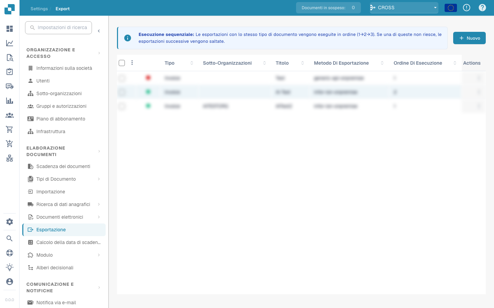

# Esportazione verso M3 Mapping (API)

### Sezioni

Il file di mapping per l'esportazione verso M3 è suddiviso in 5 sezioni e ciascuna sezione è a sua volta suddivisa in 2 sezioni

* Header (Testata)
  * Header Static Fields (Campi statici della testata)
  * Header Fields (Campi della testata)
* Tax Lines (Righe IVA)
  * Tax Line Static Fields (Campi statici delle righe IVA)
  * Tax Line Fields (Campi delle righe IVA)
* Receipt Lines (Righe di ricezione)
  * Receipt Line Static Fields (Campi statici delle righe di ricezione)
  * Receipt Line Fields (Campi delle righe di ricezione)
* Order Charge Lines (Importi aggiuntivi)
  * Order Charge Static Fields (Campi statici degli addebiti d'ordine)
  * Order Charge Fields (Campi degli addebiti d'ordine)
* Cost Lines (Righe di costo)
  * Cost Line Static Fields (Campi statici delle righe di costo)
  * Cost Line Fields (Campi delle righe di costo)

### Aggiungere e rimuovere campi

Aggiungere un nuovo campo:

* Per prima cosa dobbiamo aggiungere il **nome del campo API di M3** alla proprietà con l'elenco dei campi della sezione pertinente (ad es. StaticFields, HeaderFields, InvoiceTaxFields)
* Definisci il valore statico o il nome del campo del documento per il campo API con il prefisso appropriato per la sezione
  * Esempio 1: per definire un valore statico **AAA** per il campo API di M3 **DIVI.** Prima aggiungiamo DIVI alla proprietà **StaticFields**. Poi aggiungiamo una riga **SF\_DIVI = AAA**, poiché SF\_ è il prefisso dei campi statici
  * Esempio 2: per mappare il campo di testata **IVDT (invoice data)** sul campo invoice\_date di DocBits. Prima aggiungiamo IVDT alla proprietà **HeaderFields**. Poi aggiungiamo una riga HF\_IVDT = invoice\_date, poiché HF\_ è il prefisso dei campi di testata

Rimuovere un campo:

* Basta rimuovere il campo dalla proprietà con l'elenco dei campi della sezione e rimuovere la riga che definisce il valore del campo.

#### **Campi API di M3 disponibili:**

* I campi M3 disponibili si possono verificare aprendo la schermata appropriata in M3.

<figure><figcaption></figcaption></figure>

<figure><figcaption></figcaption></figure>

* Allo stesso modo puoi ottenere i nomi dei campi per le righe

### Testata (Header):

<figure><figcaption></figcaption></figure>

Proprietà con l'elenco dei campi: StaticFields

Prefisso dei campi della sezione: SF\_

Campi disponibili: puoi mappare qualsiasi campo API di M3 con qualsiasi valore statico

#### **Campi della testata**

Proprietà con l'elenco dei campi: HeaderFields

Prefisso dei campi della sezione: HF\_

Campi disponibili: puoi mappare qualsiasi campo DocBits su qualsiasi campo API di M3

### Riga IVA (Tax Line):

#### Campi statici della riga IVA:

Proprietà con l'elenco dei campi: InvoiceTaxStaticFields

Prefisso dei campi della sezione: IT\_SF\_

Campi M3 disponibili: consulta l'API o l'interfaccia di M3

Campi DocBits disponibili: puoi inserire qualsiasi valore, trattandosi di campi statici

#### Campi della riga IVA:

Proprietà con l'elenco dei campi: InvoiceTaxFields

Prefisso dei campi M3: ITF\_

Prefisso dei campi tabella di DocBits: TF\_

Campi M3 disponibili: consulta l'API o l'interfaccia di M3

Campi DocBits disponibili: line\_number, tax\_amount, tax\_rate, net\_amount, gross\_amount, tax\_code\_full, tax\_code, tax\_country

### Riga di ricezione (Receipt Line):

#### Campi statici della riga di ricezione:

Proprietà con l'elenco dei campi: InvoiceReceiptStaticFields

Prefisso dei campi della sezione: IR\_SF\_

Campi M3 disponibili: consulta l'API o l'interfaccia di M3

Campi DocBits disponibili: puoi inserire qualsiasi valore, trattandosi di campi statici

#### Campi della riga di ricezione:

Proprietà con l'elenco dei campi: InvoiceReceiptFields

Prefisso dei campi M3: IRF\_

Prefisso dei campi tabella di DocBits: TF\_

Campi M3 disponibili: consulta l'API o l'interfaccia di M3

Campi DocBits disponibili: packing\_slip, purchase\_order, line\_number, line\_sequence, delivery\_number, delivery\_line, amount, quantity, total\_net\_amount

### Riga di addebito d'ordine (Order Charge Line):

#### Campi statici dell'addebito d'ordine:

Proprietà con l'elenco dei campi: OrderChargeStaticFields

Prefisso dei campi della sezione: OC\_SF\_

Campi M3 disponibili: consulta l'API o l'interfaccia di M3

Campi DocBits disponibili: puoi inserire qualsiasi valore, trattandosi di campi statici

#### Campi dell'addebito d'ordine:

Proprietà con l'elenco dei campi: OrderChargeFields

Prefisso dei campi M3: OCF\_

Prefisso dei campi tabella di DocBits: TF\_

Campi M3 disponibili: consulta l'API o l'interfaccia di M3

Campi DocBits disponibili: ledger\_account, dimension\_2-7, amount, quantity, quantity2, position

### Riga di costo (Cost Line):

#### Campi statici della riga di costo:

Proprietà con l'elenco dei campi: InvoiceCostStaticFields

Prefisso dei campi della sezione: IC\_SF\_

Campi M3 disponibili: consulta l'API o l'interfaccia di M3

Campi DocBits disponibili: puoi inserire qualsiasi valore, trattandosi di campi statici

#### Campi della riga di costo:

Proprietà con l'elenco dei campi: InvoiceCostFields

Prefisso dei campi M3: ICF\_

Prefisso dei campi tabella di DocBits: TF\_

Campi M3 disponibili: consulta l'API o l'interfaccia di M3

Campi DocBits disponibili: ledger\_account, dimension\_1-12, amount, quantity, quantity2, position

Nuovo aggiornamento

```
###########################
# Header
###########################

## Header Static Fields
StaticFields=DIVI,IBTP,BSCD,IMCD,TEPY,PYME,APCD,CRTP,GEOC,CONO,BKID
SF_DIVI=AAA
SF_IBTP=20
SF_CONO=780
#SF_BSCD=DE
SF_IMCD=0
SF_TEPY=N00
SF_PYME=SCT
SF_APCD=FABCEO
SF_CRTP=1
SF_GEOC=60290522

## Header Fields
HeaderFields=SUNO,IVDT,SINO,SPYN,CUCD,CUAM,VTAM,ACDT,SERS,FTCO,BSCD,PUNO,TXAP,CORI,PAIN,BKID
HF_SUNO=supplier_id
HF_IVDT=invoice_date
HF_SINO=invoice_id
HF_SPYN=supplier_id
HF_CUCD=currency
HF_CUAM=total_net_amount
#HF_VTAM=total_tax_amount
HF_ACDT=invoice_date
#HF_SERS=invoice_sub_type
HF_FTCO=supplier_country_code
HF_PUNO=purchase_order
HF_TXAP=tax_country_1
HF_CORI = correlation_id
HF_PAIN = sqr_field_esr_reference
HF_BKID = custom_field_1


###########################
# Tax Line
###########################

# ## Tax Line Static Fields
# InvoiceTaxStaticFields=RDTP,DIVI,VTCD,CONO
# IT_SF_RDTP=3
# IT_SF_DIVI=AAA
# IT_SF_CONO=780

# ## Tax Line Fields
# InvoiceTaxFields=VTCD,VTA1,VTP1,CLAM
# ITF_VTCD=TF_tax_code
# ITF_VTA1=TF_tax_amount
# ITF_VTP1=TF_tax_rate
# ITF_CLAM=TF_gross_amount

###########################
# Receipt Line
###########################

InvoiceReceipt=invoice_table

## Receipt Line Static Fields
InvoiceReceiptStaticFields=RDTP,DIVI,SERS,RELP,VTCD,CONO
IR_SF_RDTP=1
IR_SF_DIVI=AAA
IR_SF_SERS=0
IR_SF_RELP=1
#IR_SF_VTCD=52
IR_SF_CONO=780

## Receipt Line Fields
InvoiceReceiptFields=IVQA,PUUN,PUNO,PNLI,ITNO,POPN,SUDO,NEPR,GRPR,PPUN,NLAM,GLAM
IRF_IVQA = TF_quantity
IRF_PUUN = TF_unit
IRF_PUNO = TF_purchase_order
IRF_PNLI = TF_line_number
IRF_ITNO = TF_item_number
IRF_POPN = TF_item_number
IRF_SUDO = TF_packing_slip
#IRF_NEPR = TF_net_unit_price
IRF_GRPR = TF_gross_unit_price
IRF_PPUN = TF_unit
#IRF_NLAM = TF_net_amount
IRF_GLAM = TF_total_amount

###########################
# Order Charge Line
###########################

OrderCharge=order_charges

## Order Charge Static Fields
OrderChargeStaticFields=RDTP,DIVI,CONO
OC_SF_RDTP=2
OC_SF_DIVI=AAA
OC_SF_CONO=780

## Order Charge Fields
OrderChargeFields=NLAM,CHGT,CEID
OCF_NLAM=TF_amount
OCF_CHGT=TF_voucher_text
OCF_CEID=TF_ledger_account


###########################
# Cost Line
###########################

InvoiceCost=cost_lines

## Cost Line Static Fields
InvoiceCostStaticFields=RDTP,DIVI,CONO
IC_SF_RDTP=8
IC_SF_DIVI=AAA
IC_SF_CONO=780

## Cost Line Fields
InvoiceCostFields=NLAM,VTXT,AO01,AO02,AO03,AO04,AO05,AO06,AO07,VTCD,AIT1,AIT2,AIT3,AIT4,AIT5,AIT6,AIT7,VTP1,VTP2
ICF_NLAM=TF_amount
ICF_VTXT=TF_voucher_text
ICF_AIT1=TF_ledger_account
ICF_AIT2=TF_dimension_2
ICF_AIT3=TF_dimension_3
ICF_AIT4=TF_dimension_4
ICF_AIT5=TF_dimension_5
ICF_AIT6=TF_dimension_6
ICF_AIT7=TF_dimension_7
ICF_AO01=TF_accounting_object_1
ICF_AO02=TF_accounting_object_2
ICF_AO03=TF_accounting_object_3
ICF_AO04=TF_accounting_object_4
ICF_AO05=TF_accounting_object_5
ICF_AO06=TF_accounting_object_6
ICF_AO07=TF_accounting_object_7
```

### Per i clienti US aggiorniamo questo mapping alla V3

````
```
# Changes from Version 2 to Version 3:# -StaticFields=DIVI,IBTP,BSCD,IMCD,TEPY,PYME,APCD,CRTP,GEOC,BKID
# -SF_DIVI=PJA
# +StaticFields=DIVI,IBTP,BSCD,IMCD,TEPY,PYME,APCD,CRTP,CONO,GEOC
# +SF_DIVI=RFP
# +SF_CONO=001
# -SF_TEPY=J30
# -SF_PYME=PTR
# +#SF_TEPY=N00
# +#SF_PYME=CSH
# +#SF_APCD=MHIDALGO
# -SF_BKID=001
# +SF_GEOC=999999999
# +#SF_BKID=DJ1
# -HeaderFields=SUNO,IVDT,SINO,SPYN,CUCD,CUAM,VTAM,ACDT,SERS,FTCO,BSCD,PUNO,TXAP,CORI,PAIN
# +HeaderFields=SUNO,IVDT,SINO,SPYN,CUCD,CUAM,VTAM,ACDT,SERS,FTCO,BSCD,PUNO,TXAP,CORI,PAIN,TCHG,CDC1,APCD,TEPY,PYME,BKID
# -HF_CUAM=total_net_amount
# +HF_CUAM=total_net_amount_us
# -HF_ACDT=invoice_date
# +#HF_ACDT=invoice_date
# -HF_CORI = correlation_id
# -HF_PAIN = sqr_field_esr_reference
# -
# +HF_CORI=correlation_id
# +HF_PAIN=sqr_field_esr_reference
# +HF_TCHG=additional_amount
# +HF_CDC1=negative_amount
# +HF_APCD=buyer_id
# +HF_TEPY=payment_terms
# +HF_PYME=payment_method
# +HF_BKID=bank_id
# +#HF_GEOC=supplier_geoc
# -## Tax Line Static Fields
# -InvoiceTaxStaticFields=RDTP,DIVI,VTCD
# -IT_SF_RDTP=3
# -IT_SF_DIVI=PJA
# +# ## Tax Line Static Fields
# +# InvoiceTaxStaticFields=RDTP,DIVI,VTCD,CONO
# +# IT_SF_RDTP=3
# +# IT_SF_DIVI=AAA
# +# IT_SF_CONO=780
# -## Tax Line Fields
# -InvoiceTaxFields=VTCD,VTA1,VTP1,CLAM
# -ITF_VTCD=TF_tax_code
# -ITF_VTA1=TF_tax_amount
# -ITF_VTP1=TF_tax_rate
# -ITF_CLAM=TF_gross_amount
# +# ## Tax Line Fields
# +# InvoiceTaxFields=VTCD,VTA1,VTP1,CLAM
# +# ITF_VTCD=TF_tax_code
# +# ITF_VTA1=TF_tax_amount
# +# ITF_VTP1=TF_tax_rate
# +# ITF_CLAM=TF_gross_amount
# -InvoiceReceiptStaticFields=RDTP,DIVI,SERS,RELP,VTCD
# +InvoiceReceiptStaticFields=RDTP,DIVI,SERS,RELP,VTCD,CONO
# -IR_SF_DIVI=PJA
# -IR_SF_SERS=0
# +IR_SF_DIVI=RFP
# -IR_SF_VTCD=52
# +#IR_SF_VTCD=52
# +IR_SF_CONO=001
# -InvoiceReceiptFields=IVQA,PUUN,PUNO,PNLI,ITNO,POPN,SUDO,NEPR,GRPR,PPUN,NLAM,GLAM
# +InvoiceReceiptFields=IVQA,PUUN,PUNO,PNLI,ITNO,POPN,SUDO,NEPR,GRPR,PPUN,NLAM,GLAM,TCHG,CDC1
# -#IRF_PUNO = TF_purchase_order
# -#IRF_PNLI = TF_line_number
# +IRF_PUNO = TF_purchase_order
# +IRF_PNLI = TF_line_number
# -#IRF_NEPR = TF_net_unit_price
# +IRF_NEPR = TF_net_unit_price
# -IRF_PPUN = TF_unit
# -#IRF_NLAM = TF_net_amount
# +IRF_PPUN = TF_unit_code_price
# +IRF_NLAM = TF_net_amount
# +IRF_TCHG = TF_charges
# +IRF_CDC1 = TF_discount
# -OrderChargeStaticFields=RDTP,DIVI
# +OrderChargeStaticFields=RDTP,DIVI,CONO
# -OC_SF_DIVI=PJA
# +OC_SF_DIVI=RFP
# +OC_SF_CONO=001
# -InvoiceCostStaticFields=RDTP,DIVI
# +InvoiceCostStaticFields=RDTP,DIVI,CONO
# -IC_SF_DIVI=PJA
# +IC_SF_DIVI=RFP
# +IC_SF_CONO=001

###########################
# Header
###########################

## Header Static Fields
StaticFields=DIVI,IBTP,BSCD,IMCD,TEPY,PYME,APCD,CRTP,CONO,GEOC
SF_DIVI=RFP
SF_IBTP=20
SF_CONO=001
#SF_BSCD=DE
SF_IMCD=0
#SF_TEPY=N00
#SF_PYME=CSH
#SF_APCD=MHIDALGO
SF_CRTP=1
SF_GEOC=999999999
#SF_BKID=DJ1

## Header Fields
HeaderFields=SUNO,IVDT,SINO,SPYN,CUCD,CUAM,VTAM,ACDT,SERS,FTCO,BSCD,PUNO,TXAP,CORI,PAIN,TCHG,CDC1,APCD,TEPY,PYME,BKID
HF_SUNO=supplier_id
HF_IVDT=invoice_date
HF_SINO=invoice_id
HF_SPYN=supplier_id
HF_CUCD=currency
HF_CUAM=total_net_amount_us
#HF_VTAM=total_tax_amount
#HF_ACDT=invoice_date
#HF_SERS=invoice_sub_type
HF_FTCO=supplier_country_code
HF_PUNO=purchase_order
HF_TXAP=tax_country_1
HF_CORI=correlation_id
HF_PAIN=sqr_field_esr_reference
HF_TCHG=additional_amount
HF_CDC1=negative_amount
HF_APCD=buyer_id
HF_TEPY=payment_terms
HF_PYME=payment_method
HF_BKID=bank_id
#HF_GEOC=supplier_geoc

###########################
# Tax Line
###########################

# ## Tax Line Static Fields
# InvoiceTaxStaticFields=RDTP,DIVI,VTCD,CONO
# IT_SF_RDTP=3
# IT_SF_DIVI=AAA
# IT_SF_CONO=780

# ## Tax Line Fields
# InvoiceTaxFields=VTCD,VTA1,VTP1,CLAM
# ITF_VTCD=TF_tax_code
# ITF_VTA1=TF_tax_amount
# ITF_VTP1=TF_tax_rate
# ITF_CLAM=TF_gross_amount

###########################
# Receipt Line
###########################

InvoiceReceipt=invoice_table

## Receipt Line Static Fields
InvoiceReceiptStaticFields=RDTP,DIVI,SERS,RELP,VTCD,CONO
IR_SF_RDTP=1
IR_SF_DIVI=RFP
IR_SF_RELP=1
#IR_SF_VTCD=52
IR_SF_CONO=001

## Receipt Line Fields
InvoiceReceiptFields=IVQA,PUUN,PUNO,PNLI,ITNO,POPN,SUDO,NEPR,GRPR,PPUN,NLAM,GLAM,TCHG,CDC1
IRF_IVQA = TF_quantity
IRF_PUUN = TF_unit
IRF_PUNO = TF_purchase_order
IRF_PNLI = TF_line_number
IRF_ITNO = TF_item_number
IRF_POPN = TF_item_number
IRF_SUDO = TF_packing_slip
IRF_NEPR = TF_net_unit_price
IRF_GRPR = TF_gross_unit_price
IRF_PPUN = TF_unit_code_price
IRF_NLAM = TF_net_amount
IRF_GLAM = TF_total_amount
IRF_TCHG = TF_charges
IRF_CDC1 = TF_discount

###########################
# Order Charge Line
###########################

OrderCharge=order_charges

## Order Charge Static Fields
OrderChargeStaticFields=RDTP,DIVI,CONO
OC_SF_RDTP=2
OC_SF_DIVI=RFP
OC_SF_CONO=001

## Order Charge Fields
OrderChargeFields=NLAM,CHGT,CEID
OCF_NLAM=TF_amount
OCF_CHGT=TF_voucher_text
OCF_CEID=TF_ledger_account


###########################
# Cost Line
###########################

InvoiceCost=cost_lines

## Cost Line Static Fields
InvoiceCostStaticFields=RDTP,DIVI,CONO
IC_SF_RDTP=8
IC_SF_DIVI=RFP
IC_SF_CONO=001

## Cost Line Fields
InvoiceCostFields=NLAM,VTXT,AO01,AO02,AO03,AO04,AO05,AO06,AO07,VTCD,AIT1,AIT2,AIT3,AIT4,AIT5,AIT6,AIT7,VTP1,VTP2
ICF_NLAM=TF_amount
ICF_VTXT=TF_voucher_text
ICF_AIT1=TF_ledger_account
ICF_AIT2=TF_dimension_2
ICF_AIT3=TF_dimension_3
ICF_AIT4=TF_dimension_4
ICF_AIT5=TF_dimension_5
ICF_AIT6=TF_dimension_6
ICF_AIT7=TF_dimension_7
ICF_AO01=TF_accounting_object_1
ICF_AO02=TF_accounting_object_2
ICF_AO03=TF_accounting_object_3
ICF_AO04=TF_accounting_object_4
ICF_AO05=TF_accounting_object_5
ICF_AO06=TF_accounting_object_6
ICF_AO07=TF_accounting_object_7
```
````
