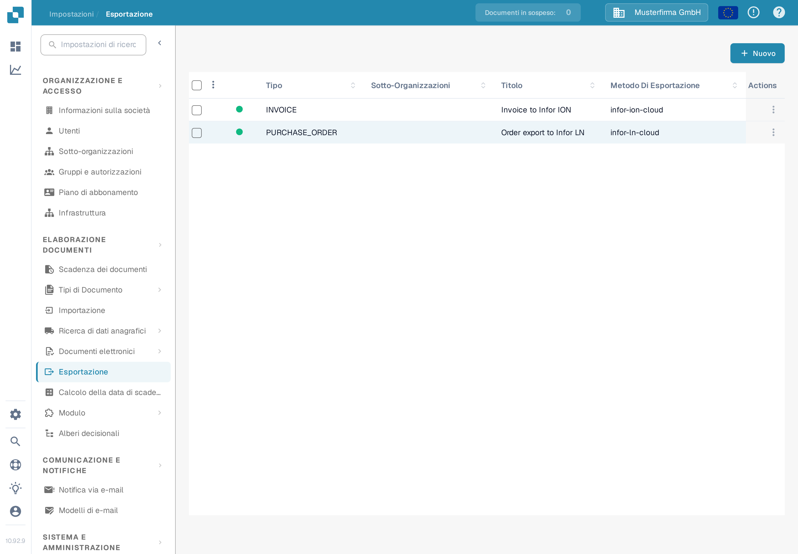
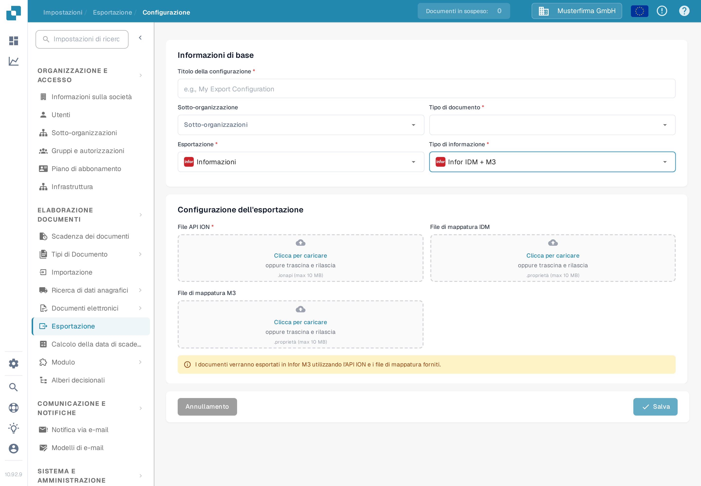

# Configurare un'esportazione Infor M3

Questa pagina spiega i controlli che collegano una configurazione di esportazione DocBits a un flusso documentale Infor ION per M3. La pagina precedente conteneva 38 screenshot di un tenant Infor più vecchio, comprese impostazioni di API e di mappatura specifiche dell'ambiente. Tali immagini non possono dimostrare la configurazione del tuo tenant, quindi la guida attuale rimanda alle istruzioni di Infor e mostra il modulo DocBits verificato in italiano. Per questo aggiornamento non sono stati testati né la connessione a Infor né l'esportazione delle fatture.

## Preparare il tenant Infor

Chiedi all'amministratore Infor l'**endpoint ION API** approvato, il file `.ionapi` specifico del tenant, i file `.properties` del **mapping IDM** e del **mapping M3**, e i nomi dei mapping BOD utilizzati dal flusso di fatturazione di questa azienda. Il file `.ionapi` contiene credenziali; tienilo fuori da screenshot, allegati Jira e Git. Il suo valore `ci` è l'ID client, come descritto nella [riferimento di Infor ai campi delle credenziali](https://docs.infor.com/crm/9.4.x/en-us/webclient/upi1639111995644.html).

Nell'ION Desk, l'amministratore dovrebbe:

1. Importare e approvare le versioni dei mapping richieste dal tenant corrente. Verifica i nomi BOD di input e output dei mapping, invece di riutilizzare i nomi di un vecchio screenshot.
2. Controllare i punti di connessione di DocBits e M3, i loro ID logici specifici dell'ambiente, le sottoscrizioni ai documenti e le autorizzazioni.
3. Costruire il flusso documentale con i mapping approvati e gli eventuali filtri necessari. Infor spiega [punti di connessione, mapping e flussi documentali](https://docs.infor.com/inforos/2024.x/en-us/useradminlib_cloud/iondeskceug_cloud_osm/lnj1556623308383.html).
4. Salvare, rivedere e [attivare il flusso documentale](https://docs.infor.com/depm/2024.x/en-us/depmolh/configuring_ion/jex1510174562552.html) solo dopo aver controllato i percorsi. L'attivazione è diversa da un esportazione di documenti riuscita.

Per un esempio ION storico completo, vedi [Esportazione verso Infor M3](README.md). Confronta ogni schermata Infor lì con il tuo tenant prima di seguirla.

## Configurare l'esportazione in DocBits

Nell'organizzazione DocBits prevista, apri **Impostazioni → Esportazione** e seleziona **Nuovo**. L'organizzazione italiana di prova Sandbox mostrata qui non ha alcuna configurazione di esportazione salvata.

<figure><figcaption>
Elenco di esportazione nelle impostazioni di DocBits in italiano: nessuna configurazione salvata, in alto a destra il pulsante „Nuovo“.
</figcaption></figure>

Inserisci un **Titolo della configurazione**, scegli il **Tipo di documento** (Fattura per questo flusso) e seleziona una **Sotto-organizzazione** solo se necessario. Scegli **Infor** per **Esportazione** e **Infor IDM + M3** per **Tipo di informazione**. Il modulo attuale chiede un **File API ION** (`.ionapi`, obbligatorio), un **File di mappatura IDM** (`.properties`) e un **File di mappatura M3** (`.properties`). Ottieni solo i file per questo tenant e rivedili prima di salvare. Lo screenshot lascia deliberatamente tutti i caricamenti vuoti.

<figure><figcaption>
Modulo di esportazione „Infor IDM + M3“ nell'interfaccia Sandbox in italiano; i campi File API ION, File di mappatura IDM e File di mappatura M3 sono lasciati vuoti.
</figcaption></figure>

Dopo aver attivato il flusso Infor, prova con una singola fattura non di produzione. Controlla il suo risultato in DocBits, ION e M3. Una configurazione salvata o un flusso attivato da soli non dimostrano che la fattura è arrivata.
