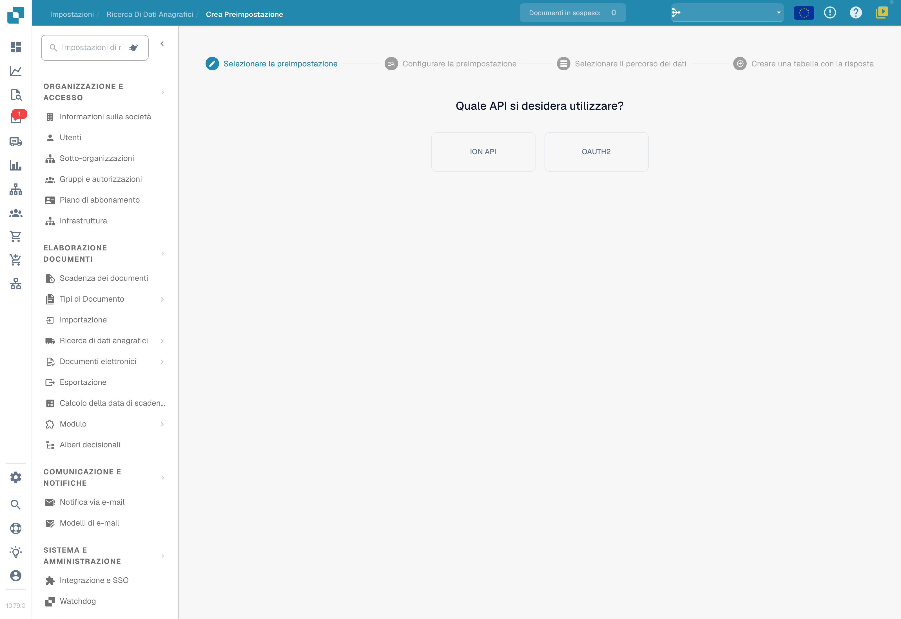
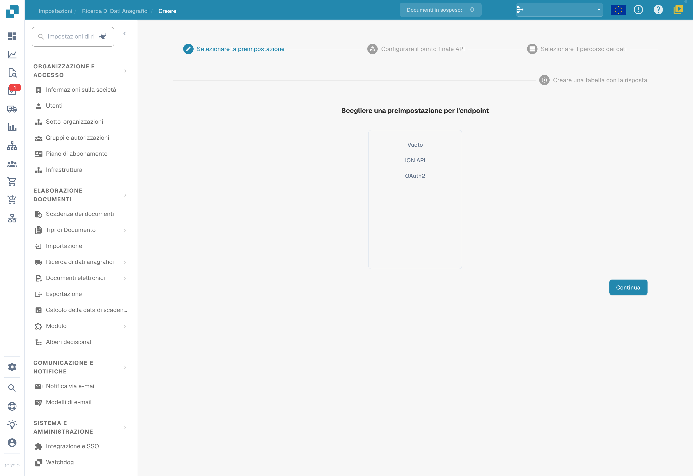

# Dati anagrafici personalizzati

## Disponibilità della funzione 

Verifica con l’amministratore la disponibilità dei dati anagrafici personalizzati in **Impostazioni → Modulo**. L’abilitazione è una modifica dell’organizzazione: controlla autorizzazioni e requisiti dell’integrazione prima di procedere.

## Panoramica 

Apri la ricerca dei dati anagrafici nelle impostazioni e l’area per le sorgenti personalizzate. Nella versione illustrata la preparazione distingue una **preimpostazione** di connessione e l’**endpoint** che la usa. I primi passaggi della procedura non dimostrano che una tabella sia stata creata o popolata.

## Preparare una preimpostazione 

Apri la creazione di una preimpostazione e scegli il tipo di API richiesto dall’integrazione, ad esempio **ION API** o **OAuth2**. Fornisci soltanto le credenziali autorizzate per la sorgente prevista. I campi successivi dipendono dall’opzione e dalla versione installata.

<figure><figcaption>
Primo passaggio Crea preimpostazione con Quale API si desidera utilizzare? e opzioni tecniche ION API e OAuth2. Nessuna credenziale è stata inserita e nessuna preimpostazione è stata salvata.
</figcaption></figure>

## Preparare un endpoint 

Apri la creazione di un endpoint e seleziona la preimpostazione appropriata. **Vuoto**, **ION API** e **OAuth2** sono le scelte fisse visibili; eventuali preimpostazioni dell’organizzazione sono valori configurati, non impostazioni universali.

<figure><figcaption>
Primo passaggio Selezionare la preimpostazione per l’endpoint, con Vuoto, ION API e OAuth2. I nomi configurati sono nascosti mantenendo la disposizione. Nessuna scelta o connessione è stata completata.
</figcaption></figure>

## Verificare risposta e mappatura

Nei passaggi previsti dalla tua installazione, configura URL, nome della sorgente, percorso dei dati nella risposta e mappatura delle colonne. Non confondere un semplice percorso a punti con tutte le espressioni JSONPath: controlla la sintassi accettata e la struttura effettiva della risposta. Il [riferimento JSONPath di Hevo](https://docs.hevodata.com/sources/engg-analytics/streaming/rest-api/writing-jsonpath-expressions/) illustra le espressioni generali, ma non certifica quali varianti siano supportate dalla tua integrazione DocBits.

Prima di salvare, verifica autenticazione, risposta, tipi di dati, chiavi e mappatura su un campione autorizzato. Dopo il salvataggio controlla l’esito del caricamento: il completamento della procedura non garantisce che la sorgente sia raggiungibile o che le righe siano state importate. Questa verifica si è limitata ai primi passaggi vuoti, senza richieste a sorgenti esterne, creazione di tabelle o salvataggi.
