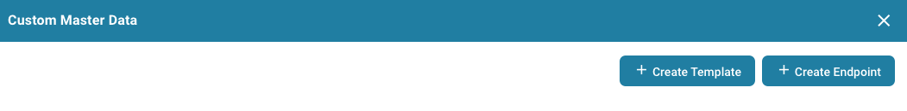
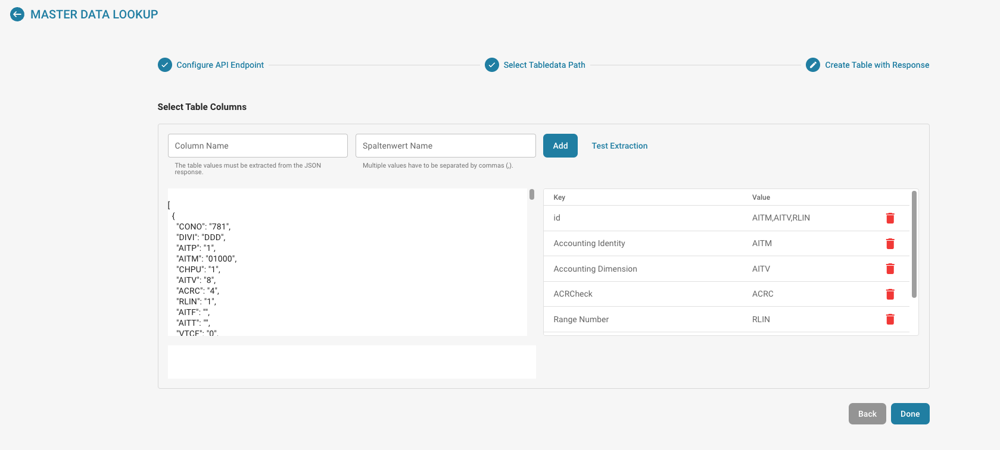

# Dati anagrafici personalizzati

#### Attivazione dei dati anagrafici personalizzati 

Dalla Dashboard vai su Impostazioni → Elaborazione documenti → Modulo.

.png>)

<figure><figcaption></figcaption></figure>

In Modulo, attiva Custom Master Data premendo il cursore come mostrato di seguito.

<figure><figcaption></figcaption></figure>

#### Panoramica della funzionalità 

Per aggiungere i tuoi dati anagrafici in DocBits, vai su Master Data Lookup nelle Impostazioni.

<figure><figcaption></figcaption></figure>

Fai clic su “Custom Master Data”.

<figure><figcaption></figcaption></figure>

Potrai quindi scegliere se creare un Template o un Endpoint.

<figure><figcaption></figcaption></figure>

#### Creare un Template 

Il primo passaggio consiste nello scegliere se utilizzare il file ION API della tua organizzazione oppure OAuth2, e inserire i dati necessari.

<figure><figcaption></figcaption></figure>

Successivamente configureremo i preset. Qui inserirai il nome della tabella dei dati anagrafici e l'URL della chiamata API.

<figure><figcaption></figcaption></figure>

Dovrai quindi inserire il percorso JSON utilizzando la notazione a punti; per ulteriori informazioni sulla notazione a punti fai clic [qui](https://docs.hevodata.com/sources/engg-analytics/streaming/rest-api/writing-jsonpath-expressions/).

Infine, dovrai mappare i dati sulle colonne che desideri creare, come nell'esempio seguente.

<figure><figcaption></figcaption></figure>

Dopo averlo fatto, fai clic su Done affinché i nuovi dati anagrafici vengano creati e popolati.

#### Creare un Endpoint 

Il primo passaggio consiste nello scegliere se utilizzare il file ION API della tua organizzazione, utilizzare OAuth2 oppure lasciare il campo vuoto e inserire i dati necessari.

<figure><figcaption></figcaption></figure>

Successivamente configureremo i preset. Qui inserirai il nome della tabella dei dati anagrafici e l'URL della chiamata API.

<figure><figcaption></figcaption></figure>

Dovrai quindi inserire il percorso JSON utilizzando la notazione a punti; per ulteriori informazioni sulla notazione a punti fai clic [qui](https://docs.hevodata.com/sources/engg-analytics/streaming/rest-api/writing-jsonpath-expressions/).

Infine, dovrai mappare i dati sulle colonne che desideri creare, come nell'esempio seguente.

<figure><figcaption></figcaption></figure>

Dopo averlo fatto, fai clic su Done affinché i nuovi dati anagrafici vengano creati e popolati.
