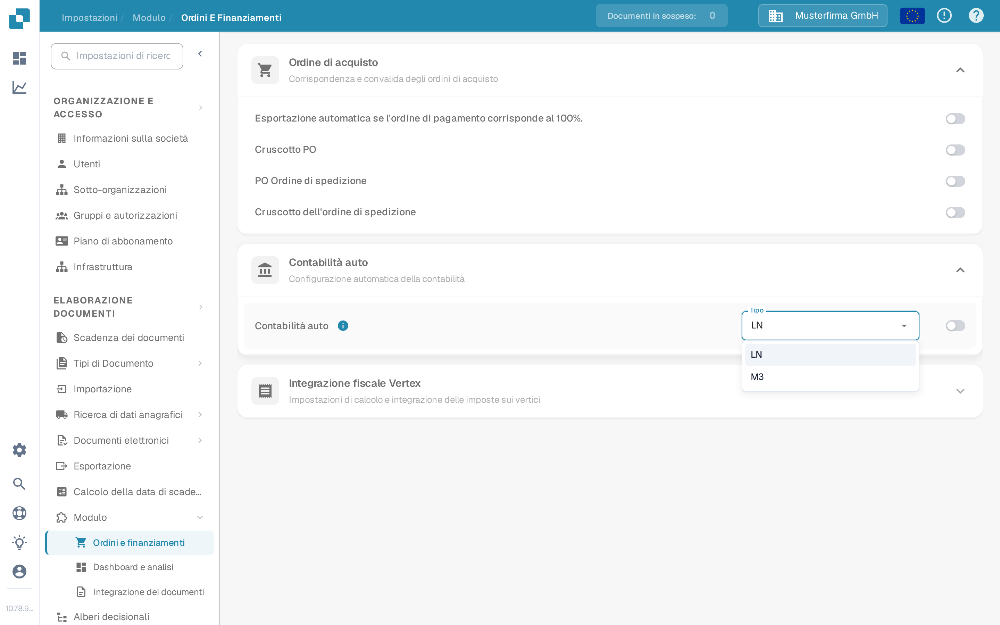

# Auto Accounting con Infor LN

Usare questa guida quando un amministratore di Infor LN vuole che DocBits utilizzi i dati master finanziari importati per la contabilità automatica (Auto Accounting). La vecchia pagina mostrava 48 schermate di un particolare tenant Infor. Nomi dei punti di connessione, mappature, credenziali e indirizzi degli endpoint di quel tenant non sono una configurazione riutilizzabile.

## Trovare l'impostazione in DocBits

Aprire **Impostazioni → Modulo → Ordini e finanziamenti → Contabilità auto** con un account amministratore. Il menu **Tipo** offre **LN** e **M3**. Per un'integrazione LN, verificare che il tipo selezionato sia **LN**. Attivare l'interruttore solo dopo aver verificato la società LN prevista, il flusso BOD e i dati master importati. La modifica del tipo o dell'interruttore può influire sul comportamento contabile; seguire quindi il processo di modifica della propria organizzazione.

Le seguenti schermate provengono dalla Sandbox sintetica **DocBits Documentation Test A**. In questa organizzazione era selezionato **LN** e la Contabilità auto era **disattivata**. Il menu è stato aperto senza selezionare un altro valore; nessuna impostazione è stata salvata.

<figure><figcaption>
Individuare Contabilità auto e controllare il tipo selezionato prima di attivarla.
</figcaption></figure>

<figure><figcaption>
LN e M3 sono i tipi disponibili in questa Sandbox; nessuna selezione è stata modificata.
</figcaption></figure>

## Preparare LN e ION

1. Confermare la società LN, l'unità contabile, l'organizzazione DocBits e l'ambiente di destinazione. Concordare con l'amministratore DocBits quale operazione API corrente e quale mappatura dei campi riceveranno conti e dimensioni. Conservare le credenziali API nell'archivio segreto approvato, mai in uno screenshot o in un allegato Jira.
2. Configurare la pubblicazione BOD in LN e convalidare la configurazione dei dati di pubblicazione. Infor documenta **BOD Parameters (tcbod0100m000)** e **Validate Publishing Data Setup (tcbod0300m000)** nella sua [guida alla pubblicazione BOD di LN](https://docs.infor.com/ln/10.7.in/en-us/lnolh/help/tc/onlinemanual/000520.html).
3. Verificare quali noun sono richiesti dalla propria versione di LN e dall'operazione di ricezione di DocBits. L'esempio precedente utilizzava `Sync.ChartOfAccounts` e `Sync.CodeDefinition` per i dati del piano dei conti e delle dimensioni. Infor elenca in [Publish Financial Master Data (tfbia0200m000)](https://docs.infor.com/ln/2025.x/en-us/lnolh/tfolh/help/tf/bia/tfbia0200m000.html) le opzioni Chart of Accounts e CodeDefinition. Alcune schede CodeDefinition compaiono solo dopo che la mappatura delle dimensioni è stata specificata e approvata. Confermare le versioni esatte dei documenti e i campi nel proprio tenant prima di instradarli.
4. In **ION Desk → Connect → Connection Points**, collegare la sorgente LN alla destinazione API DocBits approvata. In **Data Flows**, instradare i documenti selezionati, esaminare filtri e mappature, quindi salvare e attivare. Infor distingue tra [il salvataggio e l'attivazione di un flusso](https://docs.infor.com/inforos/latest/en-us/useradminlib_cloud/iondeskceug/lsm1436532178755.html).
5. In LN, utilizzare un identificatore di test non sensibile. In **Publish Financial Master Data**, usare prima **Count** o **Simulate** per esaminare la selezione, poi **Publish** solo nell'ambito della modifica approvata dall'amministratore. L'azione di pubblicazione non è specifica per la destinazione: Infor consegna a tutti gli abbonati. Tracciare tale identificatore ed eventuali errori in [ION OneView](https://docs.infor.com/inforos/latest/en-us/useradminlib_cloud/iondeskceug/lsm1436532196155.html).

## Confermare il risultato in DocBits

Chiedere all'amministratore DocBits di verificare il record ricevuto, l'organizzazione e i campi contabili nei log di importazione o API attuali. Dove la tabella di ricerca pertinente è accessibile, cercare lo stesso identificatore in **Impostazioni → Elaborazione dei documenti → Ricerca di dati anagrafici**. Un flusso ION attivato con successo da solo non dimostra che DocBits abbia accettato un record. Se un valore è assente, confrontare il BOD di origine, la mappatura ION, la risposta API e l'organizzazione di destinazione prima di attivare la Contabilità auto.

Per un test end-to-end non erano disponibili un tenant LN né un vero trasferimento BOD finanziario. Le nuove immagini della Sandbox verificano solo i controlli DocBits attuali. L'amministratore del tenant deve convalidare la mappatura finale e il risultato contabile.
