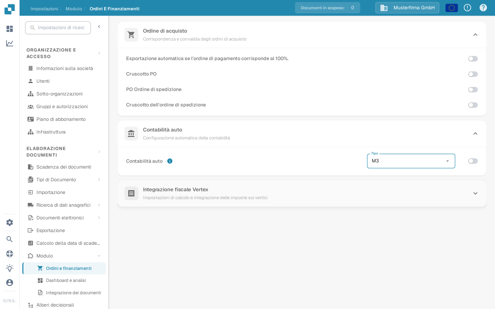

# Contabilità Automatica con Infor M3

Usa questa guida per pianificare i dati anagrafici necessari alla contabilità automatica M3 in DocBits. Una sola impostazione attiva non importa conti o elementi di costo. Il tuo amministratore Infor deve confermare la mappatura BOD, l'operazione API di DocBits e il risultato nella tua organizzazione.

## Verificare l'impostazione DocBits

Un amministratore può aprire **Impostazioni → Modulo → Ordini e finanziamenti → Contabilità auto**. Il menu **Tipo** offre **LN** e **M3**. Scegli **M3** solo per un'integrazione M3 e attiva l'interruttore dopo che il flusso di dati e i dati anagrafici richiesti sono stati verificati. Le schermate mostrano la sandbox inglese **DocBits Documentation Test A**. Il suo interruttore era **disattivato**, il Tipo attuale era **LN** e l'apertura del menu non ha salvato né modificato alcuna impostazione.

<figure><figcaption>
Trova la Contabilità auto in Ordini e finanziamenti; in questo esempio della sandbox è disattivata.
</figcaption></figure>

<figure><figcaption>
Il menu Tipo offre LN e M3. In questo esempio non è stata selezionata alcuna opzione.
</figcaption></figure>

## Preparare il flusso di dati M3

1. Concorda quale società M3 e quale organizzazione DocBits scambieranno i dati. Verifica con il tuo amministratore DocBits quale operazione API attuale accetta i dati anagrafici contabili. Evita di copiare un endpoint o una credenziale dalla schermata di un tenant precedente.
2. In M3, conferma che i BOD richiesti sono attivati per l'entità contabile rilevante. L'esempio del tenant precedente usava `Sync.ChartOfAccounts` e `Sync.CodeDefinition` per le dimensioni contabili. Conferma il nome esatto, la versione e i campi rispetto alla tua configurazione M3 e al contratto API ricevente. Infor descrive [l'attivazione della pubblicazione BOD](https://docs.infor.com/m3core/2025.x/en-us/useradminlib_cloud/m3cecoreag_cloud/wbr1509377469290.html).
3. In **ION Desk → Connect → Connection Points**, configura la sorgente M3 e una destinazione API con l'operazione DocBits approvata e l'account di servizio. In **Data Flows**, instrada solo i documenti approvati, controlla i filtri e la mappatura dei campi, quindi salva e attiva il flusso. Vedi l'[elenco dei connection point Infor](https://docs.infor.com/inforos/latest/en-us/useradminlib_cloud/iondeskceug/documentflowdesk_connectionpointmasterlist.html) e le [istruzioni per l'attivazione dei data flow](https://docs.infor.com/inforos/latest/en-us/useradminlib_cloud/iondeskceug/lsm1436532178755.html).
4. Pubblica un identificatore di test non sensibile da M3. Un caricamento iniziale può usare **EVS006** di M3; l'azione e i nomi delle tabelle dipendono dalla versione di M3 installata. Segui le [istruzioni Infor per il caricamento iniziale](https://docs.infor.com/m3core/2025.x/en-us/useradminlib_cloud/m3cecoreag_cloud/pbi1544012609638.html). In **ION OneView**, traccia l'identificatore attraverso il flusso e ispeziona il risultato API usando [Infor OneView](https://docs.infor.com/inforos/latest/en-us/useradminlib_cloud/iondeskceug/lsm1436532196155.html).
5. Controlla lo stesso identificatore in DocBits sotto **Impostazioni → Elaborazione documenti → Ricerca di dati anagrafici**. La [guida API da M3 a DocBits](import-from-infor-m3-to-docbits-via-api.md) spiega i controlli di importazione. Attiva la contabilità automatica M3 solo quando i record richiesti sono presenti e il tuo amministratore ha convalidato la mappatura.

## Elementi di costo

L'esempio del tenant precedente esportava gli elementi di costo da **PPS280** di M3 in Excel, riduceva le colonne e caricava un CSV tramite una vecchia schermata API HTTP. Quella sequenza di schermate non è una procedura di importazione generale sicura: i nomi delle colonne, il delimitatore, l'endpoint e l'autenticazione richiedono conferma per l'ambiente attuale. Usa l'attuale [guida alla tabella degli elementi di costo](table-extraction-for-costing-element.md) per preparare il file e ispezionare i controlli CSV disponibili in DocBits. Non caricare un file finché l'amministratore non ha verificato le sue colonne rispetto alla tabella di destinazione.

Se un BOD arriva a ION ma nessuna riga compare in DocBits, ispeziona il percorso ION, la risposta API, l'organizzazione, l'identificatore e la mappatura prima di attivare la funzione. Non dedurre il successo da un flusso attivato o da dati demo esistenti.

Questa pagina sostituisce 43 schermate di un tenant Infor precedente con i controlli DocBits attuali e passaggi collegati alle fonti. Non era disponibile alcun tenant Infor né trasferimento BOD in tempo reale per un test end-to-end; l'amministratore del tuo tenant deve convalidare la mappatura finale, l'importazione e il risultato contabile.
