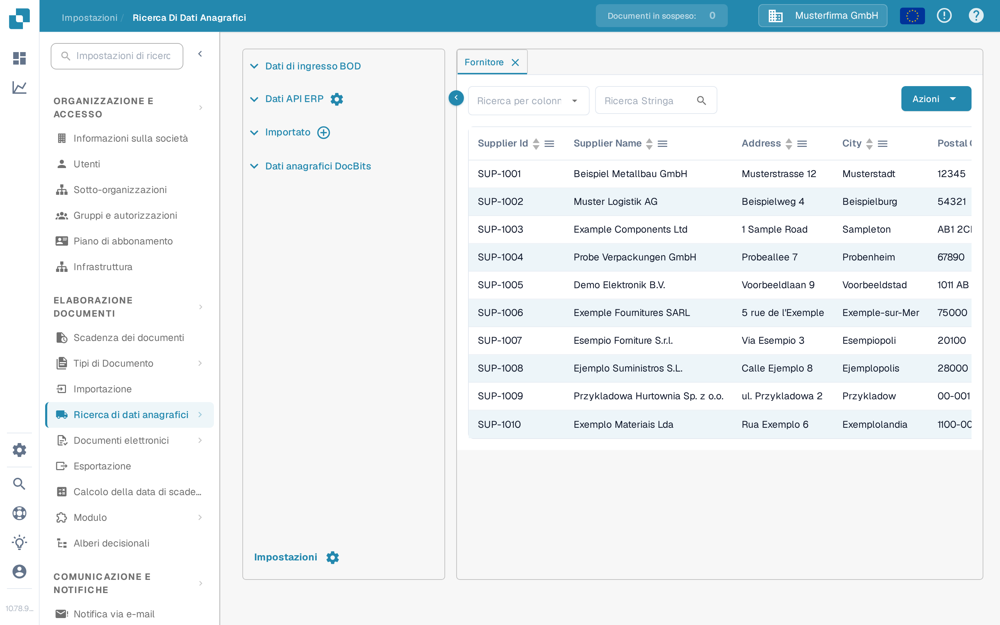
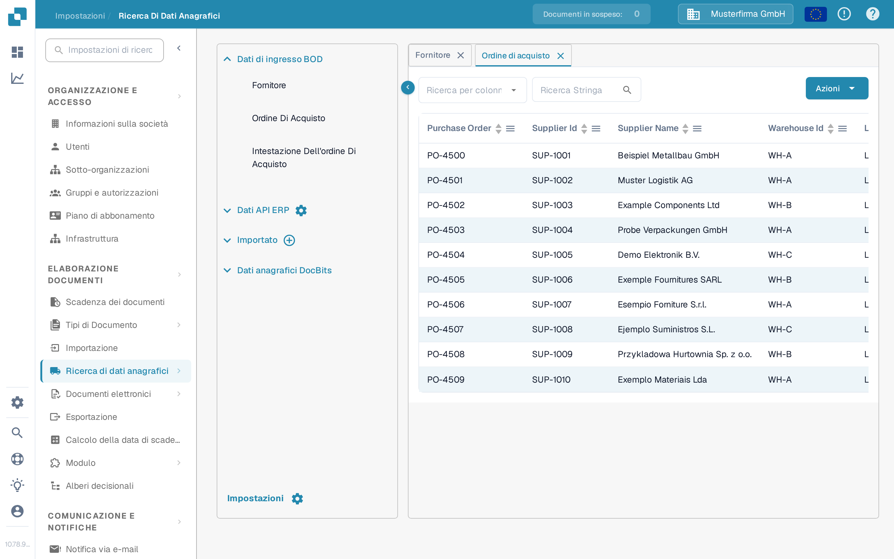

# Importazione da Infor M3 a DocBits tramite API

Usare questa guida quando un amministratore di Infor M3 deve trasferire BOD selezionati a DocBits tramite Infor ION e API Gateway. La versione precedente di questa pagina conteneva 42 schermate di un vecchio tenant Infor e indirizzi API di Sandbox fissi. Quelle schermate e quegli indirizzi non sono un modello di configurazione sicuro per un altro tenant.

Il percorso da verificare è **M3 pubblica un BOD → ION lo instrada → API Gateway chiama l'API di DocBits → DocBits mostra il record importato**. Ogni fase ha un proprio stato. Vedere un record in DocBits è la verifica finale; un data flow ION attivo da solo non dimostra un'importazione.

## Prima di configurare il flusso

1. Confermare l'azienda M3, il tenant ION, l'organizzazione DocBits e l'ambiente che si desidera collegare. Chiedere a un amministratore DocBits l'URL base corrente dell'API e l'operazione API richiesta dalla descrizione OpenAPI di quell'ambiente. Gli host regionali possono differire; non copiare un host o un percorso proxy di API Gateway da una vecchia schermata.
2. Concordare quali tipi di documento servono all'organizzazione. I dati anagrafici dei fornitori e degli ordini di acquisto possono essere verificati in DocBits. Aggiungere documenti di consegna e di contabilità solo quando il loro caso d'uso e l'operazione di ricezione sono confermati.
3. Preparare un account di servizio Infor con il permesso per l'operazione API selezionata e una credenziale API DocBits con l'accesso minimo necessario. Inserire le credenziali solo nella schermata di configurazione autorizzata. Non incollare un file `.ionapi` completo o una chiave API in una pagina di documentazione, in un ticket Jira o in una schermata.
4. Conservare un identificatore di test non sensibile per ogni BOD scelto, così da poter seguire lo stesso record in M3, in ION OneView e in DocBits.

## Scegliere il documento e l'operazione di ricezione

L'esempio del vecchio tenant usava questi BOD. Usare i metadati API attuali e il proprio progetto di integrazione per confermare ogni associazione prima di creare un connection point:

| BOD nell'esempio precedente                                                                 | Dati previsti in DocBits                            | Dove verificare il formato di ricezione                                                                                 |
| ------------------------------------------------------------------------------------------- | --------------------------------------------------- | ----------------------------------------------------------------------------------------------------------------------- |
| `Sync.SupplierPartyMaster`, `Sync.RemitToPartyMaster`                                       | Dati anagrafici dei fornitori                       | [Importazione BOD fornitori](../importing-via-the-api/supplier-bod.md)                                                  |
| `Sync.PurchaseOrder`                                                                        | Ordini di acquisto                                  | [Importazione BOD ordini di acquisto](../importing-via-the-api/purchase-order-bod.md)                                   |
| `Sync.ReceiveDelivery`                                                                      | Dati di consegna                                    | [Importazione BOD Receive Delivery](../importing-via-the-api/receive-delivery-bod.md)                                   |
| `Sync.AdvanceShipNotice`, `Sync.ChartOfAccounts`, `Sync.CodeDefinition-AccountingDimension` | Dati anagrafici aggiuntivi per funzioni configurate | [Importazione XML dei dati anagrafici](../importing-via-the-api/master-data-xml.md) e i metadati API del proprio tenant |

`Acknowledge.SupplierInvoice` appartiene a un flusso di conferma delle fatture e va configurato separatamente da un'importazione di dati anagrafici da M3 a DocBits. La vecchia pagina mescolava queste direzioni e includeva un corpo di richiesta specifico del tenant; non copiare quel corpo in un nuovo flusso senza aver verificato il contratto dell'endpoint e i controlli di accesso.

## Configurare Infor OS e ION

1. In Infor OS, preparare il target di API Gateway per l'operazione API DocBits **confermata**. Verificare con l'amministratore DocBits l'URL di destinazione, il metodo di richiesta, il formato della richiesta e l'autenticazione. Per i controlli del Gateway usare la [guida attuale di Infor API Gateway](https://docs.infor.com/inforos/2025.x/en-us/useradminlib_cloud/apigatewayag_cloud/ionapi_2025.x_apigatewayag_cloud_en-us.pdf).
2. In **ION → Connect → Connection Points**, creare o selezionare il connection point per l'API di DocBits. In **Documents** aggiungere solo i BOD scelti, selezionare l'operazione Gateway corrispondente e configurare il payload di richiesta previsto dall'operazione. Le [istruzioni sull'elemento API](https://docs.infor.com/inforos/latest/en-us/useradminlib_cloud/iondeskceug/hqg1491985489422.html) di Infor spiegano l'account di servizio e le impostazioni della richiesta.
3. In **ION → Connect → Data Flows**, collegare l'origine M3 e la destinazione API. Verificare l'elenco dei documenti, i filtri e le associazioni; quindi salvare e attivare il flusso. Infor distingue tra [salvare e attivare un data flow](https://docs.infor.com/inforos/latest/en-us/useradminlib_cloud/iondeskceug/lsm1436532178755.html).
4. Pubblicare da M3 un BOD di test approvato. In **ION OneView** cercare quell'identificatore e confermare quale connection point, associazione e chiamata API lo ha elaborato. Vedere [Infor OneView](https://docs.infor.com/inforos/latest/en-us/useradminlib_cloud/iondeskceug/lsm1436532196155.html). Se non viene mostrato alcun percorso o viene mostrato un errore, correggere prima il flusso ION e poi verificare in DocBits.

## Verificare il risultato in DocBits

Aprire **Impostazioni → Elaborazione documenti → Ricerca di dati anagrafici**. Espandere **Dati di ingresso BOD**, scegliere il tipo pertinente e cercare l'identificatore di test. Le schede **Fornitore** e **Ordine di acquisto** mostrate qui sotto sono le viste italiane attuali con dati dimostrativi sintetici. Le loro righe **non sono prova di un'importazione da M3**.

<figure><figcaption>
Scegliere Fornitore, selezionare una colonna di ricerca e inserire l'identificatore di test del fornitore.
</figcaption></figure>

<figure><figcaption>
Scegliere Ordine di acquisto e cercare l'ordine di test; le righe mostrate sono dati dimostrativi sintetici.
</figcaption></figure>

In entrambe le schede, **Ricerca per colonna** sceglie il campo, **Stringa di ricerca** accetta l'identificatore e la lente avvia la ricerca. Le intestazioni della tabella ordinano le righe visibili; le frecce in basso spostano tra le pagine. **Azioni** apre le operazioni della tabella e non è necessario per questa verifica di sola lettura. La **×** su una scheda la chiude. Il pulsante più di **Importato** serve per il caricamento di file CSV, non per ricevere un BOD da ION.

Se il BOD compare in OneView ma il record è assente in DocBits, verificare l'operazione API e la risposta, l'organizzazione/l'ambiente, il tipo di documento, il formato del payload e l'identificatore usato nella ricerca. Chiedere all'amministratore DocBits il registro di importazione corrispondente. Non dedurre il successo da una chiamata HTTP o da una schermata di una riga dimostrativa non correlata.

Questa pagina è stata aggiornata usando i controlli attuali di DocBits Sandbox e la documentazione Infor. Non erano disponibili un tenant Infor né un trasferimento reale di BOD da M3 a DocBits per una prova end-to-end; un amministratore del tenant deve validare l'associazione finale e il risultato.
