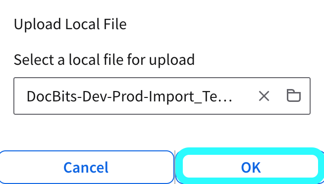

# M3\_OLD

## Importare un template di connessione API in Infor M3

Questa guida spiega come importare un template di connessione API per configurare rapidamente le impostazioni principali dell'integrazione con Infor M3. L'utilizzo di un template consente di stabilire una configurazione di connessione predefinita, semplificando il processo e garantendo coerenza.

<mark style="color:red;">**Nota**</mark>: per la configurazione dettagliata di aree specifiche come Auto Accounting, integrazione dei fornitori, ordini di acquisto o estrazione di tabelle per gli elementi di costo, consulta la documentazione corrispondente:

* [Auto Accounting](m3/auto-accounting.md)
* [Fornitori e ordini di acquisto](m3/suppliers-and-purchase-orders.md)
* [Come importare tutti i fornitori](m3/how-to-import-all-suppliers.md)
* [Estrazione di tabelle per l'elemento di costo](m3/table-extraction-for-costing-element.md)

### **Scaricare il template**

Prima di importare, scarica il template di connessione richiesto utilizzando il file seguente:



### Importazione del template

#### Passaggi per importare un template di connessione

1. **Accedi a Infor ION Desk:**
   *   Vai su **InforOS** → **ION Desk** → **Connect** → **Connection Points**.

       
2. **Importa il template:**
   *   Fai clic sul pulsante **Import**.

       <figure><figcaption></figcaption></figure>
   * Seleziona il **file template** appropriato dal tuo sistema locale.
   *   Fai clic su **OK** per avviare il processo di importazione.

       <figure><figcaption></figcaption></figure>
3. **Conferma:**
   *   Se l'importazione riesce, verrà visualizzato un messaggio di conferma.

       <figure><figcaption></figcaption></figure>
4. **Configurazione post-importazione:**
   * Dopo aver importato il template, puoi personalizzare le impostazioni di connessione specifiche in base alle necessità.
   * Non dimenticare di importare o configurare il tuo **Service Account** per l'autenticazione e il controllo degli accessi.

<figure><figcaption></figcaption></figure>
